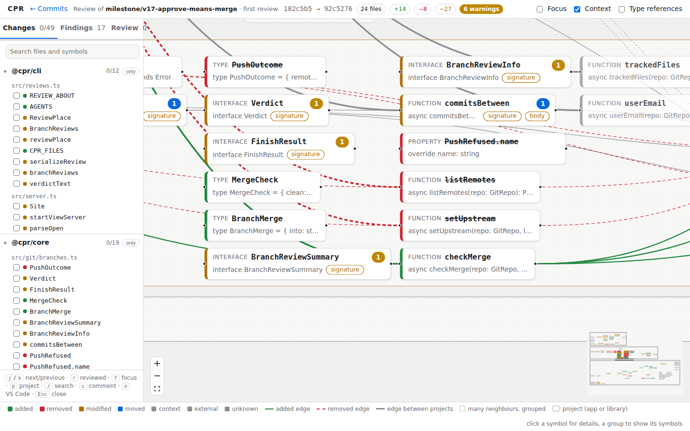
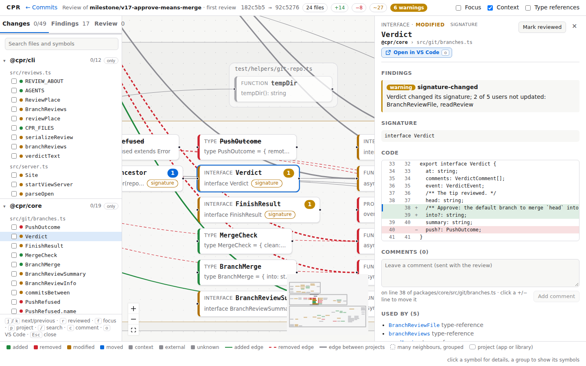
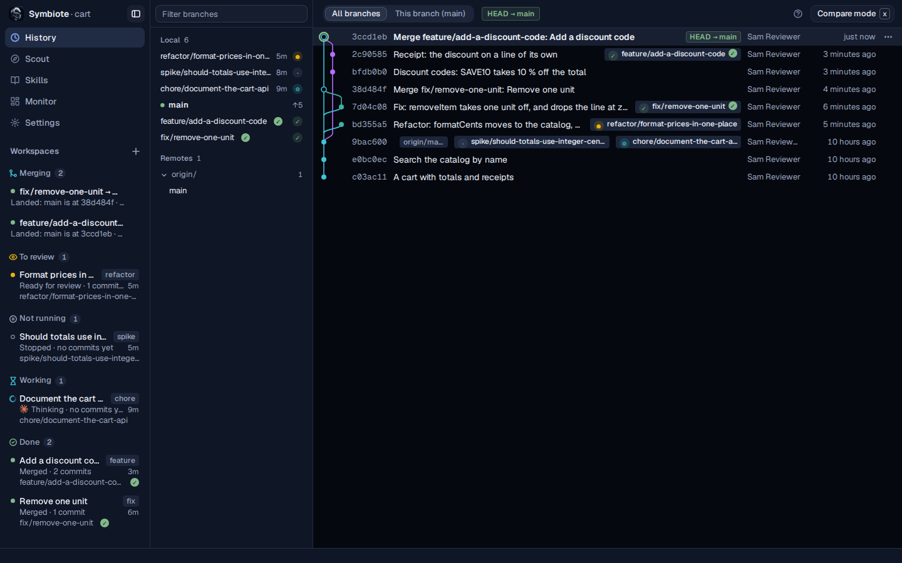
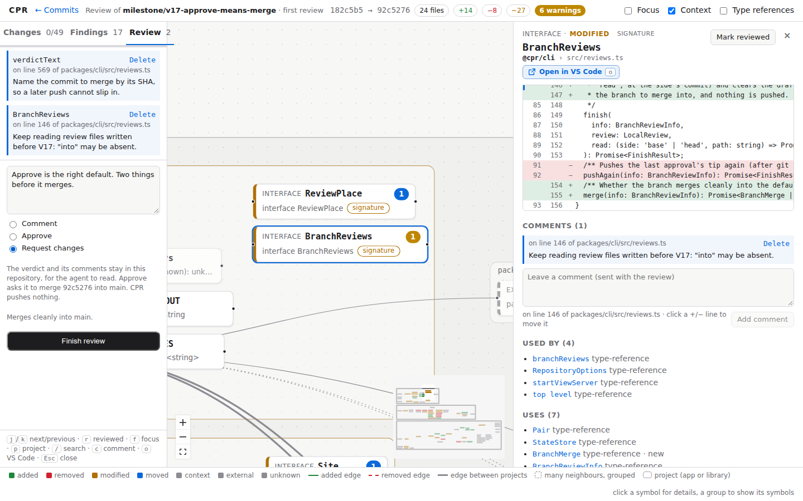
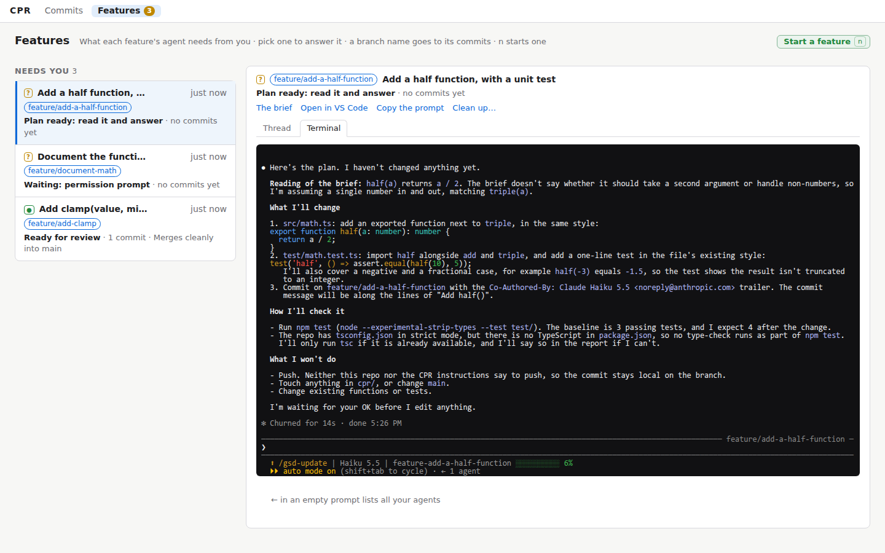

# Symbiote

Start a workspace with a coding agent, review what it changed as a graph of the symbols it
touched, and send back a verdict. Everything runs on your machine.

Symbiote turns a change into a graph of the functions, classes, methods and types it added, removed
or modified, and the calls between them. Findings point at the risky parts: a symbol removed
while code still uses it, new code that nothing calls, a signature changed under callers that
were not updated. The aim is to review decisions, not lines.



[Quick start](#quick-start) ·
[Commands](#commands) ·
[Findings](#findings) ·
[The viewer](#the-viewer) ·
[Reviewing a branch](#reviewing-a-branch) ·
[Workspaces and agents](#workspaces-and-agents) ·
[Pull and merge requests](#pull-and-merge-requests) ·
[CI](#ci) ·
[Plugins](#framework-plugins) ·
[Configuration](#configuration) ·
[Development](#development)

## What it does

- **Shows a change as a graph.** One box per file, symbols coloured by what changed, findings as
  badges, removed edges dashed. Click a symbol to see its own diff, its old and new signature,
  and who uses it.
- **Reviews any branch.** Mark symbols reviewed as you go. After new commits, only what is new or
  changed since is left to look at.
- **Works with agents.** Describe the work, and Symbiote makes its branch and worktree and starts
  Claude Code or Codex there. You read its plan, answer it, review its branch, and approve. Symbiote then
  merges the commit you approved, runs your check on the merge, and moves the branch.
- **Reads pull and merge requests.** Review a GitHub pull request or a GitLab merge request from
  the graph and post your comments as one review.
- **Runs in CI.** A GitHub Action and a GitLab CI template post the findings on the lines they
  are about.
- **Knows frameworks through plugins.** Angular templates and Qwik routes are code that plain
  TypeScript analysis cannot see; the `angular` and `qwik` plugins add it.

## Quick start

You need git, Node 22.12 or newer and pnpm 12, on macOS or Linux (WSL included).

```sh
git clone https://github.com/attomius321/Symbiote.git
cd Symbiote
pnpm install
pnpm build
pnpm app:setup    # optional: Symbiote's own window (Electron, ~100 MB); without it, the browser
alias symbiote="node $PWD/packages/cli/dist/bin.js"   # add this line to your shell profile
```

On Linux, `pnpm install` also compiles `node-pty` for [the agent's terminal](#workspaces-and-agents)
when python3, make and a C++ compiler are there. Without them it is skipped, and the rest works.

Then, in any git repository with TypeScript or JavaScript:

```sh
symbiote view          # History and your workspaces: every branch, to check out, review or compare
symbiote view main     # this branch against main, in Symbiote's window (or the browser)
symbiote diff main     # the same, in the terminal
```

## Commands

| Command | What it does |
|---|---|
| `symbiote diff <base> [head]` | Compares `head` (default `HEAD`) with where it left `base`, as a pull request does, and prints the changed symbols and the findings. |
| `symbiote view [<base> [head]]` | Opens the viewer: in [Symbiote's window](#symbiotes-window) once the desktop app is set up, else in the browser. Without revisions it opens on the repository's History, with your workspaces in the sidenav; with them, on that comparison. Runs until Ctrl+C, or until its window is closed. |
| `symbiote pr [<number>]` | Reviews a GitHub pull request or a GitLab merge request (`symbiote mr` is the same command). In a CI job for one, the number comes from the job. |
| `symbiote app install` | Adds [Symbiote's window](#symbiotes-window) to your desktop's apps, so it opens without a terminal; `symbiote app uninstall` removes it. Linux, WSL included. |
| `symbiote merge <branch>` | Merges the commit your review of `branch` approved, as Merge does in the viewer ([Merging](#merging)): `--into <branch>` picks the target, `--land` lands a merge that waits for you. |

`symbiote diff` in a repository where one function was added, one removed and one changed:

```
main (9b269bf) → HEAD (f3d543d), merge-base 9b269bf
1 file changed · 3 symbols changed: 1 added, 1 removed, 1 modified

Findings
  ✖ removed-still-referenced  src/math.ts#legacy
      legacy was removed but is still used by 1 symbol: old
  ⚠ orphan-added              src/math.ts#triple
      triple is new and nothing references it
  ℹ signature-changed         src/math.ts#add
      add changed its signature compatibly; existing users keep working (2 users, 1 untouched)

M  src/math.ts
     ~ function    add  (signature, body)  · used by 2
     - function    legacy  · used by 1
     + function    triple
```

### Options

| Option | For | What it does |
|---|---|---|
| `--json` | diff, pr | Print the graph JSON instead of the summary ([graph schema](docs/graph-schema.md)). |
| `--out <file>` | diff, pr | Also write the graph JSON to a file. The viewer opens such a file too (drag and drop). |
| `--codequality <file>` | diff, pr | Also write the findings as a GitLab Code Quality report. |
| `--fail-on <level>` | diff, pr | Exit 1 when a finding is at least `error`, `warning` or `info`. |
| `--since <rev>` | all | Mark each changed symbol new, updated or the same as in an earlier head of the change (before a push or a rebase). |
| `--project <path>` | all | The tsconfig to load, relative to the repository root (default `tsconfig.json`). |
| `--depth <n>` | all | Hops of unchanged callers and callees to include (default 1). |
| `--plugin <name\|path>` | all | Analyze with a plugin, such as `angular` or `qwik`. Repeatable. |
| `--no-merge-base` | diff, view | Compare with `base` itself, not with where `head` left it. |
| `--port <n>` | view, pr | The viewer's port (default: any free one). |
| `--browser`, `--no-open` | view, pr | Open the browser instead of [Symbiote's window](#symbiotes-window); open neither. |
| `--summary` | pr | Print the summary instead of opening the viewer. |
| `--post-findings <level>` | pr | Post new findings at or above the level as comments on their lines, instead of opening the viewer. |
| `--forge github\|gitlab` | pr | For hosts whose name does not say which forge they are. |
| `--remote <name>` | pr | The remote to read and fetch from (default `origin`). |

Exit codes: `0` ok, `1` a failure or a `--fail-on` hit, `2` a usage error. `symbiote <command> --help`
lists the options of each command.

## Findings

| Rule | Reported when | Severity |
|---|---|---|
| `removed-still-referenced` | A removed symbol's name is still used in head, by code that used it before or imports from its file. | Error; a warning when only untyped code (JavaScript, `any`) still uses it. |
| `orphan-added` | Nothing references an added symbol. | Warning; info when the package's entry exports it, or it is a default export. |
| `signature-changed` | A changed symbol's signature changed and it has users. | Warning when the change may break a user that was not updated, in another file and outside tests; otherwise info. |
| `exported-api-changed` | A published package's exported symbol is removed, no longer exported, or its signature breaks. | Warning. |

Tests (`*.test.*`, `*.spec.*`, `test/`, `tests/`, `e2e/`, `__tests__/`, `__mocks__/`) are told
apart from production code by their path. Symbiote prefers missing a finding to reporting a wrong
one, and every finding links to its symbol and the symbols involved.

## The viewer

### The first time

The first time you open Symbiote on a repository, in its window or a browser, two koi rise out of
deep water and form its S, with the sound of the water and a drop as the S locks (about 5 s). Any
key or a click ends it at once. It plays once for you, whichever repository: `symbiote view`
records it in Symbiote's config folder (`~/.config/symbiote/intro.json` on Linux). Settings plays it
again (**Play the intro**). With reduced motion the S is shown formed; without WebGL there is no
intro. In a browser the sound plays only where the page may play audio before a click.

### Symbiote's window

With the desktop app set up (`pnpm app:setup`, once: it fetches Electron, ~100 MB), `symbiote view` and
`symbiote pr` open the viewer in a window of their own, not in a browser tab: its own icon and taskbar
entry (the S the intro's koi form), no tabs or address bar, the page's name as its title. Without it they open the browser,
as `--browser` does.

- **Closing the window stops `symbiote view`**, as Ctrl+C does; Ctrl+C closes the window. Agents in
  workspaces keep running either way.
- **From your desktop's apps**: `symbiote app install`, once, in a terminal where `symbiote` works, adds Symbiote
  to them for this user (`~/.local/share/applications/symbiote.desktop` and its icon). Opened from
  there, Symbiote shows the last repository it showed, else a start page: open a repository, or one
  of the recent ones. Each repository gets its own window and its own `symbiote view`, which stops
  with the window, and with the app even if it crashes. Opened again, the running Symbiote comes to
  the front. A desktop's apps do not read your shell's profile, so `symbiote app install` records the
  node, the CLI and the `PATH` (`~/.config/symbiote/app.json`) that `symbiote view` will need to find git
  and your agents; each `symbiote view` that opens Symbiote's window records them again.
- **Its own title bar**: Symbiote and the repository, the sidenav's fold and back and
  forward over the sidenav; the page's tabs beside them (a workspace's Terminal, Thread and Brief,
  its shells, History's All branches and This branch); the panel's toggle and the window's buttons at the
  end, in Symbiote's colours, light or dark as the theme is (on Linux Symbiote draws them, and the
  window's rounded corners). Drag its free space to move the window.
- **Links that leave Symbiote** (a pull request, a link in a thread) open in your default browser.
- **Leaving with something not saved** (a prompt in Settings) asks first, in Symbiote's own dialog
  inside the page and in your system's when the window closes.
- **Keys**: Ctrl+= and Ctrl+− zoom, Ctrl+0 back to 100 %; Alt+← and Alt+→ (and the mouse's side
  buttons) go back and forward; Ctrl+R or F5 reloads; Ctrl+Shift+I opens the inspector. On macOS,
  ⌘ instead of Ctrl, and ⌘[ ⌘] for back and forward. Where the agent's terminal has the focus, it
  keeps Ctrl+R and Alt+arrows.
- **Remembered** for the next window: its size and place, the zoom, and the viewer's own choices
  (theme, folded sidenav, panel widths), kept in `$XDG_CONFIG_HOME/symbiote/app/` (`~/.config/symbiote/app/`).
- **Where it runs**: Linux, and Windows through WSL (its window comes through WSLg). macOS runs the
  same code but is not tested yet. On Ubuntu 24.04 and later, AppArmor may refuse Chromium's
  sandbox to an Electron that no package installed: `symbiote view` then says so and opens the browser
  ([Chromium on this restriction](https://chromium.googlesource.com/chromium/src/+/main/docs/security/apparmor-userns-restrictions.md)).

### Reading a change

The canvas draws one box per file, and in it the symbols that changed: green added, red removed,
orange modified, blue moved. Grey symbols are their unchanged callers and callees, for context.
A symbol's chips say what changed in it (`signature`, `body`), its badge counts its findings, and
dashed red edges are calls and references that went away.

Click a symbol, use the change list, or press j and k, and the detail panel opens beside the
canvas: the findings, the old and new signature, a line diff of just that symbol, and who uses
it and what it uses. Selecting or marking a symbol never rearranges the graph.



Large changes stay navigable:

- A changed symbol with more than 8 unchanged users or uses shows them as one node ("390 users
  in 220 files"), which opens on click.
- Zoomed out, the canvas is a map of file names. Click one to zoom in. Each pair of linked files
  has one edge, heavier the more calls it stands for.
- The change list has a search (`/`): it keeps the symbols whose path and name hold every word
  you type, Enter opens the first, and j and k walk only the matches.
- Layouts are made in the background. The change list and findings show at once, and a view you
  have seen before comes back at once.

In a monorepo, when the change spans two or more apps or libraries, each is a frame around its
files, with its name, kind and folder. Frames are ordered so that callers come before what they
call, and edges between projects are drawn heavier. The change list is then grouped by project.
"only" on a project, or p (P goes back), shows one project at a time: its changes and everything
they are linked to elsewhere.

### History

`symbiote view` without revisions opens on **History** (`/history`, or h): the repository's history,
every branch, local and remote, drawn as a graph beside the commits, the current branch the
straight line on the left. The sidenav on the left lists the pages (History, [Scout](#scout),
[Skills](#skills), Settings) and, under
them, your [workspaces](#workspaces-and-agents); a click opens one beside it, without loading the
page again. Drag the sidenav's edge to widen or narrow it (180–480 px), or focus the edge and use
the arrow keys; a double-click restores it. A workspace's changes, at the right of its terminal,
resize the same way. The widths are kept in this browser. The status bar along the bottom says what the last action did. The whole
history scrolls, and commits load as they come into view; its keys are behind the "?" in its
toolbar.

The pages are dark. **Appearance** in Settings makes them light, or follows your system, in this
browser. They are set in Geist and Geist Mono, which `symbiote view` serves itself: nothing is fetched
from elsewhere.

**Usage.** The status bar's right side shows the subscription of each agent Symbiote can start and
how much of each window is used, as its vendor counts it: `Claude Pro · 5h 59% · wk 66%`,
`Codex Go · 30d 0%`. Amber from 80 % (or when Claude warns), red at the limit; a hover says
when each window resets and how old the numbers are. `symbiote view` reads them at most every 5
minutes, while a page asks:

- **Claude Code**: from the endpoint Claude Code's own `/usage` reads, with the token Claude
  Code stored (`~/.claude/.credentials.json`, or the Keychain on macOS). Symbiote only reads it: it
  never renews it, never gives it to the page, and sends it to `api.anthropic.com` only. When the
  token has expired or a request fails, the bar shows the last numbers Symbiote read, with their age
  and why. Symbiote keeps them in its cache (`~/.cache/symbiote/usage/claude.json` on Linux, or
  `$SYMBIOTE_CACHE_DIR/usage/claude.json`), for the account they were read for, so the next run and
  every `symbiote view` on the machine have them; before Symbiote's first read, Claude is not shown.
- **Codex**: from its app server (`account/rateLimits/read`); without one, from your newest
  Codex session. An API-key login has no windows and is not shown.

`SYMBIOTE_USAGE=off` reads none of it.



- **Branches panel.** Local branches, with `↑2 ↓1` against their upstream, and remote ones by
  folder. Filter it with `/`. A click selects the branch's newest commit, however deep in the
  history it is. Workspaces you started come first: those waiting for you, the one whose agent
  last reported or asked something on top, then those whose agent is working, each with how
  long ago its agent acted (`4m`, `2h`).
- **Check out** (right-click a commit, or c): one of its branches, a remote branch as a local
  one, a tag or the commit itself. Symbiote asks first and uses `git switch`, never forced: your local
  changes come along, or git refuses and nothing changes. A checkout made in a terminal shows
  when the page is back in focus.
- **Review** (r): the branch from where it left the default branch to its tip. See
  [Reviewing a branch](#reviewing-a-branch).
- **Compare** (x, or "Compare mode"): click two commits, the older is the base, then Compare or
  Enter. One commit alone is compared with its parent. Two commits on diverged branches are
  compared from where they forked, as a pull request is, and Swap compares the other side.
- **Start a workspace** (n): see [Workspaces and agents](#workspaces-and-agents).

Each comparison is analyzed in the background with the same `--plugin`, `--project` and `--depth`,
and has its own address (`/diff/<base>..<head>/`), so it can be reloaded or bookmarked. The last 8
stay ready while `symbiote view` runs. Its ← link goes back where it was opened: History, or the
workspace for its review. A comparison has the sidenav too, folded to a rail of icons and
workspace marks so the graph keeps its width; [ opens it.

### Open in VS Code

Under `symbiote view` and `symbiote pr`, "Open in VS Code" (or o) opens the selected symbol in the window
that has the repository open, else in a new one. Ctrl+click a line (Cmd+click on macOS), or click
its number, to open that line. Symbiote finds where the line is in your working copy now: after a
checkout or an edit it opens at the line's new place, and says so. It runs VS Code's `code`
command on the machine where `symbiote` runs, so WSL, Remote SSH and containers work too. Set
`SYMBIOTE_CODE` to use another editor command (Insiders, VSCodium, Cursor).

### Keys

| Key | In History | In a change |
|---|---|---|
| j, k | Next, previous commit | Next, previous changed symbol |
| / | Find a branch | Search the change list |
| c | Check out | Comment on the selected symbol (in a review) |
| r | Review the branch | Mark the selected symbol reviewed |
| x | Compare mode | |
| n | Start a workspace | |
| h, s | History, Settings | |
| a | [Scout](#scout); on Scout, its question box or its terminal | |
| i | [Skills](#skills) | |
| w | The workspaces in the sidenav: ↑ and ↓ move, Enter opens | |
| [ | Fold the sidenav to a rail, or open it | Open the sidenav, or fold it |
| ] | | In a workspace: hide or show its branch's changes |
| f | | Focus: only the selected symbol and its neighbours |
| p, P | | Next, previous project |
| o | | Open in VS Code |
| Esc | Leave compare mode | Close the detail panel |

n, h, a, i, s, w and [ work on Settings, on Scout, on Skills and in a workspace too. In a comment box, Start a workspace, a workspace's
reply box or a prompt in Settings, Ctrl+Enter (Cmd+Enter on macOS) saves, starts or sends.

## Reviewing a branch

Pick "Review" in a commit's menu, or press r, and Symbiote compares the branch from where it left the
default branch to its tip. Mark symbols reviewed as you go (r). After new commits, review it
again: only what is new or changed since is left, and marks stay on the symbols that did not
change.

Comment on a symbol or one of its lines (select it, press c), then finish in the Review tab with
**Request changes**, **Comment** or **Approve**. Your verdict and comments are written to the
review's file, where the agent reads them; "Copy for the agent" puts them on the clipboard as
text.



Before you approve, the Review tab says whether the branch merges cleanly or which files conflict;
on a conflict, the agent resolves it on its branch and you review that. The default branch
(`main`) can be reviewed too, for its unpushed commits; an approval there says they may be pushed.

A branch's badge shows how its review stands: `✓` approved, `✗` changes requested, `+2` for its
own commits since your review, `…` while reviewing. Commits added since get a dot.

Where reviews live:

- `symbiote/reviews/<branch>/<your git email>.json`, in the repository.
- The first review writes `symbiote/.gitignore`, which keeps them out of git. Delete it to commit and
  share them. `git clean -fdx` deletes ignored files, reviews with them.
- `symbiote/AGENTS.md` tells any agent what to do with a review, and every review file's first line
  points there. Claude Code loads it when it reads a review.

### Merging

An approved branch gets **Merge into** in its Review tab and in its workspace's panel. The target
is preselected: the branch the workspace started from, else the one the approval names, else the
default branch (`main`, or `master` in older projects). Pick any other branch in the list.

Symbiote merges the commit you approved (that one, not newer ones) with `git merge --no-ff`, in a
worktree of its own in its cache. Your checkout and the agent's worktree are not used. Then:

1. It runs the check on the merge: `merge.checks` in `symbiote/config.json`, else the command it guesses
   from the target's files (a `check` or `test` script after its package manager's install, a
   Makefile target, `cargo test`, …).
2. When the check passes, it moves the target by fast-forward. If the target is checked out
   (usually in your main checkout), the fast-forward runs there, so the files move with the
   branch. git refuses when your local changes would be overwritten. Then nothing changes and Land
   tries again. A target checked out nowhere has its ref moved, only if it has not moved since.
3. With `merge.push: true` it pushes the target. This is off by default.

Merges go one at a time, each on the result of the last. The sidenav's Merging group shows each
one, and a click opens it (`/?merge=<branch>`): queued, merging, checking, ready to land, landed or
failed, with the end of a failed check's output. Without a check, a merge waits there for **Land**.

A conflict goes to a merger agent (Claude Code or Codex, `merge.agent`; `merge.model`, else
`sonnet` for Claude Code), which answers each conflicting region. Symbiote writes the answers, commits the merge
and runs the check. Nothing lands until you have reviewed the resolution, region by region:
**Approve** lands it, **Request changes** asks the agent again with your words. A check that
failed does not take Approve away: the page says which commands passed and which failed, with
the end of the output, and **Check again** runs the check again on the same merge without
asking the agent. A file deleted on one side, a binary file or a submodule is given to no one:
resolve it on the branch, review it again, then Retry. A target that moved before landing is
merged again on its new tip.

The queue is kept in Symbiote's cache. `symbiote merge <branch>` does the same from a terminal and prints
each step.

## Workspaces and agents

"Start a workspace" (n, the sidenav's +, or "Start a workspace here" in a commit's menu) is a page
beside the sidenav, at `/start` (`/start?at=<commit>` from a commit): what the work is on the left,
the branch, the agent and its options on the right. It asks what the work is in a few parts:

| Kind | It asks for | Done when, filled in | Branch |
|---|---|---|---|
| Feature | Goal: what it should do, and why | (empty) | `feature/` |
| Fix | What happens, and what should | A test that fails today passes, and the check passes. | `fix/` |
| Refactor | What to restructure, and why | Behaviour is unchanged: existing tests pass without changing what they assert, and the check passes. | `refactor/` |
| Chore | What to change, and why now | Nothing else changes, and the check passes. | `chore/` |
| Spike | The question, and what the answer will decide | A written answer: what was tried, what was measured, and a recommendation. | `spike/` |

Every kind takes a title (the workspace's name and its branch's), and under **More** where to look,
notes, and what is out of scope or how to reproduce. Done when is optional; it names the check
command Symbiote guesses from the start commit's root files (`package.json`'s `check` or `test` script
with its package manager, a Makefile's `check` or `test` target, `scripts/test.sh`, `cargo test`,
`go test ./...`, `pytest`), and says where it found it. The ⓘ after the kinds says what each is
for. The kind is picked with `1`–`5` too, and
the form is kept as a draft (in Symbiote's cache, so it outlives a new `symbiote view`) until the workspace
starts, so leaving the page loses nothing; Clear empties it.

**Documents** (optional) are files for the agent: screenshots, PDFs, notes, samples. Add files,
drop them anywhere on the page, or paste one (a screenshot) when the clipboard holds no text. Each
is uploaded as you add it, listed with its size, and kept in Symbiote's cache until the workspace
starts (one never started is removed after a week); up to 20 files, 20 MB each, 100 MB in all.
The draft keeps them. Start waits while one is on its way, or while one too large is listed.

Cancel or Esc goes back to the page you came from; Start (Ctrl+Enter) opens the new workspace in
the page's place. Symbiote then:

1. makes the agent's brief from the parts, under fixed headings (`# Fix: <title>`, `## What
   happens`, …, `## Done when` last), and adds one line for the kind: a fix is reproduced with a
   failing test first, a refactor and a chore change no behaviour, a spike answers in its report
   and commits nothing unless asked (the kind's start prompt: a project can change it in
   [Settings](#agents-prompts));
2. names a branch after the title (edit it if you like) and creates it where **Start from** says:
   the default branch's tip unless you pick another branch (local, or only on a remote: its newest
   tip, the local one's or a remote's), or the commit you picked in History;
3. gives the branch its own worktree beside your checkout, `../<repo>.worktrees/<branch>` (the
   branch's slashes become dashes), so your checkout and `symbiote view` are untouched and several
   workspaces can run at once;
4. records the brief, and the parts it was made of, in `symbiote/workspaces/<branch>.json` (`symbiote/features/` before V25, moved there the first time);
5. puts the documents beside that record, in `symbiote/documents/<branch>/` (the branch's slashes
   as folders; out of git with the rest of `symbiote/`), never in the worktree, where the
   project's checks would see them; a name taken twice becomes `name (2).ext`;
6. starts the agent you picked there in the background with the brief: Claude Code (`claude
   --bg`) or [Codex](#codex). With "Plan first and wait for my OK" (on by default), the agent
   stops after its plan. Its first prompt names the documents' folder and each file, and says it
   may read them there (the Documents prompt in [Settings](#agents-prompts)).

Prettier and ESLint read only the root's ignore files, so in your main checkout they check a
`.json` or `.js` given as a document: add `symbiote/documents` to `.prettierignore` and ESLint's
`ignores`, as this repository does.

The page offers the agents installed, Claude Code first unless `agent.kind` in
[`symbiote/config.json`](#configuration) says `codex`. Claude Code runs on your own Claude Code login
(the page says which: your subscription or an API key), in the permission mode you pick: Claude
Code's default, Accept edits, or Auto. Symbiote never grants it more. **Effort** is the level the agent's
session starts at, on a stepper: its own default (the first stop), or one it lists (Claude Code's
`--help`; for Codex, its configured model's levels, read from its app server); drag the handle, step
with the arrow keys, or click a level's word. The session keeps it, Start again uses it
again, and the Brief tab says it ("Started with Claude Code at high effort."); change it later
in the agent's own terminal (Claude Code: `/effort`). The next workspace starts at the default
again. If Claude Code does not start, the branch and worktree are kept and the page
offers the prompt to copy. Claude Code has to trust the folder, so run `claude` there once and
accept. It is found as `claude` on your `PATH`, or set `SYMBIOTE_CLAUDE`.

The sidenav lists your workspaces under the pages, by what each needs from you (a plan to read, a
permission to give, a branch to review, changes to send back), then those working, then those
merged, each group under its icon: a bell for those that need you, an hourglass for those working,
a check for those merged, and merge arrows for the merges Symbiote is making. Folded to a rail,
the icons stand for the groups. Its Workspaces heading counts the ones that need you, and + starts one (n). Each card
shows the workspace's title (a fix, refactor, chore or spike marked so), what is next, its
commits, files not committed yet, whether it merges cleanly, and its branch. A click opens it
beside the sidenav (`/?branch=<branch>`), with these actions:

- **Review** its branch;
- **Stop** or **Start** the agent;
- under **⋯**: **Open in VS Code** (its worktree), **Copy the prompt**, **Clean up**, and **Talk**,
  which copies `claude attach <id>` (Codex: `codex resume <thread> --remote <its app server> -C
  <worktree>`) for a terminal of your own (only when Symbiote cannot open the agent's terminal; its
  tooltip says why).



A workspace opens, where it can, on the agent's **Terminal**, down to the status bar: its session
as Claude Code draws it (the conversation, tool calls, permission prompts and
questions, Esc, slash commands), so you answer it without leaving Symbiote.

- It is `claude attach <id>`, run by `symbiote view` in the workspace's worktree. Claude Code keeps
  hosting the session: leaving the tab or the page only hangs up that client, and the agent goes
  on.
- **Send the verdict:** after you finish a review of the workspace's branch, this (or "Send to the
  agent" in the Review tab) types the verdict's first line and where the review is into the
  agent's input, for you to send with Enter.
- **Images:** paste a screenshot (Ctrl+V, Ctrl+Shift+V or ⌘V) or drop image files (PNG, JPEG,
  GIF or WebP, 20 MB at most) on the terminal, and the agent attaches them to the message you
  are typing, as `[Image #1]`, sent with Enter. Claude Code and Codex alike, and in Scout's terminal.
  Symbiote saves each image in its cache (`~/.cache/symbiote/images` on Linux, readable by you only) and
  pastes its path, which the agent reads; images older than a day are removed. Text in the
  clipboard pastes as text. On Linux and Windows, Ctrl+V is the page's paste: it no longer sends
  ^V for the agent to read its own machine's clipboard.
- **Paths and links:** a path the agent prints to a file of its worktree (`src/a.ts:12:5`,
  `Update(src/a.ts)`, an absolute path, a compiler's `src/a.ts(12,5)`) is underlined under the
  pointer, and Ctrl+click (⌘+click on macOS) opens it in VS Code at that line, in the worktree's
  window. A web address opens in a new tab (Symbiote's window: your browser). The agent's own
  links (OSC 8) open the same way, a file's in VS Code. Symbiote's server says which paths are
  files, so a word that only looks like one is not a link; a path outside the worktree is not one
  either. A plain click stays the terminal's. In Scout's terminal too, for files of the checkout.
- ← in an empty prompt opens Claude Code's list of all your agents, where you can switch away
  from this one.
- At most four terminals are open at once (each is a Claude Code process, about 140 MB, or a
  Codex one, about 315 MB). Shells are not counted.

**Shells:** the **+** after the Brief tab opens a shell in the workspace's worktree, in a tab of
its own (`Shell 1`, `Shell 2`, …; `&shell=<n>` in the address), for tests, a dev server or git
beside the agent. It is your shell (`$SHELL`, else `/bin/sh`; `%COMSPEC%` on Windows) with
`symbiote view`'s environment, and every workspace has its own, at most eight. A shell keeps running
while you look at another tab or workspace, or reload the page: its tab draws what it printed
again (its last 1 MB). It ends when you close its tab (×, which asks first when a program runs
in it, and names it), type `exit`, clean the workspace up, or quit Symbiote. Paths it prints and
images you paste work as in the agent's terminal.

At the terminal's right, where the window has room (1440 px wide with the sidenav open, about 1,250
with it folded), the workspace's **Changes**: its branch's commits since it left the default branch
and the files they change with their lines (what Review will show), then the files its worktree has
not committed. They are read again with the workspace list (every 5 s while the agent works). A
click on a file opens its diff in VS Code, in the worktree's window: one of the branch's from where
it left the default branch to its last commit, one not committed from the worktree's last commit to
the file on disk; a new or deleted file against an empty side. When the file on disk is the last
commit's, it is the right side, to edit there; the other sides are read-only copies in Symbiote's
cache. `]` or the button beside ⋯ hides them, remembered in the browser.

The **Brief** tab is what the agent was asked (`&brief`), drawn from its Markdown, with the
documents given with it and where they are. The **Thread** tab is the workspace's
history, read only (`&thread` in the address opens on it):
the agent's plan and reports (drawn from their Markdown), your messages, and what it waited on
(a permission to run a command, or a question and its options). The thread comes from hooks Symbiote
gives each agent it starts (`symbiote/claude-settings.json`, recorded in `symbiote/threads/`, out of git).
They only record, so permissions and questions are answered in the session itself.

The terminal needs `node-pty`, an optional dependency: on Linux `pnpm install` compiles it
(python3, make and a C++ compiler), and macOS and Windows get a prebuilt one. Without it, or with
`SYMBIOTE_TERMINAL=off`, the panel shows the thread with a box to answer in:

- **The reply box:** Send continues the agent's own session with your words. Symbiote stops a session
  that is still alive first, then resumes it. While the agent works, "Stop and send" asks before
  ending its turn.
- **Send the verdict** fills the box with what you decided. Nothing is sent until you press Send.

A workspace's branch carries its agent's mark in History, and each leads to the other.
Once a workspace is merged, Clean up removes its agent's sessions, its worktree, its documents
(their names stay in the record) and its branch. An
unmerged one is cleaned up only after you confirm, and keeps its branch. Neither happens while
the worktree has files not committed.

### Codex

Pick **Codex** when you start a workspace (it is found as `codex` on your `PATH`, or set `SYMBIOTE_CODEX`).
It runs on your own Codex login (`codex login`: your ChatGPT account or an API key); if it is not
logged in, the workspace is kept and says so. Its model and reasoning effort are your Codex
configuration's (`~/.codex/config.toml`).

- **On your Codex app server** (Codex 0.163 and later): Symbiote starts the workspace's thread on your
  app-server daemon, the one `codex agents` browses, and starts the daemon when it does not run
  (`codex app-server daemon start`). The daemon is yours: the thread goes on when `symbiote view`
  closes, and is named after the branch. Symbiote reads the thread from there: its prompt, your
  messages (from the panel or from Codex's own terminal), Codex's final answer of each turn, and
  how a turn ended. Nothing is written in `symbiote/threads/`.
- **Sandbox:** Codex's `workspace-write`, so it writes only in its worktree. A worktree's git data
  lives in your checkout's `.git`, which that sandbox keeps read-only, so Symbiote also lets it write
  what a commit on its own branch needs: the worktree's git folder, git's objects, and the folders
  of the branch's ref and its log. Other branches, git's config and hooks stay read-only. Network
  access is whatever your Codex configuration allows. Symbiote never passes Codex's bypass flags.
  Codex marks the repository trusted in your Codex configuration (`~/.codex/config.toml`) when a
  workspace starts, as it does for any writable sandbox; Symbiote cannot start it otherwise.
- **Its terminal:** the panel opens on Codex's own terminal, joined to the workspace's thread
  (`codex resume <thread> --remote unix://<socket> -C <worktree>`, run by `symbiote view`), as Claude
  Code's is: what you type there is in the thread, its approval prompts are answered there, and
  leaving the tab only hangs up that client. The first time in a worktree, Codex asks whether you
  trust it, and the panel says so first: the answer is yours, saved in your Codex configuration.
  Ctrl+C on an empty prompt leaves; `?` lists Codex's keys.
- **Approvals:** Codex asks before it runs what its sandbox refuses (`on-request`). The workspace
  then says "Waiting: approval prompt", and its thread shows what Codex said before asking, if it
  said anything. You answer in its terminal.
- **Without terminals** (no `node-pty`, or `SYMBIOTE_TERMINAL=off`), the panel keeps the reply box: a
  message while Codex works joins its turn (Send, nothing stopped); once the turn ended, it starts
  the next; to a turn waiting on an approval, "Stop and send" asks first. Talk copies the command
  above, for a terminal of your own.
- Stop interrupts its turn and ends the commands it left running. Start starts a new thread.
  Clean up also archives the workspace's threads (`codex unarchive` brings one back).
- **Without an app server** (an older Codex, or a daemon that does not start), Symbiote runs `codex
  exec --json` in the worktree through a small runner of its own, which writes what Codex does
  into `symbiote/threads/`. Send then continues the thread with `codex exec resume`, "Stop and send"
  asks first while it works, and Codex never stops to ask for a permission. Talk copies `codex
  resume <thread> -C <worktree>`; what you do there is not in Symbiote's thread. A workspace started
  this way keeps it until you start its agent again.

## Scout

**Scout** (a, or the sidenav's pages: `/scout`) is an agent to ask about the repository: where
something is decided, why it works this way, what touches it. It runs in the checkout `symbiote
view` runs in, as it is now (no branch, no worktree), and it is read-only: it reads and searches
files and runs git's read commands, and never edits, commits, checks out or pushes. Work it finds
goes through a workspace you start.

- **Ask:** the question box starts a conversation (Enter asks, Shift+Enter starts a new line). Its
  answer is in the agent's own terminal on the page, where you ask more. One conversation per
  repository is kept, and opened again when you come back; **New conversation** stops and removes
  its session (Claude Code keeps its transcript: `claude --resume` opens it) and starts over.
- **Its agent** is chosen as a workspace's: `agent.kind` in `symbiote/config.json`, else Claude
  Code, else Codex; the box offers the other when both are installed.
- **Its effort** is the level a conversation starts at, on a stepper under the question: the
  project's (`scout.effort` in `symbiote/config.json`, set in **Settings**, Scout's Effort) when
  the agent lists it, else the agent's own default. Move it before the first question for that
  conversation only; the page's head names it ("with Claude Code at low effort"). The session keeps
  it through follow-ups; `/effort` in its terminal changes it.
- **Claude Code** runs with `--tools Read,Grep,Glob,Bash --permission-mode dontAsk
  --strict-mcp-config` and Symbiote's settings file, `symbiote/scout-settings.json`, whose
  PreToolUse hook decides first: Read, Grep and Glob go on to Claude Code's own rules; Bash runs
  only `git log`, `show`, `blame`, `diff`, `shortlog`, `grep`, `rev-parse`, `merge-base`,
  `ls-files` and `ls-tree`, one command, with no option that writes a file or runs a program
  (`--output`, `-O`, `--ext-diff`) and no shell operator but a pipe into `head`, `tail`, `wc` or
  `grep`; every other command and tool is refused, and nothing asks. Claude Code's own permission
  rules cannot do this: `Bash(git log *)` also matches `git log --output=<file>`.
- **Codex** runs on its app server (Codex 0.163 and later), in its `read-only` sandbox with approvals
  `never`: what the sandbox refuses fails, nobody is asked. Its terminal is Codex's own, joined to
  the thread; the first time in a folder, Codex asks whether you trust it. Without the app server,
  Scout says so.
- **The sidenav** marks Scout while it answers, and when it answered while you were on another page,
  until you open it.
- Scout's session is found by the ID Symbiote recorded in `symbiote/scout.json` when it started it,
  never by its folder: your own sessions in the checkout are left alone. Its prompt is
  `prompts.scout` ([Agents' prompts](#agents-prompts)).
- Without terminals (no `node-pty`, or `SYMBIOTE_TERMINAL=off`), the box continues the conversation
  and its answers are read in a terminal of yours (`claude attach <id>`, which the page names).

## Skills

A skill is a folder with a `SKILL.md`: its frontmatter's `name` and `description` tell an agent
when to load it, and the rest how to do the work in this repository. Claude Code reads
`.claude/skills/<name>/`, Codex `.agents/skills/<name>/`. **Skills** (i, or the sidenav's pages:
`/skills`) shows them for the checkout `symbiote view` runs in, and **Scribe** writes them.

- **The list** has Scribe first, then the skills by folder, each folder named with the agents
  that read it. A skill opens as its whole `SKILL.md`, frontmatter included, with its other files
  listed and its git state ("Not committed: commit it to share it…").
- **Checks**, as you type: only what the open standard ([agentskills.io](https://agentskills.io/specification)),
  Anthropic's API or an agent would refuse, or a limit passed. Errors: no frontmatter, one not
  closed, a value YAML cannot read (a plain `description:` holding `: `), which leaves Claude Code
  with no description to match. Warnings: a name missing, unlike its folder, or not lowercase
  letters, digits and hyphens (64 at most), or holding "claude" or "anthropic" (the API refuses
  it); a description missing, over 1,024 characters (the standard) or 1,536 (Claude Code cuts it
  in its list), or holding `<` or `>`; a body empty or over 500 lines; a link to a file the skill
  does not have. Whether it says the right thing is yours to read.
- **Save** (Ctrl+S) writes the file in place; commit it to share it. A save over a file written
  since you opened it (by an editor, by Scribe) is refused, your draft kept: **Read it again**,
  then save. Drafts are kept while you open another skill; leaving the page with one asks first.
- **New skill** writes `.claude/skills/<name>/SKILL.md` from a name and a description; you write
  its instructions next. **Delete** removes the skill's folder (it asks first, and says whether git
  can bring it back).
- **Link for Codex**, when Codex is installed and `.agents/skills` does not exist, makes it a link
  to `../.claude/skills`: one copy of each skill, read by both agents (Codex 0.163 lists none of
  `.claude/skills` without it). Commit the link to share it. Not offered on Windows.

### Scribe

**Scribe** writes a new skill, or changes one, from what you ask (**Improve with Scribe** on a
skill starts the request for it). It runs in the checkout, as Scout does: one conversation per
repository, in its own terminal on the page, **New conversation** to start over, its agent and
effort chosen in its box. It reads the repository's instructions and skills first, writes only in
`.claude/skills/`, and never commits: you read what it wrote on the page, change it, and commit it.
While it writes, the list is read again every 5 s, and the sidenav marks Skills.

- **Claude Code** runs with `--tools Read,Grep,Glob,Bash,Write,Edit --permission-mode default
  --strict-mcp-config` and `symbiote/scribe-settings.json`, whose PreToolUse hook decides first:
  reads go on to Claude Code's rules, Bash runs only git's read commands (as Scout's), Write and
  Edit only a file in a skill's folder of `.claude/skills/` (by its real path, no `..`), anything
  else is refused. `.claude` is a folder Claude Code protects: it asks you in Scribe's terminal
  before each write there; "allow … for this session" lets the rest of the conversation write.
- **Codex** runs on its app server in `workspace-write`, started in `.claude/skills`, its only
  writable folder, with approvals `never`: a write elsewhere fails, nobody is asked.
- Its record is `symbiote/scribe.json`, its prompt `prompts.scribe` ([Agents' prompts](#agents-prompts)).

## Pull and merge requests

`symbiote pr 123` works with GitHub (and GitHub Enterprise) and GitLab (gitlab.com and self-managed).
It reads the forge from the `origin` remote, fetches the change's head and target branch, and
analyzes the same diff the forge shows. Tokens come from `GITHUB_TOKEN` or `GH_TOKEN` (or
`gh auth login`), and `GITLAB_TOKEN`.

- **Review from the graph.** Write comments on symbols (c; click a + or − line to choose where it
  lands), then submit them from the Review tab as one review: comment, approve, or request
  changes. They arrive as inline comments on those lines.
- **Review again after a push.** Marks and drafts are kept per pull request. Run `symbiote pr` again:
  symbols you reviewed that did not change stay reviewed, those that did are flagged `↻`, and
  drafts follow their code to its new lines.
- **See only what a push changed.** Compare with the head you saw last. A rebase that touched
  nothing shows nothing:

```sh
symbiote pr 123 --since 3c2b1a0   # each changed symbol: new, updated, or the same as in 3c2b1a0
```

## CI

In CI, Symbiote posts the findings instead of opening the viewer. Findings an earlier run already
posted are not repeated. Inside a pull or merge request job, `symbiote pr` finds the number itself:

```sh
symbiote pr --post-findings warning --fail-on error
```

### GitHub Action

```yaml
on: pull_request
permissions: { contents: read, pull-requests: write }
jobs:
  symbiote:
    runs-on: ubuntu-latest
    steps:
      - uses: actions/checkout@v7
        with: { fetch-depth: 0 }
      - uses: attomius321/Symbiote@main
        with:
          post-findings: warning   # empty: don't post
          fail-on: error           # empty: never fail
```

| Input | Default | What it does |
|---|---|---|
| `post-findings` | `warning` | Post new findings at or above this level. Empty: don't post. |
| `fail-on` | `error` | Fail the job on a finding at least this level. Empty: never. |
| `plugins` | | Plugins, comma-separated (`angular`), besides those in `symbiote/config.json`. |
| `project`, `depth` | | As `--project` and `--depth`. |
| `token` | `github.token` | Reads the pull request and posts comments (needs `pull-requests: write`). |
| `pull-request` | the event's | The pull request number. |
| `working-directory` | `.` | Where the repository is checked out. |
| `setup-node` | `true` | Install Node 22 first. |

The action builds Symbiote, runs it, writes the summary to the run's page, and outputs the graph
JSON's path (`steps.<id>.outputs.graph`) for upload. Pull requests from forks get a read-only
token, so review them without posting (this repository's own
[workflow](.github/workflows/symbiote.yml) does that).

### GitLab CI

```yaml
include:
  - remote: https://raw.githubusercontent.com/attomius321/Symbiote/main/ci/gitlab/symbiote.yml
```

Its `symbiote` job runs on merge request pipelines. Without a token, findings appear in the merge
request's Code Quality widget. Add a masked `GITLAB_TOKEN` variable (api scope) to also get them
as comments on their lines. Override `SYMBIOTE_POST_FINDINGS`, `SYMBIOTE_FAIL_ON`, `SYMBIOTE_PLUGINS` or
`SYMBIOTE_VERSION` in your own `symbiote:` job.

## Framework plugins

Framework knowledge comes as plugins, so the TypeScript and JavaScript analysis stays the same
for every project. A plugin lets Symbiote see what plain TypeScript cannot: a template that calls a
component's methods, a method the framework calls, decorator settings that are configuration
rather than contract.

```sh
symbiote diff main --plugin angular          # Angular templates, decorators, lifecycle hooks
symbiote diff main --plugin qwik             # Qwik routes, component$ props, MDX routes
symbiote diff main --plugin ./tools/my-plugin.mjs
```

Or turn one on for the repository in `symbiote/config.json` (`{ "plugins": ["angular"] }`). In CI,
use the action's `plugins` input or GitLab's `SYMBIOTE_PLUGINS` variable. A short name means
`@symbiote/plugin-<name>`, found in your project first, then next to Symbiote; a path starts with `.` or
`/`. A plugin that fails is skipped with a warning; it never fails the review.

### Angular

With `angular`, a template is code: its edits are changes (formatting aside), and what it calls
counts as a use.

- A method removed while its template still calls it is an error at the template line.
- A method used only by a template, a lifecycle hook or a host listener is not an orphan.
- Editing `@Component({ imports })` is not read as a new signature.
- Templates see the repository's components, directives and pipes. A removed component still
  placed, an input renamed while still bound, an output removed while still listened to, or a
  pipe whose `transform` changed under a template that was not updated is reported.
- With dependencies installed, templates also see Angular's and its libraries' components,
  directives and pipes, read from their typings in `node_modules`. So `x$ | async` has a type,
  and `(ngModelChange)="save($event)"` or `#f="ngForm"` are typed. In CI, install dependencies
  before Symbiote runs.
- In the viewer, a template opens with its own diff, and comments on its lines go to the `.html`
  file.

Repositories with several apps work at any depth, with nothing at the root. Each file's imports
resolve with its own project's `paths` and `baseUrl`, each template is read with its app's
Angular version and installed libraries, and an app's templates only use components of its own
Angular workspace and of shared code outside every workspace.

### Qwik

With `qwik`, Qwik 1.x (`@builder.io/qwik-city`) and 2.x (`@qwik.dev/router`) are read by Qwik's
own file rules, in the routes folder its Vite config names.

- What Qwik's router calls by name is not an orphan: `onGet`, `head`, `onRequest` and the other
  route exports, `routeLoader$` and `routeAction$` values (also re-exported, also through a form
  library's wrapper when Qwik is installed), server plugins' handlers, entries and error pages.
  A helper a route module exports but nothing calls is still an orphan.
- A `component$`'s props are its signature, shown as
  `const Badge = component$<{ label: string; tone: string }>`. An optional prop added is
  compatible; a required prop added or one removed is a warning that names the JSX not updated,
  also when the props are a named type whose definition changed. This works without
  `node_modules`.
- `.mdx` routes are templates: their imports, components and `{expressions}` are code, and prose
  edits are no change. A component removed while a page still renders it is an error at that
  line, a required prop a page does not pass is a warning, and a component only pages use is not
  an orphan (components the MDX provider gives included).

### Your own

A plugin implements the `TsPlugin` interface exported by `@symbiote/core`. The
[plan](docs/plan/x1-plugins.md) describes the hooks, and
[`tpl-plugin.ts`](packages/core/test/helpers/tpl-plugin.ts) is a complete example.

## Configuration

### `symbiote/config.json`

At the repository root (`symbiote.config.json`, the older place, still works). Every key is optional.

```jsonc
{
  "plugins": ["angular"],
  "workspaces": { "branchPrefixes": { "fix": "bugfix/" }, "worktrees": "../{repo}.worktrees" },
  "agent": { "kind": "claude", "permissionMode": "default", "model": "opus" },
  "merge": { "checks": ["pnpm install --frozen-lockfile", "pnpm check"], "push": false }
}
```

| Key | Default | What it does |
|---|---|---|
| `plugins` | none | Plugins every run uses, by name or path. |
| `workspaces.branchPrefixes` | `feature/`, `fix/`, `refactor/`, `chore/`, `spike/` | The start of a new workspace's branch name, per kind of work; an object with some kinds changes only those. |
| `workspaces.branchPrefix` | `feature/` | The Feature prefix, as before kinds of work; `branchPrefixes.feature` wins over it. |
| `workspaces.worktrees` | `../{repo}.worktrees` | Where workspaces' worktrees go, relative to the checkout (`{repo}` is its folder name). |
| `agent.kind` | `claude` | The agent Start a workspace offers first, when installed: `claude` or `codex`. |
| `agent.permissionMode` | `default` | The permission mode Start a workspace suggests for Claude Code: `default`, `acceptEdits` or `auto`. |
| `agent.model` | Claude Code's | The model Claude Code starts with (Codex's is its own configuration's). |
| `scout.effort` | the agent's | The effort level each [Scout](#scout) conversation starts at, when Scout's agent lists it (Settings sets it). |
| `merge.checks` | guessed | The check a merge runs before it lands ([Merging](#merging)): a command, or a list run in order through the shell in Symbiote's merge worktree. Add an install first when the check needs dependencies, e.g. `["pnpm install --frozen-lockfile", "pnpm check"]`. |
| `merge.push` | `false` | Push the target branch after a merge lands. |
| `prompts` | Symbiote's | What Symbiote tells its agents, each prompt whole ([below](#agents-prompts)). |

Before V25 the `workspaces` section was called `features`; that name is still read when `workspaces` is not there.

### Agents' prompts

Every text Symbiote gives its agents can be replaced under `prompts`. **Settings** in `symbiote view` (s)
lists them by agent, each with Symbiote's text until you change it, its placeholders (click one to
insert it), Save and Reset to Symbiote's; it writes only `prompts` and leaves the rest of the file as
it is. Scout's group also holds its Effort (`scout.effort`), saved when you let go of the stepper. A missing key is Symbiote's text, so the file keeps only the prompts you change. A prompt is a
string or a list of lines, and `{name}` is filled in where the prompt allows it (any other brace
is text). Commit `symbiote/config.json` to share them: the page says whether it is committed. It is
read at each use, so a change applies to the next agent started.

```json
{
  "prompts": {
    "start": {
      "spike": [
        "You are starting a new spike on the branch {branch}, started from {start}.",
        "",
        "{brief}",
        "",
        "Commit what you try under spikes/, and push the branch."
      ]
    }
  }
}
```

| Key | What | Placeholders |
|---|---|---|
| `start.feature`, `start.fix`, `start.refactor`, `start.chore`, `start.spike` | A workspace's start prompt for that kind | `{branch}`, `{start}`, `{brief}` (required), `{documents}`, `{plan}`, `{into}`, `{record}`, `{reviews}`, `{agents}`, `{symbiote}` |
| `plan.first`, `plan.direct` | What `{plan}` becomes, with Plan first and without | none |
| `documents` | What `{documents}` becomes when files were given with the brief (else its line goes); added after a start prompt without `{documents}` | `{folder}` (required), `{files}` |
| `verdict.approve`, `verdict.push`, `verdict.address`, `verdict.where` | The sentences of a verdict sent to a branch's agent | `{branch}`, `{at}`, `{into}`; `{reviewer}`, `{what}`; `{review}`, `{agents}` |
| `reviews` | `symbiote/AGENTS.md`, how an agent acts on a review | none |
| `merger` | The merger's instructions; Symbiote adds the answer format it reads | none |
| `scout` | [Scout](#scout)'s first prompt; its tools stay read-only whatever it says | `{question}` (required) |
| `scribe` | [Scribe](#scribe)'s first prompt; it writes only in `.claude/skills/` whatever it says | `{request}` (required), `{skills}`, `{checkout}` |

A value Symbiote cannot use (not text, a start prompt without `{brief}`, Scout's without
`{question}`, Documents without `{folder}`, Scribe's without `{request}`, or too long: 8,000 characters for a start prompt,
Scout's or Scribe's, 1,000 for a sentence,
20,000 otherwise) is ignored, and Symbiote's
text is used.

### `.symbioteignore`

Symbols in `examples/`, `playground/`, `fixtures/`, `__fixtures__/`, `__snapshots__/` and
`generated/` folders, and in `*.generated.*` files, are listed but not analyzed. A `.symbioteignore`
at the repository root (gitignore syntax) changes that. It is read from your working folder, so
it applies at once, even uncommitted, and to any commits you compare:

```gitignore
# every `interfaces` folder, at any depth
interfaces/
# only the top-level `tools` folder
/tools/
# but keep this one
!apps/web/interfaces/public.ts
```

### Projects in a monorepo

The graph JSON says which app or library each file belongs to (`projects`, see the
[graph schema](docs/graph-schema.md#project)). Symbiote finds them from workspace members (npm, Yarn,
pnpm), Nx projects and, with `--plugin angular`, `angular.json`. When a repository declares none,
its packages and the folders with their own `tsconfig.json` are the projects.

### Environment variables

| Variable | What it does |
|---|---|
| `GITHUB_TOKEN`, `GH_TOKEN` | GitHub token for `symbiote pr` (else `gh auth token`). |
| `GITLAB_TOKEN` | GitLab token for `symbiote pr`. |
| `GITHUB_API_URL`, `GITLAB_API_URL` | The forge's API, for self-hosted instances. |
| `SYMBIOTE_FORGE` | `github` or `gitlab`, when the host name does not say (as `--forge`). |
| `SYMBIOTE_CODE` | The editor command "Open in VS Code" runs (default: VS Code's `code`, from `PATH` or its usual install places). |
| `SYMBIOTE_CLAUDE` | The Claude Code program workspaces start (default: `claude` on `PATH`). |
| `SYMBIOTE_CODEX` | The Codex program workspaces start (default: `codex` on `PATH`). |
| `SYMBIOTE_TERMINAL` | `off`: no agent's terminal in a workspace's panel; the panel keeps Talk and the reply box. |
| `SYMBIOTE_USAGE` | `off`: no subscription usage is read, and the status bar shows none. |
| `SYMBIOTE_INTRO` | `off`: no [first-time intro](#the-first-time), and nothing recorded of it. |
| `SYMBIOTE_APP` | `off`: `symbiote view` and `symbiote pr` open the browser, never [Symbiote's window](#symbiotes-window). A path: the program to run as the app instead. |
| `SYMBIOTE_CACHE_DIR` | Where Symbiote keeps its worktrees and review state. Default: `$XDG_CACHE_HOME/symbiote`, else `~/Library/Caches/symbiote` on macOS and `~/.cache/symbiote` elsewhere. |

### Moving from the former name

Symbiote had another name until 2026-10-21. It moves what it kept under that name once, on
first use: the repository's folder into `symbiote/` (reviews, workspaces, threads, `config.json`;
it writes its own `.gitignore` and `AGENTS.md` again), its cache's state but not its worktrees,
and the app's settings and choices. `symbiote app install` replaces the old desktop entry. A
folder of that name that holds the project's own tracked files is left alone, and a config or
ignore file at the root under the former name is not read: rename it to `symbiote.config.json`
or `.symbioteignore`.

## Limits

- TypeScript and JavaScript only (`.ts .tsx .js .jsx .mts .cts .mjs .cjs`). Other languages need
  an adapter of their own.
- Static analysis: no runtime or data-flow analysis.
- Workspaces start Claude Code or Codex. Any configured agent command is planned (V20c in the
  [plan](docs/plan/v20-other-agents.md)).

## Development

```sh
pnpm install
pnpm check        # format, lint, typecheck, unit tests
pnpm build        # compile the packages and bundle the viewer
pnpm test:e2e     # viewer end-to-end tests (after pnpm build; the app's need pnpm app:setup and Xvfb)
node packages/cli/dist/bin.js diff main
```

| Package | Role |
|---|---|
| `packages/core` | The engine: git, symbols, diff, references, detectors, graph JSON |
| `packages/cli` | The `symbiote` command line and the viewer's local server |
| `packages/forge` | GitHub and GitLab APIs |
| `packages/viewer` | The browser app `symbiote view` and `symbiote pr` serve |
| `packages/desktop` | Symbiote's window: an Electron app showing the viewer's server (`pnpm app:setup`) |
| `packages/plugin-angular`, `packages/plugin-qwik` | Framework plugins |
| `action.yml`, `ci/gitlab/symbiote.yml` | The GitHub Action and the GitLab CI template |
| `spikes/` | Experiments outside the workspace |

Changes to the analysis are checked on real repositories, not only on fixtures:
`scripts/regression/` runs pinned commits of ky, zod, vite, RealWorld, Bitwarden and Qwik on two
builds and compares edges, findings and time; `scripts/viewer/measure.mjs` times the viewer on a
graph in Chromium. `CLAUDE.md` (and one per package) and `.claude/skills/` hold the working rules
for Claude Code in this repository.

- [Plan](docs/PLAN.md): the North Star and an index of every milestone; each milestone's plan
  (design, decisions, results) in [`docs/plan/`](docs/plan/).
- [Journal](docs/JOURNAL.md): every entry by date; what each milestone learned and measured in
  [`docs/journal/`](docs/journal/), under its plan's name.
- [Graph schema](docs/graph-schema.md): the graph JSON contract.
