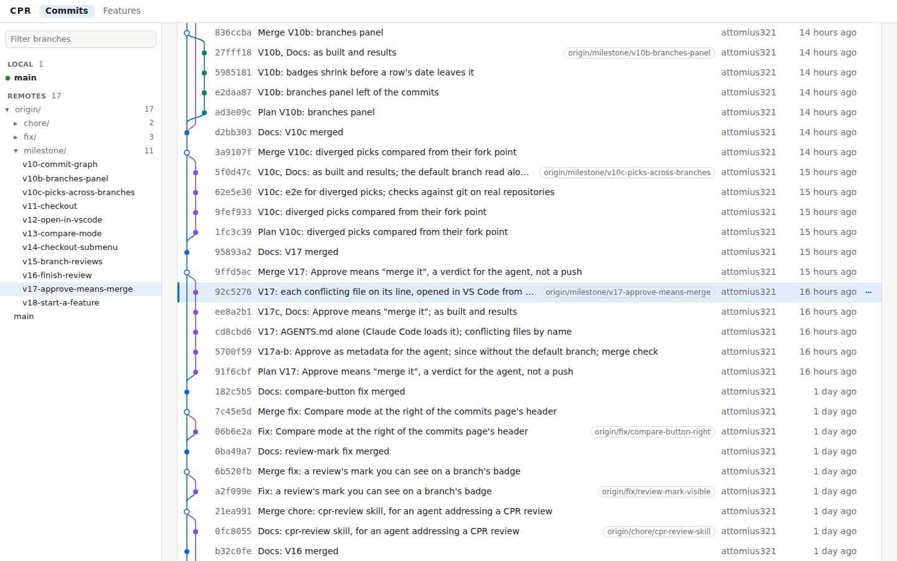

# CPR

**Coordinated Programming Runtime.** Start a workspace with a coding agent, review what it changed
as a graph of the symbols it touched, and send back a verdict. Everything runs on your machine.

CPR turns a change into a graph of the functions, classes, methods and types it added, removed
or modified, and the calls between them. Findings point at the risky parts: a symbol removed
while code still uses it, new code that nothing calls, a signature changed under callers that
were not updated. The aim is to review decisions, not lines.


[Quick start](#quick-start) ·
[Commands](#commands) ·
[Findings](#findings) ·
[The viewer](#the-viewer) ·
[Reviewing a branch](#reviewing-a-branch) ·
[Workspaces and agents](#workspaces-and-agents) ·
[Pull and merge requests](#pull-and-merge-requests) ·
[CI](#ci) ·
[Plugins](#framework-plugins) ·
[Configuration](#configuration) ·
[Development](#development)

## What it does

- **Shows a change as a graph.** One box per file, symbols coloured by what changed, findings as
  badges, removed edges dashed. Click a symbol to see its own diff, its old and new signature,
  and who uses it.
- **Reviews any branch.** Mark symbols reviewed as you go. After new commits, only what is new or
  changed since is left to look at.
- **Works with agents.** Describe the work, and CPR makes its branch and worktree and starts
  Claude Code there. You read its plan, answer it, review its branch, and approve. The agent then
  merges the commit you approved.
- **Reads pull and merge requests.** Review a GitHub pull request or a GitLab merge request from
  the graph and post your comments as one review.
- **Runs in CI.** A GitHub Action and a GitLab CI template post the findings on the lines they
  are about.
- **Knows frameworks through plugins.** Angular templates and Qwik routes are code that plain
  TypeScript analysis cannot see; the `angular` and `qwik` plugins add it.

## Quick start

You need git, Node 22.12 or newer and pnpm 12, on macOS or Linux (WSL included).

```sh
git clone https://github.com/attomius321/CPR.git
cd CPR
pnpm install
pnpm build
alias cpr="node $PWD/packages/cli/dist/bin.js"   # add this line to your shell profile
```

On Linux, `pnpm install` also compiles `node-pty` for [the agent's terminal](#workspaces-and-agents)
when python3, make and a C++ compiler are there. Without them it is skipped, and the rest works.

Then, in any git repository with TypeScript or JavaScript:

```sh
cpr view          # the commits page: every branch, ready to check out, review or compare
cpr view main     # this branch against main, in the browser
cpr diff main     # the same, in the terminal
```

## Commands

| Command | What it does |
|---|---|
| `cpr diff <base> [head]` | Compares `head` (default `HEAD`) with where it left `base`, as a pull request does, and prints the changed symbols and the findings. |
| `cpr view [<base> [head]]` | Opens the viewer in the browser. Without revisions it opens on the commits page; with them, on that comparison. Runs until Ctrl+C. |
| `cpr pr [<number>]` | Reviews a GitHub pull request or a GitLab merge request (`cpr mr` is the same command). In a CI job for one, the number comes from the job. |

`cpr diff` in a repository where one function was added, one removed and one changed:

```
main (9b269bf) → HEAD (f3d543d), merge-base 9b269bf
1 file changed · 3 symbols changed: 1 added, 1 removed, 1 modified

Findings
  ✖ removed-still-referenced  src/math.ts#legacy
      legacy was removed but is still used by 1 symbol: old
  ⚠ orphan-added              src/math.ts#triple
      triple is new and nothing references it
  ℹ signature-changed         src/math.ts#add
      add changed its signature compatibly; existing users keep working (2 users, 1 untouched)

M  src/math.ts
     ~ function    add  (signature, body)  · used by 2
     - function    legacy  · used by 1
     + function    triple
```

### Options

| Option | For | What it does |
|---|---|---|
| `--json` | diff, pr | Print the graph JSON instead of the summary ([graph schema](docs/graph-schema.md)). |
| `--out <file>` | diff, pr | Also write the graph JSON to a file. The viewer opens such a file too (drag and drop). |
| `--codequality <file>` | diff, pr | Also write the findings as a GitLab Code Quality report. |
| `--fail-on <level>` | diff, pr | Exit 1 when a finding is at least `error`, `warning` or `info`. |
| `--since <rev>` | all | Mark each changed symbol new, updated or the same as in an earlier head of the change (before a push or a rebase). |
| `--project <path>` | all | The tsconfig to load, relative to the repository root (default `tsconfig.json`). |
| `--depth <n>` | all | Hops of unchanged callers and callees to include (default 1). |
| `--plugin <name\|path>` | all | Analyze with a plugin, such as `angular` or `qwik`. Repeatable. |
| `--no-merge-base` | diff, view | Compare with `base` itself, not with where `head` left it. |
| `--port <n>`, `--no-open` | view, pr | The viewer's port (default: any free one), and not opening the browser. |
| `--summary` | pr | Print the summary instead of opening the viewer. |
| `--post-findings <level>` | pr | Post new findings at or above the level as comments on their lines, instead of opening the viewer. |
| `--forge github\|gitlab` | pr | For hosts whose name does not say which forge they are. |
| `--remote <name>` | pr | The remote to read and fetch from (default `origin`). |

Exit codes: `0` ok, `1` a failure or a `--fail-on` hit, `2` a usage error. `cpr <command> --help`
lists the options of each command.

## Findings

| Rule | Reported when | Severity |
|---|---|---|
| `removed-still-referenced` | A removed symbol's name is still used in head, by code that used it before or imports from its file. | Error; a warning when only untyped code (JavaScript, `any`) still uses it. |
| `orphan-added` | Nothing references an added symbol. | Warning; info when the package's entry exports it, or it is a default export. |
| `signature-changed` | A changed symbol's signature changed and it has users. | Warning when the change may break a user that was not updated, in another file and outside tests; otherwise info. |
| `exported-api-changed` | A published package's exported symbol is removed, no longer exported, or its signature breaks. | Warning. |

Tests (`*.test.*`, `*.spec.*`, `test/`, `tests/`, `e2e/`, `__tests__/`, `__mocks__/`) are told
apart from production code by their path. CPR prefers missing a finding to reporting a wrong
one, and every finding links to its symbol and the symbols involved.

## The viewer

### Reading a change

The canvas draws one box per file, and in it the symbols that changed: green added, red removed,
orange modified, blue moved. Grey symbols are their unchanged callers and callees, for context.
A symbol's chips say what changed in it (`signature`, `body`), its badge counts its findings, and
dashed red edges are calls and references that went away.

Click a symbol, use the change list, or press j and k, and the detail panel opens beside the
canvas: the findings, the old and new signature, a line diff of just that symbol, and who uses
it and what it uses. Selecting or marking a symbol never rearranges the graph.


Large changes stay navigable:

- A changed symbol with more than 8 unchanged users or uses shows them as one node ("390 users
  in 220 files"), which opens on click.
- Zoomed out, the canvas is a map of file names. Click one to zoom in. Each pair of linked files
  has one edge, heavier the more calls it stands for.
- The change list has a search (`/`): it keeps the symbols whose path and name hold every word
  you type, Enter opens the first, and j and k walk only the matches.
- Layouts are made in the background. The change list and findings show at once, and a view you
  have seen before comes back at once.

In a monorepo, when the change spans two or more apps or libraries, each is a frame around its
files, with its name, kind and folder. Frames are ordered so that callers come before what they
call, and edges between projects are drawn heavier. The change list is then grouped by project.
"only" on a project, or p (P goes back), shows one project at a time: its changes and everything
they are linked to elsewhere.

### The commits page

`cpr view` without revisions opens on the repository's history: every branch, local and remote,
drawn as a graph beside the commits, the current branch the straight line on the left. The whole
history scrolls, and commits load as they come into view.



- **Branches panel.** Local branches, with `↑2 ↓1` against their upstream, and remote ones by
  folder. Filter it with `/`. A click selects the branch's newest commit, however deep in the
  history it is. Workspaces you started come first: those waiting for you, the one whose agent
  last reported or asked something on top, then those whose agent is working, each with how
  long ago its agent acted (`4m`, `2h`).
- **Check out** (right-click a commit, or c): one of its branches, a remote branch as a local
  one, a tag or the commit itself. CPR asks first and uses `git switch`, never forced: your local
  changes come along, or git refuses and nothing changes. A checkout made in a terminal shows
  when the page is back in focus.
- **Review** (r): the branch from where it left the default branch to its tip. See
  [Reviewing a branch](#reviewing-a-branch).
- **Compare** (x, or "Compare mode"): click two commits, the older is the base, then Compare or
  Enter. One commit alone is compared with its parent. Two commits on diverged branches are
  compared from where they forked, as a pull request is, and Swap compares the other side.
- **Start a workspace** (n): see [Workspaces and agents](#workspaces-and-agents).

Each comparison is analyzed in the background with the same `--plugin`, `--project` and `--depth`,
and has its own address (`/diff/<base>..<head>/`), so it can be reloaded or bookmarked. The last 8
stay ready while `cpr view` runs.

### Open in VS Code

Under `cpr view` and `cpr pr`, "Open in VS Code" (or o) opens the selected symbol in the window
that has the repository open, else in a new one. Ctrl+click a line (Cmd+click on macOS), or click
its number, to open that line. CPR finds where the line is in your working copy now: after a
checkout or an edit it opens at the line's new place, and says so. It runs VS Code's `code`
command on the machine where `cpr` runs, so WSL, Remote SSH and containers work too. Set
`CPR_CODE` to use another editor command (Insiders, VSCodium, Cursor).

### Keys

| Key | On the commits page | In a change |
|---|---|---|
| j, k | Next, previous commit | Next, previous changed symbol |
| / | Find a branch | Search the change list |
| c | Check out | Comment on the selected symbol (in a review) |
| r | Review the branch | Mark the selected symbol reviewed |
| x | Compare mode | |
| n | Start a workspace | |
| f | | Focus: only the selected symbol and its neighbours |
| p, P | | Next, previous project |
| o | | Open in VS Code |
| Esc | Leave compare mode | Close the detail panel |

n starts a workspace from the Workspaces tab too. In a comment box, the start dialog or a workspace's
reply box, Ctrl+Enter (Cmd+Enter on macOS) saves, starts or sends.

## Reviewing a branch

Pick "Review" in a commit's menu, or press r, and CPR compares the branch from where it left the
default branch to its tip. Mark symbols reviewed as you go (r). After new commits, review it
again: only what is new or changed since is left, and marks stay on the symbols that did not
change.

Comment on a symbol or one of its lines (select it, press c), then finish in the Review tab with
**Request changes**, **Comment** or **Approve**. Your verdict and comments are written to the
review's file, where the agent reads them; "Copy for the agent" puts them on the clipboard as
text.


CPR pushes and merges nothing itself. An approval asks the agent to merge the commit you
reviewed (that one, not newer ones) into the repository's default branch, when you tell it to
act on the review ("check my review"). Before you approve, the Review tab says whether that merge
is clean or which files conflict; on a conflict, the agent resolves it on its branch and you
review that. The default branch (`main`) can be reviewed too, for its unpushed commits; an
approval there says they may be pushed.

A branch's badge shows how its review stands: `✓` approved, `✗` changes requested, `+2` for its
own commits since your review, `…` while reviewing. Commits added since get a dot.

Where reviews live:

- `cpr/reviews/<branch>/<your git email>.json`, in the repository.
- The first review writes `cpr/.gitignore`, which keeps them out of git. Delete it to commit and
  share them. `git clean -fdx` deletes ignored files, reviews with them.
- `cpr/AGENTS.md` tells any agent what to do with a review, and every review file's first line
  points there. Claude Code loads it when it reads a review.

## Workspaces and agents

"Start a workspace" (n, or "Start a workspace here" in a commit's menu) asks what the work is, in
a few parts:

| Kind | It asks for | Done when, filled in | Branch |
|---|---|---|---|
| Feature | Goal: what it should do, and why | (empty) | `feature/` |
| Fix | What happens, and what should | A test that fails today passes, and the check passes. | `fix/` |
| Refactor | What to restructure, and why | Behaviour is unchanged: existing tests pass without changing what they assert, and the check passes. | `refactor/` |
| Chore | What to change, and why now | Nothing else changes, and the check passes. | `chore/` |
| Spike | The question, and what the answer will decide | A written answer: what was tried, what was measured, and a recommendation. | `spike/` |

Every kind takes a title (the workspace's name and its branch's), and under **More** where to look,
notes, and what is out of scope or how to reproduce. Done when is optional; it names the check
command CPR guesses from the start commit's root files (`package.json`'s `check` or `test` script
with its package manager, a Makefile's `check` or `test` target, `scripts/test.sh`, `cargo test`,
`go test ./...`, `pytest`), and says where it found it. The ⓘ after the kinds says what each is
for. The kind is picked with `1`–`5` too, and
the form is kept as a draft (in CPR's cache, so it outlives a new `cpr view`) until the workspace
starts; Clear empties it. CPR then:

1. makes the agent's brief from the parts, under fixed headings (`# Fix: <title>`, `## What
   happens`, …, `## Done when` last), and adds one line for the kind: a fix is reproduced with a
   failing test first, a refactor and a chore change no behaviour, a spike answers in its report
   and commits nothing unless asked;
2. names a branch after the title (edit it if you like) and creates it at the default branch's
   tip, or at the commit you picked;
3. gives the branch its own worktree beside your checkout, `../<repo>.worktrees/<branch>` (the
   branch's slashes become dashes), so your checkout and `cpr view` are untouched and several
   workspaces can run at once;
4. records the brief, and the parts it was made of, in `cpr/features/<branch>.json`;
5. starts Claude Code there in the background (`claude --bg`) with the brief. With "Plan first
   and wait for my OK" (on by default), the agent stops after its plan.

The agent runs on your own Claude Code login (the dialog says which: your subscription or an API
key), in the permission mode you pick: Claude Code's default, Accept edits, or Auto. CPR never
grants it more. If Claude Code does not start, the branch and worktree are kept and the page
offers the prompt to copy. Claude Code has to trust the folder, so run `claude` there once and
accept. It is found as `claude` on your `PATH`, or set `CPR_CLAUDE`.

The **Workspaces** tab (`/workspaces`) lists workspaces by what each needs from you (a plan to read, a permission to
give, a branch to review, changes to send back), then those working, then those merged. The tab
counts the ones that need you. Each workspace shows its title (a fix, refactor, chore or spike
marked so), its commits, files not committed yet, your review, and whether it merges cleanly, with
these actions:

- **Review** its branch;
- **Talk**, which copies `claude attach <id>` for a terminal of your own (only when CPR cannot
  open the agent's terminal in the panel; its tooltip says why);
- **Open in VS Code**, its worktree;
- **Stop** or **Start** the agent;
- **Copy the prompt**.


Pick a workspace and its panel opens beside the list, where it can on the agent's **Terminal**:
its session as Claude Code draws it (the conversation, tool calls, permission prompts and
questions, Esc, slash commands), so you answer it without leaving CPR.

- It is `claude attach <id>`, run by `cpr view` in the workspace's worktree. Claude Code keeps
  hosting the session: leaving the tab or the page only hangs up that client, and the agent goes
  on.
- **Send the verdict:** after you finish a review of the workspace's branch, this (or "Send to the
  agent" in the Review tab) types the verdict's first line and where the review is into the
  agent's input, for you to send with Enter.
- ← in an empty prompt opens Claude Code's list of all your agents, where you can switch away
  from this one.
- At most four terminals are open at once (each is a Claude Code process, about 140 MB).

The **Thread** tab is the workspace's history, read only (`&thread` in the address opens on it):
the agent's plan and reports (drawn from their Markdown), your messages, and what it waited on
(a permission to run a command, or a question and its options). The thread comes from hooks CPR
gives each agent it starts (`cpr/claude-settings.json`, recorded in `cpr/threads/`, out of git).
They only record, so permissions and questions are answered in the session itself.

The terminal needs `node-pty`, an optional dependency: on Linux `pnpm install` compiles it
(python3, make and a C++ compiler), and macOS and Windows get a prebuilt one. Without it, or with
`CPR_TERMINAL=off`, the panel shows the thread with a box to answer in:

- **The reply box:** Send continues the agent's own session with your words. CPR stops a session
  that is still alive first, then resumes it. While the agent works, "Stop and send" asks before
  ending its turn.
- **Send the verdict** fills the box with what you decided. Nothing is sent until you press Send.

A workspace's branch carries its agent's mark on the commits page, and each leads to the other.
Once a workspace is merged, Clean up removes its agent's sessions, its worktree and its branch. An
unmerged one is cleaned up only after you confirm, and keeps its branch. Neither happens while
the worktree has files not committed.

## Pull and merge requests

`cpr pr 123` works with GitHub (and GitHub Enterprise) and GitLab (gitlab.com and self-managed).
It reads the forge from the `origin` remote, fetches the change's head and target branch, and
analyzes the same diff the forge shows. Tokens come from `GITHUB_TOKEN` or `GH_TOKEN` (or
`gh auth login`), and `GITLAB_TOKEN`.

- **Review from the graph.** Write comments on symbols (c; click a + or − line to choose where it
  lands), then submit them from the Review tab as one review: comment, approve, or request
  changes. They arrive as inline comments on those lines.
- **Review again after a push.** Marks and drafts are kept per pull request. Run `cpr pr` again:
  symbols you reviewed that did not change stay reviewed, those that did are flagged `↻`, and
  drafts follow their code to its new lines.
- **See only what a push changed.** Compare with the head you saw last. A rebase that touched
  nothing shows nothing:

```sh
cpr pr 123 --since 3c2b1a0   # each changed symbol: new, updated, or the same as in 3c2b1a0
```

## CI

In CI, CPR posts the findings instead of opening the viewer. Findings an earlier run already
posted are not repeated. Inside a pull or merge request job, `cpr pr` finds the number itself:

```sh
cpr pr --post-findings warning --fail-on error
```

### GitHub Action

```yaml
on: pull_request
permissions: { contents: read, pull-requests: write }
jobs:
  cpr:
    runs-on: ubuntu-latest
    steps:
      - uses: actions/checkout@v7
        with: { fetch-depth: 0 }
      - uses: attomius321/CPR@main
        with:
          post-findings: warning   # empty: don't post
          fail-on: error           # empty: never fail
```

| Input | Default | What it does |
|---|---|---|
| `post-findings` | `warning` | Post new findings at or above this level. Empty: don't post. |
| `fail-on` | `error` | Fail the job on a finding at least this level. Empty: never. |
| `plugins` | | Plugins, comma-separated (`angular`), besides those in `cpr/config.json`. |
| `project`, `depth` | | As `--project` and `--depth`. |
| `token` | `github.token` | Reads the pull request and posts comments (needs `pull-requests: write`). |
| `pull-request` | the event's | The pull request number. |
| `working-directory` | `.` | Where the repository is checked out. |
| `setup-node` | `true` | Install Node 22 first. |

The action builds CPR, runs it, writes the summary to the run's page, and outputs the graph
JSON's path (`steps.<id>.outputs.graph`) for upload. Pull requests from forks get a read-only
token, so review them without posting (this repository's own
[workflow](.github/workflows/cpr.yml) does that).

### GitLab CI

```yaml
include:
  - remote: https://raw.githubusercontent.com/attomius321/CPR/main/ci/gitlab/cpr.yml
```

Its `cpr` job runs on merge request pipelines. Without a token, findings appear in the merge
request's Code Quality widget. Add a masked `GITLAB_TOKEN` variable (api scope) to also get them
as comments on their lines. Override `CPR_POST_FINDINGS`, `CPR_FAIL_ON`, `CPR_PLUGINS` or
`CPR_VERSION` in your own `cpr:` job.

## Framework plugins

Framework knowledge comes as plugins, so the TypeScript and JavaScript analysis stays the same
for every project. A plugin lets CPR see what plain TypeScript cannot: a template that calls a
component's methods, a method the framework calls, decorator settings that are configuration
rather than contract.

```sh
cpr diff main --plugin angular          # Angular templates, decorators, lifecycle hooks
cpr diff main --plugin qwik             # Qwik routes, component$ props, MDX routes
cpr diff main --plugin ./tools/my-plugin.mjs
```

Or turn one on for the repository in `cpr/config.json` (`{ "plugins": ["angular"] }`). In CI,
use the action's `plugins` input or GitLab's `CPR_PLUGINS` variable. A short name means
`@cpr/plugin-<name>`, found in your project first, then next to CPR; a path starts with `.` or
`/`. A plugin that fails is skipped with a warning; it never fails the review.

### Angular

With `angular`, a template is code: its edits are changes (formatting aside), and what it calls
counts as a use.

- A method removed while its template still calls it is an error at the template line.
- A method used only by a template, a lifecycle hook or a host listener is not an orphan.
- Editing `@Component({ imports })` is not read as a new signature.
- Templates see the repository's components, directives and pipes. A removed component still
  placed, an input renamed while still bound, an output removed while still listened to, or a
  pipe whose `transform` changed under a template that was not updated is reported.
- With dependencies installed, templates also see Angular's and its libraries' components,
  directives and pipes, read from their typings in `node_modules`. So `x$ | async` has a type,
  and `(ngModelChange)="save($event)"` or `#f="ngForm"` are typed. In CI, install dependencies
  before CPR runs.
- In the viewer, a template opens with its own diff, and comments on its lines go to the `.html`
  file.

Repositories with several apps work at any depth, with nothing at the root. Each file's imports
resolve with its own project's `paths` and `baseUrl`, each template is read with its app's
Angular version and installed libraries, and an app's templates only use components of its own
Angular workspace and of shared code outside every workspace.

### Qwik

With `qwik`, Qwik 1.x (`@builder.io/qwik-city`) and 2.x (`@qwik.dev/router`) are read by Qwik's
own file rules, in the routes folder its Vite config names.

- What Qwik's router calls by name is not an orphan: `onGet`, `head`, `onRequest` and the other
  route exports, `routeLoader$` and `routeAction$` values (also re-exported, also through a form
  library's wrapper when Qwik is installed), server plugins' handlers, entries and error pages.
  A helper a route module exports but nothing calls is still an orphan.
- A `component$`'s props are its signature, shown as
  `const Badge = component$<{ label: string; tone: string }>`. An optional prop added is
  compatible; a required prop added or one removed is a warning that names the JSX not updated,
  also when the props are a named type whose definition changed. This works without
  `node_modules`.
- `.mdx` routes are templates: their imports, components and `{expressions}` are code, and prose
  edits are no change. A component removed while a page still renders it is an error at that
  line, a required prop a page does not pass is a warning, and a component only pages use is not
  an orphan (components the MDX provider gives included).

### Your own

A plugin implements the `TsPlugin` interface exported by `@cpr/core`. The
[plan](docs/PLAN.md#x1--plugins) describes the hooks, and
[`tpl-plugin.ts`](packages/core/test/helpers/tpl-plugin.ts) is a complete example.

## Configuration

### `cpr/config.json`

At the repository root (`cpr.config.json`, the older place, still works). Every key is optional.

```jsonc
{
  "plugins": ["angular"],
  "features": { "branchPrefixes": { "fix": "bugfix/" }, "worktrees": "../{repo}.worktrees" },
  "agent": { "permissionMode": "default", "model": "opus" }
}
```

| Key | Default | What it does |
|---|---|---|
| `plugins` | none | Plugins every run uses, by name or path. |
| `features.branchPrefixes` | `feature/`, `fix/`, `refactor/`, `chore/`, `spike/` | The start of a new workspace's branch name, per kind of work; an object with some kinds changes only those. |
| `features.branchPrefix` | `feature/` | The Feature prefix, as before kinds of work; `branchPrefixes.feature` wins over it. |
| `features.worktrees` | `../{repo}.worktrees` | Where workspaces' worktrees go, relative to the checkout (`{repo}` is its folder name). |
| `agent.permissionMode` | `default` | The permission mode the start dialog suggests: `default`, `acceptEdits` or `auto`. |
| `agent.model` | Claude Code's | The model agents start with. |

### `.cprignore`

Symbols in `examples/`, `playground/`, `fixtures/`, `__fixtures__/`, `__snapshots__/` and
`generated/` folders, and in `*.generated.*` files, are listed but not analyzed. A `.cprignore`
at the repository root (gitignore syntax) changes that. It is read from your working folder, so
it applies at once, even uncommitted, and to any commits you compare:

```gitignore
# every `interfaces` folder, at any depth
interfaces/
# only the top-level `tools` folder
/tools/
# but keep this one
!apps/web/interfaces/public.ts
```

### Projects in a monorepo

The graph JSON says which app or library each file belongs to (`projects`, see the
[graph schema](docs/graph-schema.md#project)). CPR finds them from workspace members (npm, Yarn,
pnpm), Nx projects and, with `--plugin angular`, `angular.json`. When a repository declares none,
its packages and the folders with their own `tsconfig.json` are the projects.

### Environment variables

| Variable | What it does |
|---|---|
| `GITHUB_TOKEN`, `GH_TOKEN` | GitHub token for `cpr pr` (else `gh auth token`). |
| `GITLAB_TOKEN` | GitLab token for `cpr pr`. |
| `GITHUB_API_URL`, `GITLAB_API_URL` | The forge's API, for self-hosted instances. |
| `CPR_FORGE` | `github` or `gitlab`, when the host name does not say (as `--forge`). |
| `CPR_CODE` | The editor command "Open in VS Code" runs (default: VS Code's `code`, from `PATH` or its usual install places). |
| `CPR_CLAUDE` | The Claude Code program workspaces start (default: `claude` on `PATH`). |
| `CPR_TERMINAL` | `off`: no agent's terminal in a workspace's panel; the panel keeps Talk and the reply box. |
| `CPR_CACHE_DIR` | Where CPR keeps its worktrees and review state. Default: `$XDG_CACHE_HOME/cpr`, else `~/Library/Caches/cpr` on macOS and `~/.cache/cpr` elsewhere. |

## Limits

- TypeScript and JavaScript only (`.ts .tsx .js .jsx .mts .cts .mjs .cjs`). Other languages need
  an adapter of their own.
- Static analysis: no runtime or data-flow analysis.
- Claude Code is the only agent workspaces start for now. Codex and any configured agent command
  are planned (V20 in the [plan](docs/PLAN.md)).

## Development

```sh
pnpm install
pnpm check        # format, lint, typecheck, unit tests
pnpm build        # compile the packages and bundle the viewer
pnpm test:e2e     # viewer end-to-end tests (after pnpm build)
node packages/cli/dist/bin.js diff main
```

| Package | Role |
|---|---|
| `packages/core` | The engine: git, symbols, diff, references, detectors, graph JSON |
| `packages/cli` | The `cpr` command line and the viewer's local server |
| `packages/forge` | GitHub and GitLab APIs |
| `packages/viewer` | The browser app `cpr view` and `cpr pr` serve |
| `packages/plugin-angular`, `packages/plugin-qwik` | Framework plugins |
| `action.yml`, `ci/gitlab/cpr.yml` | The GitHub Action and the GitLab CI template |
| `spikes/` | Experiments outside the workspace |

Changes to the analysis are checked on real repositories, not only on fixtures:
`scripts/regression/` runs pinned commits of ky, zod, vite, RealWorld, Bitwarden and Qwik on two
builds and compares edges, findings and time; `scripts/viewer/measure.mjs` times the viewer on a
graph in Chromium. `CLAUDE.md` (and one per package) and `.claude/skills/` hold the working rules
for Claude Code in this repository.

- [Plan](docs/PLAN.md): the design, every milestone and every decision.
- [Journal](docs/JOURNAL.md): what each milestone learned and measured.
- [Graph schema](docs/graph-schema.md): the graph JSON contract.
