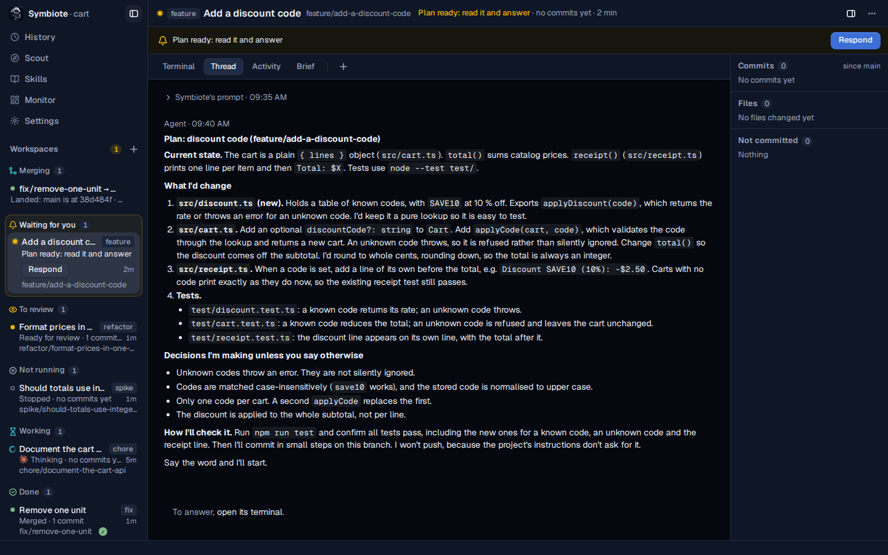
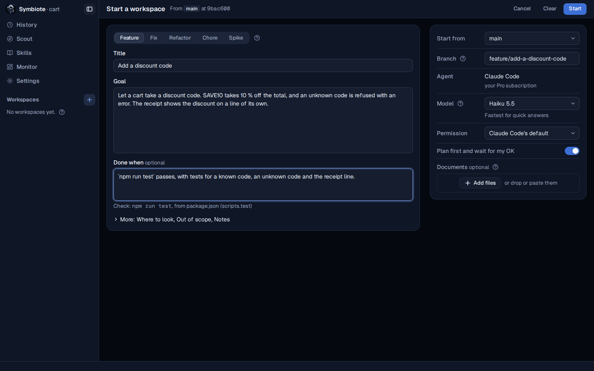
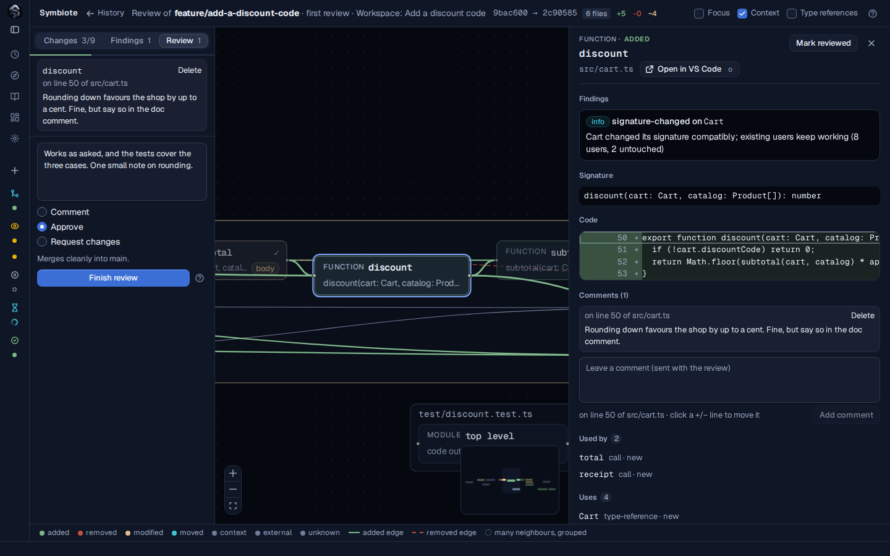
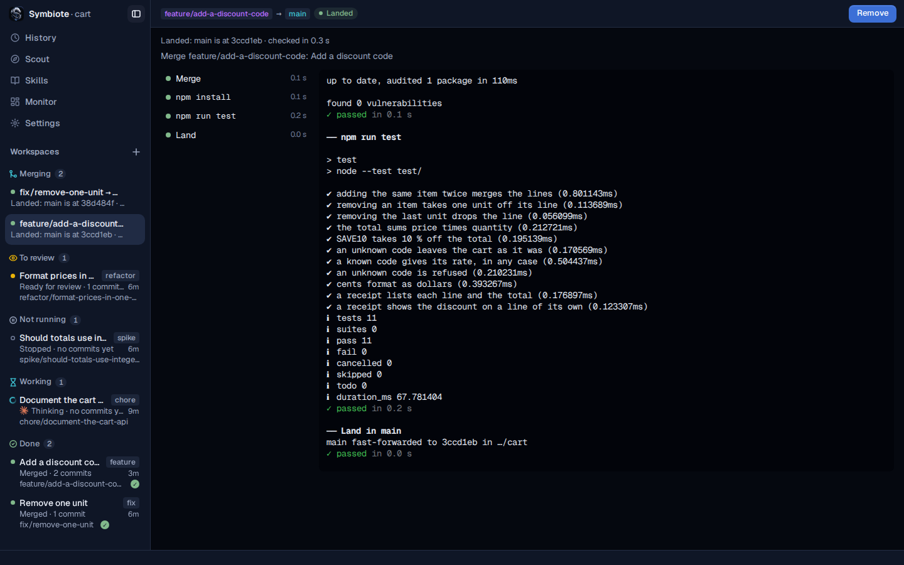

# Symbiote

Symbiote runs coding agents on your machine and keeps you in charge of what they ship. Each task
gets a *workspace*: a branch, a folder and an agent of its own, Claude Code, Codex or Hermes. You
read the agent's plan, answer its questions, review its branch and approve it. When you ask,
Symbiote merges the commit you approved. Once your project's check (its tests, for example) passes
on the merge, Symbiote moves your branch to it.



Several agents can work at once, each on its own branch, while you keep working in your own
checkout. Everything runs locally: Symbiote is a command, `symbiote`, and an app that the command
opens in a window of its own or in your browser.

[Install](#install) · [Quick start](#quick-start-your-first-workspace) ·
[Workspaces](#workspaces) · [Other pages](#the-other-pages) ·
[Review without an agent](#review-without-an-agent) ·
[Files and network](#what-symbiote-writes-and-sends) · [Limits](#limits) ·
[Development](#development)

## Requirements

- Linux, or Windows through WSL. macOS runs the same code but is not tested yet.
- git, and Node 22.12 or newer. The install gets pnpm itself; no compiler is needed.
- Claude Code, Codex or Hermes Agent, installed and set up. Symbiote starts them with your own
  login and configuration, so their work counts against your own subscription, API key or model
  server. Symbiote's own helper agents, the merger, Scout and Scribe (described below), run on
  Claude Code or Codex.

## Install

Run this once:

```sh
git clone https://github.com/attomius321/Symbiote.git && cd Symbiote && ./install.sh
```

It installs Symbiote's dependencies and builds it, and adds two commands to `~/.local/bin`:
`symbiote`, and `symbiote-nexus` (see [below](#several-symbiotes-in-one-window)). It also sets up
Symbiote's window, which downloads Electron (about 100 MB), and adds the window to your desktop's
app list. With `--no-app` it skips the window, and Symbiote opens in your browser. It takes about
30 seconds with the window, 10 without, on a fast connection. If `~/.local/bin` is not on your
`PATH`, it prints the line to add to your shell's profile. Then run `symbiote --help` to check
the install.

To update Symbiote, run `git pull && ./install.sh` in its folder. An alias for `symbiote` from an
older install is no longer needed: the install says so if it finds one in `~/.bashrc` or
`~/.zshrc`.

### Symbiote's window

`symbiote view` opens Symbiote's window. Closing the window stops `symbiote view`, but agents keep
running. To use a browser tab anyway, add `--browser`. To start Symbiote from your desktop's app
list instead of a terminal, pick **Symbiote** there.

Two limits apply to the window:

- On Ubuntu 24.04 and later, AppArmor can refuse the sandbox that Electron needs. Symbiote then
  says so and opens your browser instead.
- On WSL, files dragged from Windows never reach the window. Use the **Add files** and **Attach
  images** buttons instead. Windows' files are under `/mnt/c`.

### Several Symbiotes in one window

Each `symbiote view` serves one repository. Symbiote nexus shows every one running on this
machine as a tab of one window, and starts new ones in any repository on your PC. Run it anywhere:

```sh
symbiote-nexus
```

The row at the top has two groups, with a line between them. On the left are the nexus's own
pages, **Symbiotes** and **Folders**, each with an icon. After the line, each tab is one Symbiote,
with a dot for its state: green while it runs, an empty ring once it stopped. A Symbiote's tab shows
it as its own window would. A Symbiote you opened stays loaded while you look at another, so
switching back is instant. A `symbiote view` started in a terminal gets its tab within 2 seconds.

**Symbiotes** shows each running Symbiote as a card, with its folder, branch and changed files.
Under them, **Repositories in** lists the other repositories in the folders your Symbiotes are in:
click one to open a Symbiote there.

**Folders** shows your PC's folders, one folder at a time. Its repositories come first, as cards
that show the checked-out branch. The other folders follow as rows; click one to go into it. A
repository is as far as you go: clicking it opens a Symbiote there, or shows the one already
running. A path inside a repository shows the folder that holds it, with the repository picked.
The places are on the left: your home folder, the folders your Symbiotes are in, `/`, and on WSL
the Windows drives (`C:`). To go to any folder, hidden ones included, type its path in **Go to
folder** and press Enter.

Closing the nexus stops no Symbiote, not even the ones it started, so their agents keep working.
To stop a Symbiote, click the stop button on its card in **Symbiotes**, then **Stop**.
Its terminals, and the agents working in them, stop with it. If you had opened its tab, the tab
stays, marked stopped, with **Start again** and **Close tab**.

The nexus opens like `symbiote view`: in Symbiote's window when it is set up, else in your browser.
It takes `--browser`, `--no-open` and `--port` too.

## Quick start: your first workspace

This walks one task from start to merge. You need a git repository of your own, and Claude Code
or Codex. Claude Code starts only in a repository you have trusted. Trusting the repository also
covers its workspaces' worktrees. If you have never run `claude` in this repository, run it there
once and accept its trust prompt. Codex needs no such step.

1. In the repository, run `symbiote view`. Symbiote opens on **Git**, the repository's
   commits and branches. The list on the left is the *sidenav*: its pages, then your workspaces,
   and **Settings** at the bottom.
2. Press `n`, or click **+** beside **Workspaces** in the sidenav. The **Start a workspace** page
   opens.
3. Leave **Feature** picked. Type a **Title**, such as "Add a discount code", and describe the
   **Goal**: what it should do, and why. Leave **Plan first and wait for my OK** on.
4. Click **Start workspace**. Symbiote creates the branch and its own folder, starts the agent
   there, and opens the workspace on the agent's terminal.
5. Wait for the plan. The workspace moves to **Waiting for you** in the sidenav. Read the plan in
   the terminal, then type your answer there: "OK", or what to change.
6. When the agent has finished, the workspace moves to **To review**. Click **Review** at the top
   of the workspace. The branch's changes open on their files. In the **Review** tab on the left,
   pick **Approve** and click **Finish review**.
7. Click **Merge into**. Symbiote merges the commit you approved into the branch the workspace
   started from, and runs your project's check. If the check passes, Symbiote *lands* the merge:
   it moves that branch to the merge commit.
8. The workspace moves to **Done**. Click **Clean up** to remove its folder, its branch and the
   agent's sessions. The workspace then goes to **History** (`h`), with its brief and what its
   agent did.

## Workspaces

A workspace is one task for one agent. It has a branch and a *worktree*: a second working folder
of the same repository, checked out on that branch. It also has the agent's session and a record
of what you asked. Agents never work in your own checkout, so you can keep working while they
do.

### Start a workspace

The **Start a workspace** page (`n`) asks what the work is. Each kind of work asks its own
question and names its branch with its own prefix:

| Kind | It asks | Branch |
|---|---|---|
| Feature | What should it do, and why? | `feature/` |
| Fix | What happens, and what should happen? | `fix/` |
| Refactor | What should be restructured, and why? | `refactor/` |
| Chore | What should change, and why now? | `chore/` |
| Spike | What is the question, and what will the answer decide? | `spike/` |

A spike answers its question in a written report, which you read in its **Thread** tab. It
commits nothing unless you ask, so it usually has nothing to merge.

Every kind also takes a title, an optional **Done when** (how you will know it works), and more
notes under **More**. If Symbiote finds your project's check, such as `npm run test`, `cargo
test` or `pytest`, it names it under **Done when**. Under the goal, the Markdown button shows it
as the agent's brief will read, the paperclip adds documents, and a count shows the brief's
length (at most 20,000 characters). The form is kept as a draft until you start, so leaving the
page loses nothing.



The cards beside the form hold the workspace's choices:

- **Start from**: the branch to start from. The default branch, unless you pick another. Its
  list has a search: type words from a branch's name, in any order, then pick it with ↑, ↓ and
  Enter.
- **Branch name**: the new branch's name, made from the title. You can edit it; the button
  beside it names it after the title again.
- **Agent**, **Model** and **Effort**: the agent, the model it starts with, and its effort level
  (how long the model thinks before it answers). The lists come from the agent itself.
- **Permissions** (Claude Code): Claude Code's own permission mode, which decides what it may do
  without asking you. Symbiote never grants the agent more than the mode you pick.
- **Approvals** (Hermes): Hermes asks in its terminal before a dangerous command. Its card says
  Working while it waits there.
- **Plan first and wait for my OK**: the agent writes a plan and stops before it changes
  anything. It is on by default.
- **Documents**: files for the agent, such as screenshots, PDFs or samples. Up to 20 files, 20 MB
  each.

To have the model, effort and **Plan first** picked for you, write the brief and click **Suggest
settings**. A small model (by default Haiku 5.5 for Claude Code, GPT-6 Luna for Codex) reads the
brief, and a card proposes the settings with one sentence on why, in 3 to 5 seconds. Your cards
change only if you click **Use these settings**; **Dismiss** keeps them. It never changes the
agent or its permissions, and it runs only when you click. In **Settings**, **Suggest settings**
holds the model and effort it runs on for each agent. It also holds its instructions, including
which models it counts as small, mid and large.

When you click **Start workspace** (or press Ctrl+Enter), Symbiote:

1. writes the agent's *brief* (the task in words) from your answers;
2. creates the branch and its worktree next to your checkout, in `../<repo>.worktrees/`;
3. records the workspace in `symbiote/workspaces/<branch>.json`;
4. starts the agent in the worktree, in the background, with the brief.

Hermes has no background mode: it runs in a terminal of `symbiote view`, given the brief as its
first message. It keeps running when you leave its tab or reload the page, and stops when
Symbiote quits. Its Terminal tab then continues the session (`hermes --resume`).

### See what needs you

The sidenav lists your workspaces in groups, by what each one needs from you:

| Group | What is in it |
|---|---|
| **Merging** | Merges Symbiote is making |
| **Waiting for you** | Agents stopped on you: a plan to read, a question, a permission to give |
| **To review** | Finished work: a branch to review, or an approval to merge |
| **Not running** | Agents that failed, were stopped, or have not started |
| **Working** | Agents at work, with what each one is doing right now |
| **Done** | Merged workspaces, ready to clean up |

Each card shows the workspace's title, its kind, its state, and how long it has been in that
state. A waiting card has **Respond**, which opens the agent's terminal. When Scout or Scribe waits
for you, its page's link turns amber like this group and says **Waits**.

The window's title counts everything that waits for you: workspaces, merges, Scout, Scribe and
agents' asks. In Symbiote's own window, the taskbar icon also gets an amber dot while anything
waits. When something new waits while you are in another window, Symbiote asks the desktop to
blink its taskbar button until you come back. Desktops that blink a window asking for attention do
so, KDE and XFCE among them. On WSL the taskbar shows the dot but cannot blink.

### Work with the agent

Click a workspace to open it. Its page has four tabs:

- **Terminal**: the agent's own terminal, as Claude Code, Codex or Hermes draws it. Answer
  questions and permission prompts here, as you would in your own terminal. Leaving the tab does
  not stop the agent. To give the agent an image, paste it (Ctrl+V) or use **Attach images**.
- **Thread**: the agent's plans and reports, your messages, and what it waited for.
- **Activity**: the agent's work as phases, such as exploring the code, implementing, testing,
  debugging and committing. Each kind of phase has its own colour on the timeline. Your messages
  (in bubbles), the agent's questions and its reports sit between the phases. Each phase shows when
  it started, how long it took and its status. Click a phase to see
  its events, and click an event to see its whole command, output and exit code. While the agent
  works, a line at the top says what it is running. **Raw events** lists every line Symbiote
  recorded.
- **Brief**: what the agent was asked, with the documents you gave it.

The **+** after the tabs opens a shell in the workspace's worktree, for tests, a dev server or git.
Where the window is wide enough, the **Changes** panel on the right lists the branch's commits and
changed files. Click a file to open its diff in VS Code.

The commits count from where the workspace started: for a workspace started from another branch,
only its own commits, not that branch's. To review it against another branch, pick that branch in
**since** above the commits. **Review**, the commit count, the merge check and the target of an
approval follow the pick. Pick **where it started** to go back.

The top of the page has these buttons:

- **Review** opens the branch's changes for review.
- **Stop** stops the agent, and **Start** starts it again.
- **⋯** holds **Open in VS Code**, which opens the worktree, and **Copy the prompt**, which copies
  the agent's first prompt.

### Review the branch and tell the agent

**Review** opens on the branch's **Files**: every changed file, as the workspace lists them, and
a file's diff when you click it. Click a line of the diff to comment on it. **Graph** (`g`) shows
the same changes as a graph. The graph draws a box for each changed file, and in it the *symbols*
that changed: functions, classes, methods and types, coloured by what changed. Lines between
symbols are calls and other uses. *Findings* mark the risky changes: a function removed while
code still calls it, new code that nothing uses, or a signature changed under callers that were
not updated. The [review guide](docs/guide/review-and-ci.md) explains the files, the graph and
the findings.



To review:

1. On **Files**, read each file's diff, and click a line to comment on it.
2. On **Graph**, click a symbol to see its diff and who uses it. Press `r` to mark it reviewed.
   To comment on a symbol, select it and press `c`.
3. In the **Review** tab, pick **Approve**, **Request changes** or **Comment**, then click
   **Finish review**.

Symbiote writes your *verdict* (the decision and your comments) to
`symbiote/reviews/<branch>/<your git email>.json`. If you approved, there is nothing to tell the
agent: you merge next. If you requested changes or commented, click **Send to the agent**.
Symbiote types the verdict and the review file's path into the agent's terminal, and you send it
with Enter. The agent reads your comments from that file.

After the agent adds commits, review the branch again. Only what is new or changed since your
last review is left to look at.

### Merge

After you approve a branch, **Merge into** appears in the **Review** tab, under **Merge**, and on
the workspace's page. The target is the branch the workspace is reviewed against: the one it
started from, unless you picked another in **since**, or pick another here. Symbiote then:

1. merges the commit you approved (not any later one) in a worktree of its own, so neither your
   checkout nor the agent's worktree is used;
2. runs your project's check on the merge. The check is `merge.checks` in
   [`symbiote/config.json`](docs/reference/configuration.md), or a command Symbiote finds in the
   project, such as a `test` script in `package.json`;
3. lands the merge if the check passes: it moves the target branch forward to the merge commit.

Beside the target, pick how it lands: **with a merge commit** (the default) or **by
fast-forward**. A fast-forward makes no new commit: the target moves to the commit you approved,
once the check has passed on that commit. It is offered only when the target has no commits the
branch lacks; otherwise the control says so. If the target moves while a fast-forward waits its
turn, the merge waits for you: click **Merge commit instead**, or bring the target into the branch
and review it again. `merge.strategy` in `symbiote/config.json` sets which one is picked first.

If the target branch is checked out in your own checkout, landing updates your files too. If that
would overwrite changes you have not committed, git refuses and nothing changes. The merge then
waits until you click **Land**.

Symbiote does not push unless you set `merge.push` to `true` in `symbiote/config.json`. Merges
run one at a time, in the order you asked for them. Click one under **Merging** to see its steps
and their output as they run. If the check fails, nothing lands, and the merge page shows the
check's output. If the project has no check, the merge waits for you to click **Land**.

If the branch conflicts with the target, Symbiote gives the conflict to the *merger*, an agent
that proposes a resolution for each conflicting part. Nothing lands until you review it. The
merge page shows each resolved part. It marks in red the lines where either branch's change was
lost, and in amber the lines the merger wrote itself.

**Approve** lands the resolution, and **Request changes** asks the merger again with your words.
If the resolution's check failed, **Check again** runs the check again without asking the merger.



### Clean up

When a workspace is merged, it moves to **Done**. **Clean up** stops and removes the agent's
sessions, and removes the worktree, the documents and the branch. To remove a workspace that was
not merged, use **Clean up…** under **⋯**. Symbiote asks first and keeps the branch. Symbiote does
not clean up a workspace while its worktree has changes that are not committed.

A cleaned-up workspace goes to **History** (`h`, under Monitor in the sidenav). History lists them
newest first, by the day they were cleaned up. Search them by title, branch or brief, or show one
kind of work. Pick one to read it: its **Activity**, **Thread**, **Brief** and **Changes**, as its
page showed them, with nothing to answer or run. Its commits are still shown after its branch is
deleted: Symbiote finds them from the commit you approved, which the merge keeps. **Open the
change** shows those commits' files and graph, as comparing two commits in Git does. A
workspace's old link (`/?branch=…`) opens it in History.

## The other pages

The sidenav also opens these pages. Each has a key.

- **Git** (`g`): the repository's commits and branches, drawn as a graph. Select a commit to see
  its message, author, parents and files in the details pane. Click a file to see its diff in the
  commits' place, and **Open in VS Code** (`o`) to open that diff in VS Code; `j` and `k` step
  through the files, `Esc` goes back to the commits. Right-click a
  commit to check it out, review its branch (`r`), start a workspace from it, or make a branch or
  a tag there. Right-click a branch in the branches panel to rename or delete it. Double-click
  the branch to check it out. Press `x` to compare two commits.
  Your uncommitted changes are a row above the commits: stage files, write a message and commit
  them in the details pane. **Fetch**, **Pull** (fast-forward only, merge or rebase) and **Push**
  are at the top, with **Find a commit** (`f`) to search the messages, authors and SHAs.
  Symbiote never forces a push and never discards your changes: when git refuses, it says why.
- **Scout** (`a`): an agent you can ask about the repository: where something is decided, why it
  works this way, or what waits for you. Scout can also act on your workspaces for you: start one,
  answer an agent, review or merge a branch. Before a start, Scout can ask for suggested settings,
  as **Suggest settings** does, and shows them to you: you choose what it starts with. Scout never
  edits files. It can send a message to an agent without asking you, but a start, a verdict, a
  merge and a clean-up each wait until you click **Confirm**. The page is Scout's terminal: you ask
  there. **New conversation** starts over.
- **Skills** (`i`): the repository's *skills*, the instruction files agents load for a kind of
  task (`.claude/skills/<name>/SKILL.md`). Search them by name or description, read and edit
  them here (with line numbers, or as a Markdown preview), or open one in VS Code. As you type,
  the page flags what an agent would refuse, such as a missing name or description. *Scribe*, an
  agent on the same page, writes a new skill or improves one: you ask in its terminal, and
  **Improve with Scribe** types the skill's path there for you. Scribe only writes in
  `.claude/skills/` and never commits.
  Your *skill library* is a folder of skills kept outside the repository, a plain folder or one
  in a git repository. Set it once in Settings, and every repository's Skills page lists its
  skills too: you edit and add them there, and Scribe writes them. If Settings says so, the page
  also commits and pushes the library's changes.
- **Monitor** (`m`): how the code is spread across folders and files, to spot the files that have
  grown too large. A map shows each file sized by its lines of code, and marks the long ones.
- **History** (`h`): the workspaces you cleaned up, with their activity, thread, brief and
  changes. See [Clean up](#clean-up).
- **Settings** (`s`): the prompts Symbiote gives its agents, such as a workspace agent's first
  prompt; the model and effort of the merger, Scout and Scribe (set only here: their pages have no
  such choices); the **Skill library** (its folder,
  or a repository to clone, and who commits its changes); and **Appearance** (dark, light or your
  system's, and whether Git's commit details show on the right or below the commits).

The status bar at the bottom shows how much of your Claude and Codex subscription limits you have
used.


## Review without an agent

The graph works on any change, with or without a workspace:

```sh
symbiote view main     # this branch against main, as a graph
symbiote diff main     # the same comparison, printed in the terminal
symbiote pr 123        # a GitHub pull request or a GitLab merge request
```

`symbiote pr` posts your comments to the pull request as one review. A GitHub Action and a GitLab
CI template post the findings on the lines they are about. The
[review guide](docs/guide/review-and-ci.md) covers these, the tokens they need, the framework
plugins for Angular and Qwik, and CSS and SCSS. Every command and option is in the
[commands reference](docs/reference/commands.md).

## What Symbiote writes and sends

In your repository, Symbiote keeps its files in the `symbiote/` folder: workspace records,
reviews, the agents' threads and activity, documents, and the settings of the agents it starts.
An agent's activity holds each command it ran, whole up to 8 KB, and the last 2 KB of its output
or error. It also writes `symbiote/AGENTS.md`, which tells any agent how to act on a review. Symbiote's own
`symbiote/.gitignore` keeps everything there out of git, itself included, except two files. They
are yours to commit and share: `config.json` holds your settings, and `merge.md` your rules for
the merger.

Two more things write elsewhere in the repository: saving a skill writes in `.claude/skills/`, and
landing a merge updates the branch you have checked out.

Outside the repository, Symbiote writes:

- the workspaces' worktrees, next to your checkout, in `../<repo>.worktrees/`;
- its cache, `~/.cache/symbiote` on Linux, with the worktrees it compares and merges in, the
  list of merges, drafts, pasted images, its logs, the address of each running
  `symbiote view` (Symbiote nexus reads them), and the output of each Symbiote the nexus started;
- its settings for this machine, `~/.config/symbiote` on Linux: the skill library's folder, and
  whether the intro was seen;
- the skill library's skills, when you save, add or delete one, or Scribe writes one. Symbiote
  commits and pushes the library only if Settings says so, and only its folder.

Symbiote itself sends three things over the network:

- Your Claude usage is read from `api.anthropic.com`, with the token Claude Code stored. Codex's
  usage comes from Codex on your machine. Set `SYMBIOTE_USAGE=off` to read neither.
- `symbiote pr` and the CI jobs call the GitHub or GitLab API, and fetch the pull request.
- A merge is pushed only if you set `merge.push`.

The agents talk to their own services, as they do when you run them yourself. Symbiote's fonts
and pages are served by `symbiote view` itself.

All settings are in the [configuration reference](docs/reference/configuration.md).

## Limits

- Workspaces start Claude Code, Codex or Hermes. Other agents are not supported yet, and Scout,
  Scribe and the merger run on Claude Code or Codex only.
- The graph reads TypeScript, JavaScript, CSS and SCSS. Other files have no symbols in the graph;
  a review shows their diffs on its **Files** page, where you can comment on their lines.
  Workspaces work in any git repository.
- The analysis is static: it reads code and does not run it.
- Symbiote is tested on Linux and WSL only, as [Requirements](#requirements) says.

## Development

`./install.sh` is all a checkout needs. To work on Symbiote itself:

```sh
pnpm install
pnpm check        # format, lint, typecheck and unit tests
pnpm build        # compile the packages and bundle the app
pnpm test:e2e     # the app's end-to-end tests, after pnpm build
```

The code is in `packages/`. The main ones are `cli`, the `symbiote` command and its server;
`viewer`, the app; `core`, the analysis; and `desktop`, Symbiote's window. `CLAUDE.md` holds the
working rules for agents in this repository.

- [Plan](docs/PLAN.md): every milestone, with its design and results.
- [Journal](docs/JOURNAL.md): what each change learned and measured.
- [Graph schema](docs/graph-schema.md): the graph JSON that `symbiote diff --json` prints.
