# Symbiote

Symbiote is an app on your own machine for working with coding agents. It shows a code change as a
graph of the functions, classes and types it touched, and marks the risky parts. It runs agents such
as Claude Code and Codex, each on a branch and in a folder of its own. It keeps track of what each
one needs from you. In Hive mode, it can also take a task from your goal to merged code with no one
in the loop.

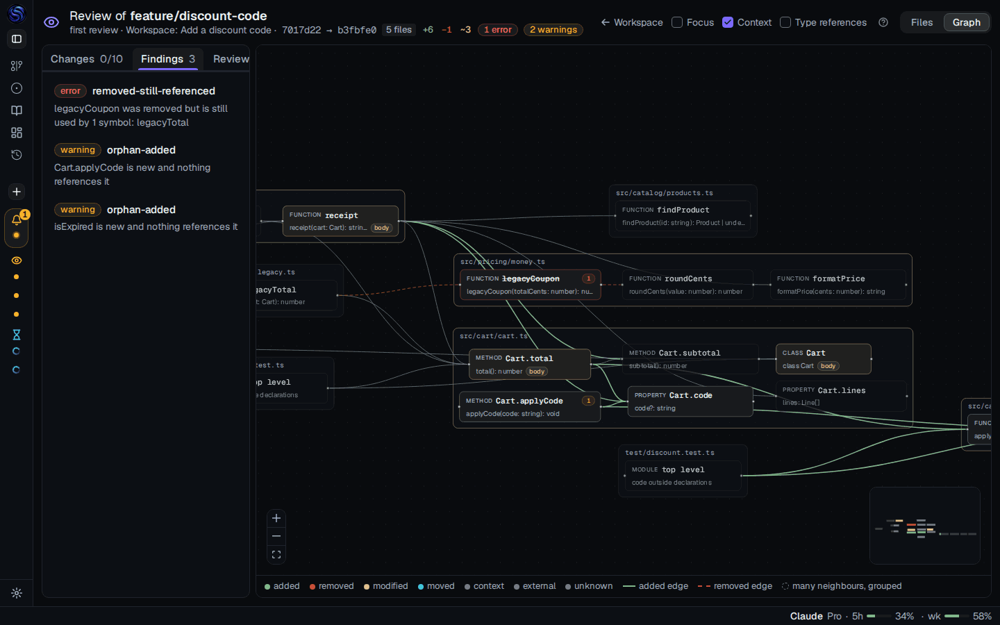

Use Symbiote to:

- **Review a change faster.** See which functions and types changed and who calls them before you
  read the lines. Symbiote flags a function removed while code still calls it, new code that nothing
  uses, and signatures changed under their callers.
- **Run several agents at once.** Each task gets a *workspace*: a branch, a folder and an agent. You
  keep working in your own checkout while the agents work in theirs.
- **Stay in charge of what is merged.** You review and approve the agent's branch. Symbiote merges
  it only after your project's tests pass on the merge.
- **Hand a goal over completely.** In Hive mode, Symbiote runs your tests after each of the agent's
  turns. A second agent proves bugs with failing tests. Once both pass, Symbiote merges the work.

Everything runs locally: Symbiote is a command, `symbiote`, and an app that opens in a window of its
own or in your browser.

[Install](#install) · [Try it](#try-it) · [Review](#review-a-change-as-a-graph) ·
[Workspaces](#run-agents-in-workspaces) · [Hive mode](#hive-mode-from-goal-to-merged-on-its-own) ·
[Nucleus](#nucleus-ask-about-your-repository) · [Other pages](#the-other-pages) ·
[Files and network](#what-symbiote-writes-and-sends) · [Docs](#documentation)

## What you need

- Linux, or Windows through WSL. macOS runs the same code but is not tested yet.
- git, and Node 22.12 or newer. The install gets pnpm itself, and no compiler is needed.
- For workspaces: a coding agent, Claude Code, Codex or Hermes Agent, installed and logged in.
  Symbiote starts them with your own login, so their work counts against your own subscription or
  API key. Reviewing a change needs no agent.

## Install

Run this once:

```sh
git clone https://github.com/attomius321/Symbiote.git && cd Symbiote && ./install.sh
```

The install takes about 30 seconds on a fast connection. It does three things:

- It installs Symbiote's dependencies and builds it.
- It adds two commands to `~/.local/bin`: `symbiote`, and `symbiote-nexus` (see [Several Symbiotes
  in one window](#several-symbiotes-in-one-window)). If that folder is not on your `PATH`, the
  install prints the line to add to your shell's profile.
- It sets up Symbiote's window, which downloads Electron (about 100 MB), and adds the window to your
  desktop's app list. To skip the window and use your browser, run `./install.sh --no-app` (about 10
  seconds).

Run `symbiote --help` to check the install. To update Symbiote, run `git pull && ./install.sh` in
its folder. If an older install left an alias for `symbiote` in `~/.bashrc` or `~/.zshrc`, the
install says so: you can remove it.

### Symbiote's window

If you installed the window, `symbiote view` opens in it. Otherwise it opens your browser. Closing
the window stops `symbiote view`, but agents keep running. To use a browser tab instead, add
`--browser`. To start Symbiote without a terminal, pick **Symbiote** in your desktop's app list.

Two limits apply to the window:

- On Ubuntu 24.04 and later, AppArmor can refuse the sandbox that Electron needs. Symbiote then says
  so and opens your browser instead.
- On WSL, files dragged from Windows never reach the window. Use the **Add files** and **Attach
  images** buttons instead. Windows' files are under `/mnt/c`.

## Try it

The first time Symbiote opens, a few seconds of intro play over the page. A click or any key ends
it, and `SYMBIOTE_INTRO=off` turns it off.

### See your branch as a graph

You need a git repository with your branch checked out, a branch that changes some TypeScript or
JavaScript.

1. In the repository, run `symbiote view main`. The app opens on the change's **Files**: each
   changed file and its diff.
2. Press `g` to switch to the **Graph**. Each box is a changed file, and in it are the functions,
   classes and types that changed. Click one to see its diff and the code that uses it.

On a change's page, `g` switches between Files and Graph. On the other pages, `g` opens Git. To
print the same comparison in your terminal instead, run `symbiote diff main`.

### Start your first workspace

This walks one task from start to merge. You need Claude Code or Codex. Claude Code starts only in a
repository you have trusted. If you have never run `claude` in this repository, run it there once
and accept its trust prompt.

1. In the repository, run `symbiote view`. Symbiote opens on the **Overview**: what waits for you,
   the agents at work and the day. The column on the left is the *sidenav*: the pages, then your
   workspaces.
2. Press `n`, or click **+** beside **Workspaces**. The **Start a workspace** page opens.
3. Leave **Feature** picked. Type a **Title**, such as "Add a discount code", and describe the
   **Goal**: what it should do, and why. Leave **Plan first and wait for my OK** on.
4. Click **Start workspace**. Symbiote creates a branch and a folder for it, starts the agent there,
   and opens the workspace.
5. Wait for the plan. The workspace moves to **Waiting for you**. Read the plan in the **Thread**
   tab, then click **Approve plan**, or write what to change and click **Send reply**.
6. When the agent has finished, the workspace moves to **To review**. Click **Review**, read the
   changes, and in the **Review** tab pick **Approve** and click **Finish review**.
7. Click **Merge into**. Symbiote merges the commit you approved into the branch the workspace
   started from, such as `main`, and runs your project's tests on the merge. If they pass, it
   *lands* the merge: it moves that branch to the merge commit.
8. The workspace moves to **Done**. Click **Clean up** to remove its folder and branch. It stays
   readable in **History**.

## Review a change as a graph

Symbiote reads the code on both sides of a change and draws what changed. Each changed file is a
box. In it are the *symbols* that changed: functions, classes, methods and types, and for
stylesheets, rules and variables. Green is added, red removed, amber modified. Lines between symbols
are calls and other uses. Grey symbols did not change but call or are called by one that did.

*Findings* mark the changes that may break something. Each one links to its symbol:

| Finding | What it means | Level |
|---|---|---|
| `removed-still-referenced` | A removed symbol is still used by code in the change. | Error; a warning if only untyped code uses it, or if it is a CSS class |
| `orphan-added` | Nothing uses a new symbol. | Warning; info if the package's entry point exports it |
| `signature-changed` | A symbol's parameters or return type changed, and other code uses it. | Warning if it may break code the change did not update; otherwise info |
| `exported-api-changed` | A published package's export was removed or broke. | Warning |

An error is most likely a bug, a warning is worth a look, and info is for your attention only.

A change has two pages. **Files** lists every changed file with its diff, including files the graph
does not read, such as Markdown. **Graph** is the picture above. On a change's page, `g` switches
between them. Click a line or a symbol to comment on it. In the **Review** tab, pick **Approve**,
**Request changes** or **Comment**, and click **Finish review**. If you review the branch again
after new commits, only what changed since is left to look at.

Open a change in one of these ways:

```sh
symbiote view main     # this branch against main, in the app
symbiote diff main     # the same comparison, printed in the terminal
symbiote pr 123        # a GitHub pull request or a GitLab merge request
```

On the **Git** page you can also review any branch (right-click it, **Review**) or compare two
commits (`x`). The [review guide](docs/guide/review-and-ci.md) explains the graph, each finding, and
what to do about it.

### Pull and merge requests, and CI

`symbiote pr 123` opens a pull request (GitHub) or a merge request (GitLab) the same way. It posts
your comments to it as one review, each on its line. It needs a token, such as `GITHUB_TOKEN` or
`GITLAB_TOKEN`. After a push, run it again: what you reviewed and did not change stays reviewed.

To check every pull request, add Symbiote's GitHub Action or its GitLab CI template to your
repository. They post the findings as comments on the lines they are about, and fail the job on an
error. You can pick another level to post or fail on. The Action uses the job's own `GITHUB_TOKEN`.
On GitLab, comments need a `GITLAB_TOKEN` variable; without one, the findings show in the merge
request's Code Quality widget. The [review guide](docs/guide/review-and-ci.md#run-in-ci) has the
workflow to copy.

### Frameworks and stylesheets

Some frameworks call code in ways plain TypeScript cannot see, such as a template that calls a
component's method. A *plugin* teaches Symbiote one framework. Two come with it:

```sh
symbiote view main --plugin angular   # Angular templates, inputs and outputs
symbiote view main --plugin qwik      # Qwik routes, component props and MDX pages
```

Symbiote also reads CSS and SCSS: a class removed while a component still uses it is a
`removed-still-referenced` warning. See [framework
plugins](docs/guide/review-and-ci.md#framework-plugins) and
[stylesheets](docs/guide/review-and-ci.md#stylesheets).

## Run agents in workspaces

A *workspace* is one task for one agent. It has its own branch and its own *worktree*: a second
working folder of your repository, checked out on that branch. Agents never work in your own
checkout, so you can keep working while they do. Symbiote can start Claude Code, Codex or Hermes
Agent.

### Start a workspace

The **Start a workspace** page (`n`) asks what the work is. Each kind of work asks its own question
and names its branch with its own prefix:

| Kind | It asks | Branch |
|---|---|---|
| Feature | What should it do, and why? | `feature/` |
| Fix | What goes wrong, and what should happen instead? | `fix/` |
| Refactor | What, and why is the current shape a problem? | `refactor/` |
| Chore | What, and why now? | `chore/` |
| Spike | What do you want to find out, and what will you decide with the answer? | `spike/` |

A spike answers its question in a written report and commits nothing, so it has nothing to merge.

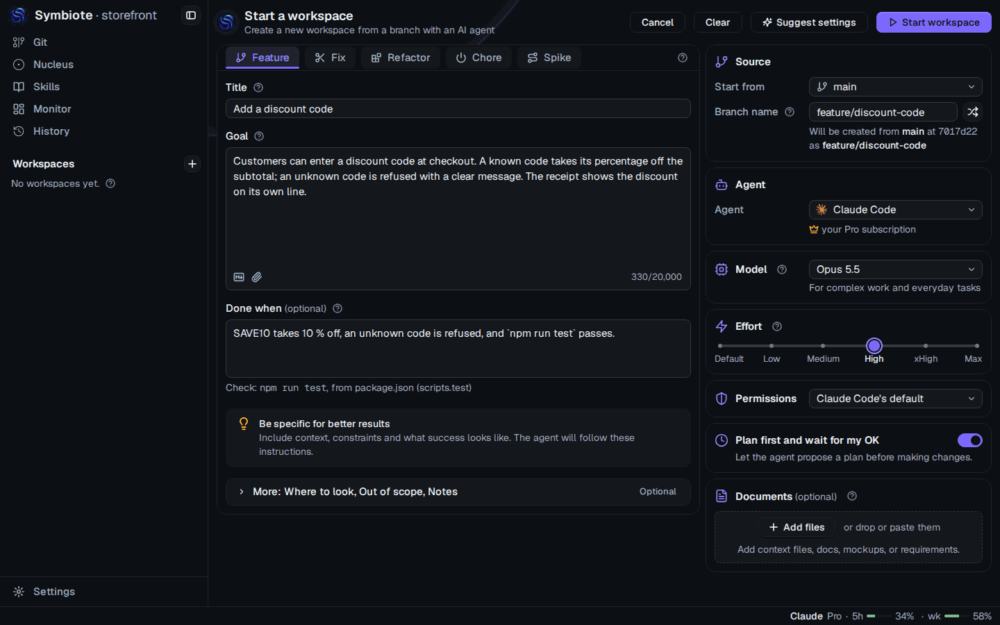

Besides the title and the main question, you can say **Done when**: how you will know it works. The
cards on the right set where the branch starts, the agent, its model and its *effort* (how long the
model thinks before it answers). **Plan first and wait for my OK** makes the agent write a plan and
stop before it changes anything. You can give the agent documents, such as screenshots or a PDF.
**Suggest settings** has a small model read your brief and propose the model, the effort and Plan
first, in a few seconds.

### See what needs you

The sidenav lists your workspaces in groups, by what each one needs from you:

| Group | What is in it |
|---|---|
| **Merging** | Merges Symbiote is making |
| **Waiting for you** | Agents stopped on you: a plan to read, a question, a permission to give |
| **To review** | Finished work: a branch to review, or an approval to merge |
| **Not running** | Agents that failed, were stopped, or have not started |
| **Working** | Agents at work, with what each one is doing right now |
| **Done** | Merged workspaces, ready to clean up. Folded under its name; click it to open |

The **Overview** (`t`), first in the sidenav, puts it on one page. Its inbox lists each workspace
that waits for you, the oldest first, with the one thing to do: **Respond** or **Answer** opens the
agent's terminal, **Review** opens the change, **Merge into** queues an approved one. Under it are
the agents at work, the merges under way and what merged into the default branch today; beside it,
your subscription's usage and today's events. Today runs from your midnight.

The window's title counts what waits for you. In Symbiote's window, the taskbar icon also gets a
violet dot, and on desktops that support it the taskbar button blinks.

### Work with the agent

Click a workspace to open it. Its head shows the workspace's *steps* on one line: **Build**,
**Review** and **Merge**, after **Plan** and **Your OK** when **Plan first** is on. The current
step is amber while the agent works and violet when it waits for you. Then come the commits and
the changed files. In Hive mode, the steps are **Write**, **Check**, **Review** and **Land**, with
the round, the time and what it spent.

Under the head, the tabs:

- The agent's own terminal, named after the agent (**Claude Code**, **Codex** or **Hermes**), with
  a violet dot when it waits for you and an amber one while it works. Answer its questions and
  permission prompts here, as you would in your own terminal. To give it an image, paste it or use
  **Attach images**.
- **Thread**: the agent's plans and reports, and your messages. When a plan waits for your OK,
  **Approve plan** types the OK into the agent's terminal and sends it. **Send reply** does the
  same with what you wrote.
- **Activity**: what the agent did, as a timeline of phases such as exploring, implementing, testing
  and debugging. Click a phase to see each command and its output. **Export** saves it as one
  Markdown file, for you or another agent to read.
- **Brief**: what the agent was asked: the *brief*, written from your answers on the Start page.

The **+** after the tabs opens a shell in the workspace's folder. A shell's tab names the program
running in it. The bar under the terminal says what the agent waits for, in its own words, and the
keys that answer it. **Split** shows the agent and a shell side by side. **Focus** keeps the
terminal alone: the sidenav as a row of icons and no side card. The side card on the right shows
what the agent does now, the files it has not committed yet, and the branch's commits and files.

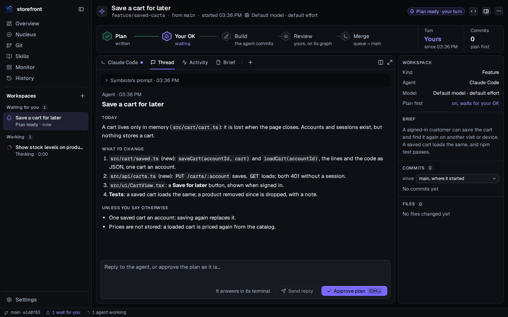

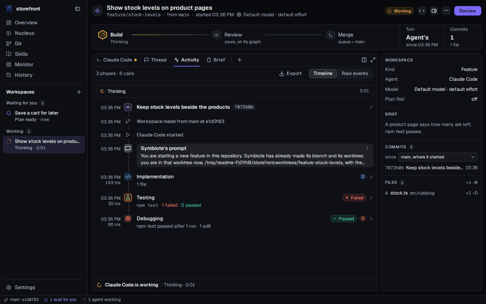

### Review the branch and tell the agent

**Review** opens the branch's change, as in [Review a change as a
graph](#review-a-change-as-a-graph). Comment on lines and symbols, then pick a verdict in the
**Review** tab and click **Finish review**. If you requested changes or commented, click **Send to
the agent**. Symbiote writes your *verdict*, the decision and your comments, to
`symbiote/reviews/<branch>/<your git email>.json`. It types the verdict and that file's path into
the agent's terminal, and you send it with Enter. The agent reads your comments from the file. If
you approved, there is nothing to send: you merge next.

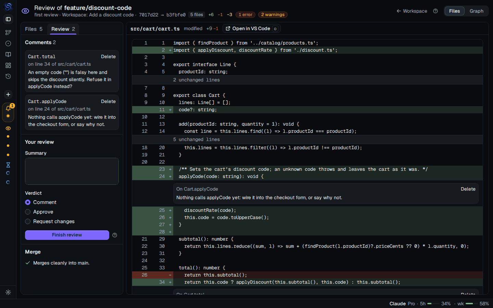

### Merge

After you approve a branch, click **Merge into**. Symbiote then:

1. merges the commit you approved, in a folder of its own, so neither your checkout nor the agent's
   is touched;
2. runs your project's *check* on the merge: the commands that test your project. They are
   `merge.checks` in `symbiote/config.json`, or a test command Symbiote finds, such as `npm test`;
3. lands the merge if the check passes: it moves the target branch to the merge commit. If that
   branch is checked out in your own checkout, your files move with it.

Merges run one at a time, in the order you asked for them: the *merge queue*. If the check fails,
nothing lands, and **Send to the agent** gives the failure to the branch's agent. If the branch
conflicts with its target, an agent called the *merger* proposes a resolution. Nothing lands until
you approve it. Symbiote pushes nothing unless you set `merge.push` in `symbiote/config.json`. (Hive
mode, below, pushes what it lands.)

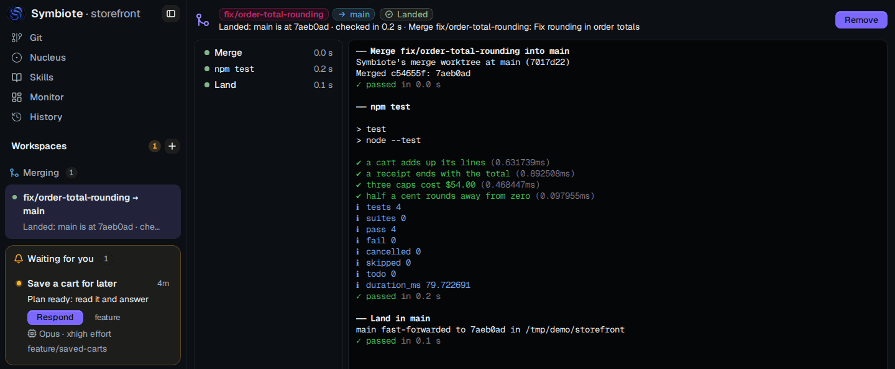

### Clean up and History

When a workspace is merged, it moves to **Done**. **Clean up** stops the agent and removes its
folder and branch. The workspace then goes to **History** (`h`), where you can still read its
activity, thread, brief and changes.

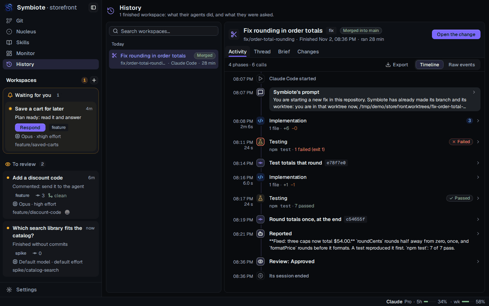

The [workspaces guide](docs/guide/workspaces.md) covers every choice on these pages: the start
page's cards, a merge commit or a fast-forward, conflicts and the merger, and what a clean-up
removes.

## Hive mode: from goal to merged on its own

In Hive mode, Symbiote drives each workspace you start from its brief to merged. No step waits for
you, unless you ask Hive to land through a pull request. Everything above this section is *normal
mode*, where you decide. You turn Hive on per repository, in **Settings**, **Hive mode**.

- **The agent works the brief.** Hive answers its plan and its questions in your place.
- **Symbiote runs your check** after each of the agent's turns, and sends the agent what fails.
- **A second agent reviews the change.** Once the check passes, a fresh Claude Code with none of the
  first agent's context runs the change in a throwaway clone of the repository. It reports only bugs
  it can prove with a failing test, and Symbiote runs each test again before the agent sees it.
- **Hive lands the work** once the check passes and the review finds nothing. It merges the
  workspace into the branch it started from, runs the check on the merge, and pushes. It can open a
  pull or merge request instead, which lands when you merge it.
- **Hive stays within limits.** It stops after 3 rounds of fixes. Your Claude subscription counts
  your use in windows of time, such as 5 hours and a week. While any window's use is at 90 % or
  more, Hive starts no agent until that window resets. It stops a workspace whose spend reaches the
  budget you set, in dollars. Turning Hive off stops its agents, checks and reviews.

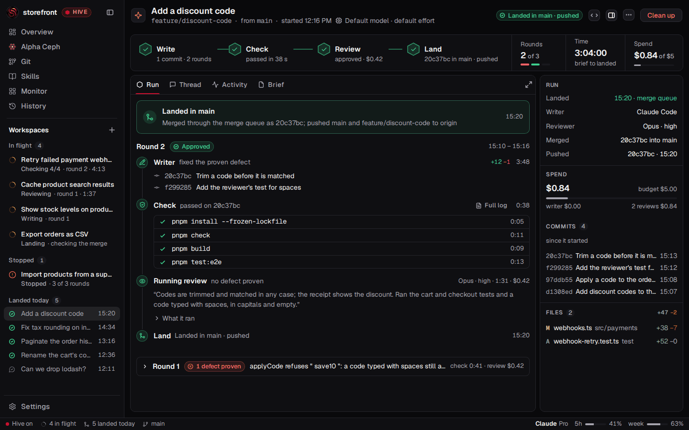

Start a project in normal mode, and turn Hive on once the repository has a check and tests you
trust: what passes them lands without you. Hive does not turn on without a check. Each workspace's
**Run** tab shows its rounds as a timeline: the writer's commits, the check's commands and their
times, the review's proven defects, and where it landed or why Hive stopped. While Hive is on, the app turns warm ink with crimson
for Hive's own marks, and
Nucleus, the agent [below](#nucleus-ask-about-your-repository), is called *Alpha Ceph*: the same
agent, told what Hive does. Hive drives Claude Code only, and its reviews run on Linux only.

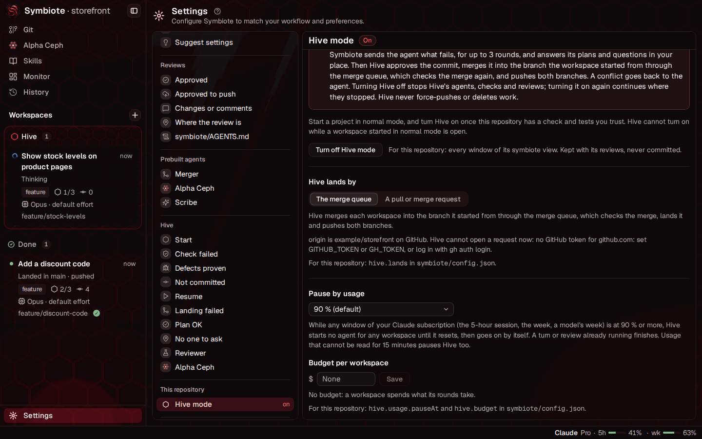

In Hive mode the **Overview** shows Hive's day: how many workspaces are in flight, landed today,
the defects its reviews proved, the median time from brief to landed, and what was spent since
midnight. A workspace Hive stopped is called out with why. Each workspace in flight shows its step,
round, time and spend; beside them, the usage at which Hive pauses, the budget and the reviewer.

The [Hive section of the configuration reference](docs/reference/configuration.md#hive-mode)
explains each step, its settings and where Hive keeps its record.

## Nucleus: ask about your repository

*Nucleus* (`a`) is an agent you talk to in a terminal on its own page. Ask it where something is
decided, why code works the way it does, or what waits for you. It reads your checkout and your
workspaces' folders, so it can answer about an agent's work before it is committed. It can search
the web and read web pages.

Nucleus can also act for you: start a workspace, answer an agent, review or merge a branch. It never
edits files. It may send a message to an agent without asking you, but a start, a verdict, a merge
or a clean-up waits until you click **Confirm** in the bar it shows. Its **Activity** tab records
what it did.

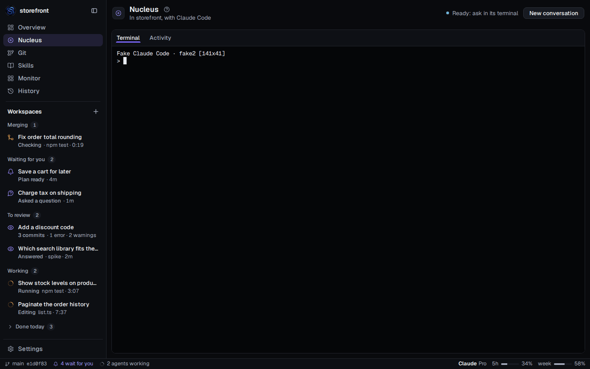

You can give the same tools to an agent of your own, such as Claude Code in your terminal: see
[Symbiote's tools for your own
agent](docs/reference/commands.md#symbiotes-tools-for-your-own-agent).

## The other pages

Each page has a key; the [commands reference](docs/reference/commands.md#keys) lists them all. The
[pages guide](docs/guide/pages.md) describes each page in full.

### Git

**Git** (`g`) draws the repository's commits and branches as a graph. Select a commit to see its
files and diffs, a file's history and blame. Stage and commit your changes, make branches and tags,
merge, rebase, cherry-pick, stash, fetch, pull and push. Symbiote never forces a push and asks
before anything that would lose changes.

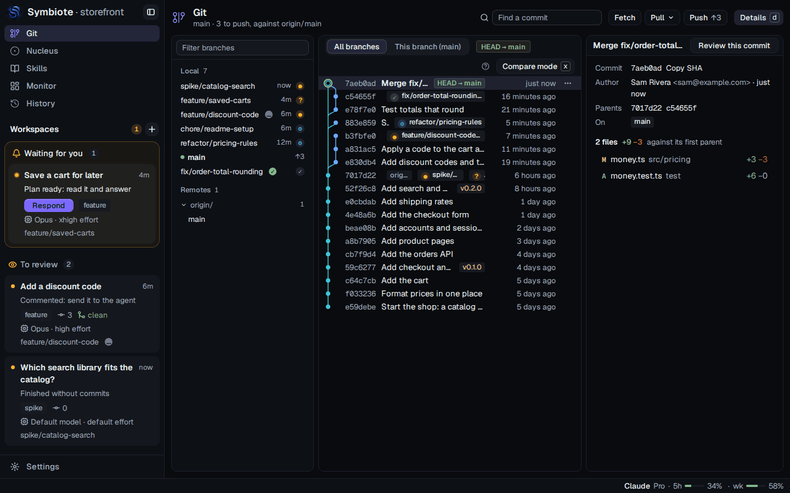

### Skills and Scribe

**Skills** (`i`) lists the instruction files agents load for a kind of task
(`.claude/skills/<name>/SKILL.md`). Read and edit them, with checks for what an agent would refuse.
*Scribe*, an agent on the same page, writes a new skill or improves one. A *skill library*, a folder
of skills outside the repository, shows on every repository's Skills page.

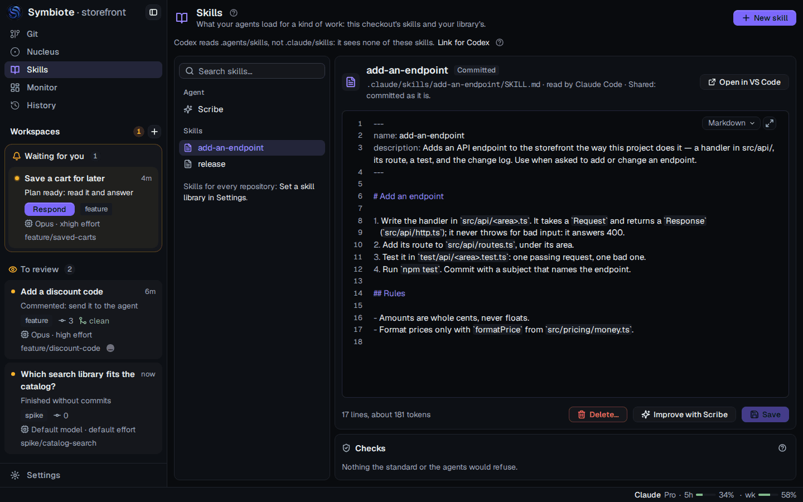

### Monitor

**Monitor** (`m`) shows where the code is: a map of every file, sized by its lines of code, with the
long files in warmer colours. Use it to spot the files that have grown too large.

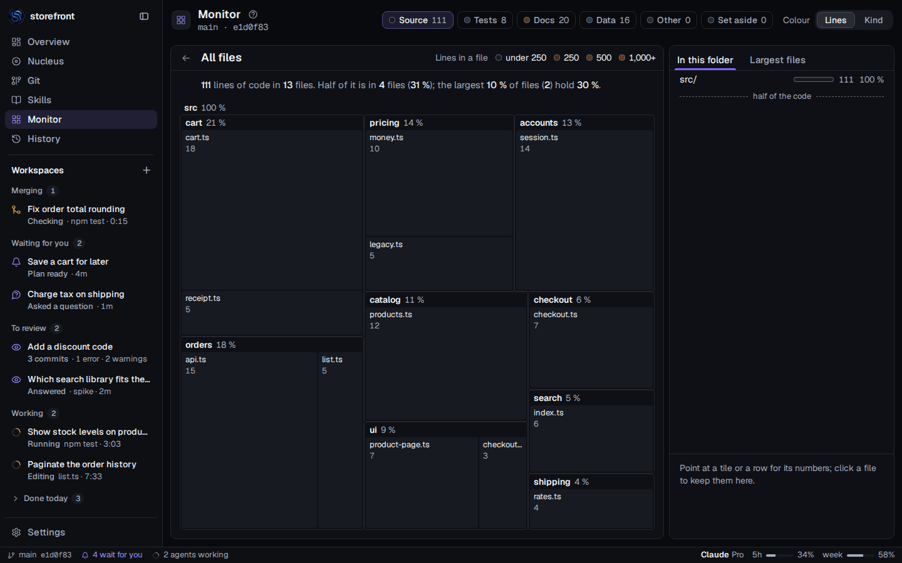

### Settings

**Settings** (`s`) holds:

- the prompts Symbiote gives each agent, which you can edit, with their placeholders;
- the model and effort of Symbiote's own agents: the merger, Nucleus and Scribe;
- Hive mode, and the skill library;
- **Appearance**: dark, light or your system's theme; the text size (Compact, Default or Large); and
  where Git shows a commit's details.

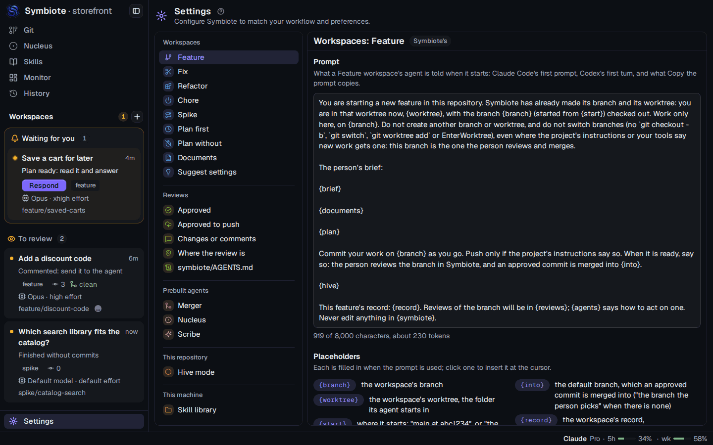

The status bar at the bottom shows how much of your Claude and Codex subscription limits you have
used.

## Several Symbiotes in one window

Each `symbiote view` serves one repository. *Symbiote nexus* shows every one running on this machine
as a tab of one window, and starts new ones in any repository on your computer:

```sh
symbiote-nexus
```

Its **Symbiotes** page shows the running ones as cards, with the repositories you pinned (with the
pin on a card), and your folders under them. Click a repository to open a Symbiote there. Closing
the nexus stops no Symbiote, so their agents keep working.

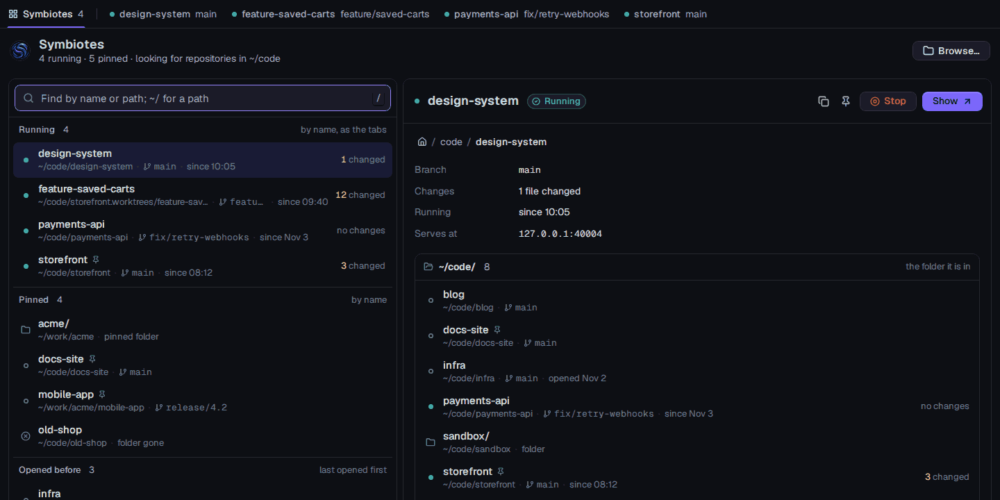

## Logs

Every Symbiote process writes its log lines to one folder, `~/.cache/symbiote/logs/` by default. To
read them in Grafana, run `pnpm logs:up` in Symbiote's folder (it needs Docker). See
[Logs](docs/reference/configuration.md#logs) in the configuration reference.

## What Symbiote writes and sends

In your repository, Symbiote keeps its files in the `symbiote/` folder:

- the workspace records, your reviews, and the agents' threads and activity;
- this repository's switches, such as Hive mode;
- Hive's record of each workspace it drives, with the tests its reviewer wrote and the output of
  each check;
- `AGENTS.md`, which tells any agent how to act on a review.

Symbiote's own `symbiote/.gitignore` keeps all of it out of git, except two files that are yours to
commit and share. `config.json` holds your settings, and `merge.md` your rules for the merger.

An agent's activity keeps each command it ran, whole up to 8 KB, and the last 2 KB of its output.
Nucleus's activity, `symbiote/nucleus-activity.jsonl`, also keeps the first 2 KB of each page it
read. Past 4 MB it moves to `nucleus-activity.1.jsonl`, replacing the one before. In Nucleus's
activity and in any exported activity, values of your environment variables named like secrets, and
tokens by their shape, are replaced with `[redacted]`.

Two more things write elsewhere in the repository. Saving a skill writes in `.claude/skills/`, which
you commit yourself. Landing a merge moves the branch you have checked out.

Outside the repository, Symbiote writes:

- the workspaces' worktrees, next to your checkout, in `../<repo>.worktrees/`;
- its cache, `~/.cache/symbiote` on Linux. It holds the worktrees Symbiote compares and merges in,
  the list of merges, drafts, pasted images and logs. It also holds the address of each running
  `symbiote view`, which the nexus reads, and the output of each Symbiote the nexus started. A
  running review's throwaway copies are there until the review ends. So is a copy of the script that
  records each agent's thread, about 23 KB for each build of Symbiote;
- its settings for this machine, `~/.config/symbiote` on Linux: the skill library's folder, the
  folders you pinned in the nexus, and whether the intro was seen;
- the skill library's skills, when you or Scribe save one. Symbiote commits and pushes the library
  only if Settings says so.

Symbiote itself sends three things over the network. The agents' own traffic, Nucleus's web searches
included, is described after them.

- **Your Claude usage** is read from `api.anthropic.com` at most every 5 minutes, with the token
  Claude Code stored. Hive reads it before it starts an agent. Codex's usage comes from Codex on
  your machine. Set `SYMBIOTE_USAGE=off` to read neither.
- **Pull and merge requests.** `symbiote pr` and the CI jobs call the GitHub or GitLab API and fetch
  the change. So does Hive when it lands through a request. It opens the request, posts Symbiote's
  review on it, and reads it once a minute until you merge or close it.
- **Pushes.** Symbiote pushes a merge only if you set `merge.push`, or when Hive lands it.

The agents talk to their own services, as they do when you run them yourself. Symbiote's fonts and
pages are served by `symbiote view` itself.

Nucleus searches the web and reads web pages when a question needs it. On Claude Code, the searches
go through Anthropic, and Claude Code fetches each page from your machine. It can reach any address
your machine can, including ones on your own network. On Codex, OpenAI runs the searches and opens
the pages. A page can hold instructions: Nucleus treats it as data, and nothing it reads can start,
approve, merge or clean up without your **Confirm**. A start does not wait for your Confirm in Hive
mode, or if you turn on **Start workspaces without a Confirm** in Settings. To turn Nucleus's web
access off, set `nucleus.web` to `false` in `symbiote/config.json`.

## Limits

- Workspaces start Claude Code, Codex or Hermes. Nucleus, Scribe and the merger run on Claude Code
  or Codex. Hive drives Claude Code only.
- The graph reads TypeScript, JavaScript, CSS and SCSS. Other files show as diffs on the **Files**
  page, where you can comment on them. Workspaces work in any git repository.
- The analysis is static: it reads the code and does not run it.
- Symbiote is tested on Linux and WSL only.

## Documentation

- [Review changes as a graph](docs/guide/review-and-ci.md): the graph, the findings, pull requests,
  CI, framework plugins.
- [Work with agents in workspaces](docs/guide/workspaces.md): starting, answering, reviewing,
  merging and cleaning up, in detail.
- [Symbiote's pages](docs/guide/pages.md): Git, Nucleus, Skills, Monitor, Settings and the nexus.
- [Commands and keys](docs/reference/commands.md): every command, option and key, and the tools for
  your own agent.
- [Configuration](docs/reference/configuration.md): `symbiote/config.json`, prompts, Hive mode,
  environment variables and logs.
- [Graph schema](docs/graph-schema.md): the graph JSON that `symbiote diff --json` prints.

## Development

`./install.sh` is all a checkout needs. To work on Symbiote itself:

```sh
pnpm install
pnpm check        # format, lint, typecheck and unit tests
pnpm build        # compile the packages and bundle the app
pnpm test:e2e     # the app's end-to-end tests, after pnpm build
```

The code is in `packages/`. The main ones are `cli`, the `symbiote` command and its server;
`viewer`, the app; `core`, the analysis; `desktop`, Symbiote's window; and `nexus`. `CLAUDE.md`
holds the working rules for agents in this repository. The [plan](docs/PLAN.md) lists every
milestone, with its design and results, and the [journal](docs/JOURNAL.md) what each change learned
and measured.
