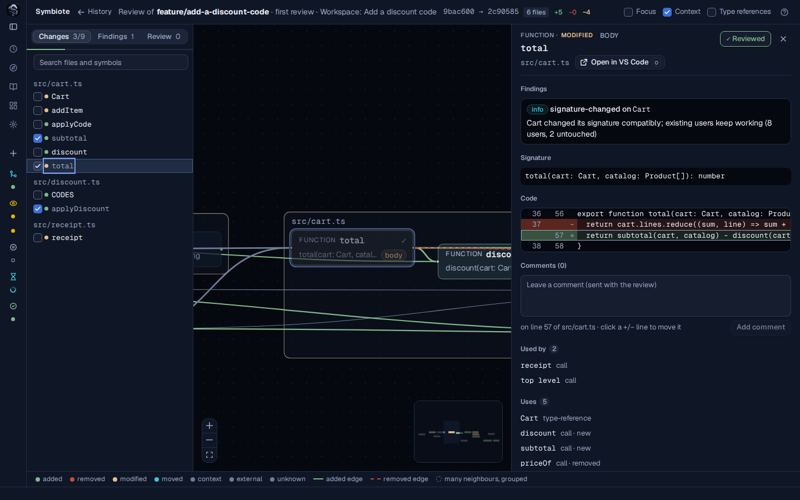

# Review changes as a graph

Symbiote shows a change as a graph of the code it touched, so you can review what changed in
behaviour before you read lines. This guide covers a change's files, reading the graph, the
findings, reviewing a branch or a pull request, and running Symbiote in CI. A workspace's
**Review** button opens the same change. The [README](../../README.md) covers workspaces and
explains the terms this guide uses.

## Open a change

Pick the way that matches what you want to review:

- **Your branch against another**: run `symbiote view main` in the repository. To print the same
  comparison in the terminal, run `symbiote diff main`.
- **Any branch**: on **Git**, select one of the branch's commits, press `r`, and pick the
  branch (a commit can be on several). Symbiote compares the branch's newest commit with the
  commit where the branch left the default branch.
- **Two commits**: on **Git**, press `x`, click two commits, then click **Compare**. The older
  commit is the base.
- **A pull request or a merge request**: run `symbiote pr <number>`. See
  [Review a pull or merge request](#review-a-pull-or-merge-request).

Symbiote compares a branch from the commit where it left the other branch, as a pull request
does. Each comparison has its own address in the app, so you can reload it or bookmark it.

A change has two pages, **Files** and **Graph**, switched at the top left or with `g`. It opens on
**Files**. A graph JSON file opened in the app without `symbiote view` opens on **Graph**: there
are no diffs to show.

## Read the files

**Files** lists every file the change touches, as a workspace's **Changes** panel does: its
status (`A` added, `M` modified, `D` deleted, `R` renamed), its name and folder, and the lines
added and removed. Files the graph has no symbols for, such as Markdown, JSON or images, are
listed too. Click a file, or press `j` and `k`, to see its diff. The diff is git's: its lines are
the ones the list counts. Unchanged lines are folded to three around each change; click a fold to
open it. To open the file in VS Code at its first change, press `o`. To open one line, Ctrl+click
it.

In a review, click a line to write a comment under it, and press Ctrl+Enter to add it. A comment
on a line inside a function, a class or another symbol is about that symbol: the **Graph** page
shows it in the symbol's detail panel. A comment on a line no symbol holds, such as a line of a
Markdown file, is about that line only.

## Read the graph



The graph draws a box for each changed file. In each box are the *symbols* that changed:
functions, classes, methods, types, and for stylesheets, rules and variables. Colours say what
changed:

| Colour | Meaning |
|---|---|
| Green | Added |
| Red | Removed |
| Amber | Modified |
| Cyan | Moved |
| Grey | Not changed, but uses a changed symbol or is used by one |

A legend under the graph repeats these colours.

Lines between symbols are calls and other uses. A dashed red line is a use that the change
removed. A symbol's chips say what changed in it, such as `signature` or `body`. Its badge counts
its findings.

Click a symbol, or press `j` and `k` to walk the change list. The detail panel opens beside the
graph with the symbol's findings, its old and new signature, a diff of only that symbol, and the
symbols that use it and that it uses. To open the symbol in VS Code, press `o`. To open one line,
Ctrl+click it.

Large changes stay readable in three ways:

- If more than 8 unchanged symbols use a changed symbol, or are used by it, they are drawn as one
  box, such as "390 users in 220 files". Click the box to open it.
- Zoomed out, the graph becomes a map of file names. Click a name to zoom in.
- The change list has a search (`/`). It keeps the symbols whose path and name hold every word you
  type.

In a monorepo, if the change spans several apps or libraries, each one is drawn as a frame
around its files. Press `p` and `P` to show one project at a time, with everything it links to.
Symbiote finds the projects from your workspace's packages (npm, Yarn, pnpm), from
Nx, and from `angular.json` with the Angular plugin. If a repository declares none, each package
and each folder with its own `tsconfig.json` is a project.

## Findings

A *finding* is a change that Symbiote thinks is risky. Each one links to its symbol and to the
symbols involved. Symbiote prefers to miss a finding rather than report a wrong one.

| Finding | What it means | What to do |
|---|---|---|
| `removed-still-referenced` | A removed symbol is still used by code in the change's head. | Update or remove the code that still uses it, or keep the symbol. |
| `orphan-added` | Nothing uses a new symbol. | Check that the code that should call it does, or remove it. |
| `signature-changed` | A symbol's signature changed, such as its parameters or its return type, and other code uses it. | Check its users, above all those the change did not update. |
| `exported-api-changed` | A published package's exported symbol was removed, is no longer exported, or its signature breaks. | Treat it as a breaking change for the package's users. |

Each finding is an error, a warning or info:

- `removed-still-referenced` is an error, except in two cases where it is a warning: only untyped
  code (JavaScript or `any`) still uses the symbol, or the symbol is a CSS class, a custom
  property or keyframes.
- `orphan-added` is a warning. It is info if the package's entry point exports the symbol, or if
  it is a default export.
- `signature-changed` is a warning if the change may break code that uses the symbol and that the
  change did not update, in another file that is not a test. Otherwise it is info.
- `exported-api-changed` is a warning.

Symbiote tells tests apart from product code by their path: `*.test.*`, `*.spec.*`, and files
under `test/`, `tests/`, `e2e/`, `__tests__/` or `__mocks__/`.

## Review a branch

To review a branch, open it with **Review** on its workspace, or with `r` on **Git**. A
workspace's review starts where the workspace started, or at the branch picked in its **Changes**
panel; any other branch's, where it leaves the default branch. Then:

1. On **Files**, read each file's diff. Click a line to comment on it: any line shown, changed or
   not.
2. On **Graph**, select each symbol and read it. Press `r` to mark it reviewed. A bar under the
   tabs shows how much you have reviewed. To comment on a symbol, select it and press `c`. To put
   the comment on one line, click an added or removed line in the symbol's diff.
3. Open the **Review** tab, on either page. Pick **Approve**, **Request changes** or
   **Comment**, write a summary if you like, and click **Finish review**.

Symbiote writes the review to `symbiote/reviews/<branch>/<your git email>.json`, in the
repository. Symbiote's `symbiote/.gitignore` keeps reviews out of git. To commit and share them,
edit `symbiote/.gitignore` or delete it. Symbiote leaves a `.gitignore` you changed as it is. To
give a review to an agent that has no workspace, click **Copy for the agent** and paste the text
into its chat.
`symbiote/AGENTS.md` tells any agent how to act on a review.

On **Git**, each branch you reviewed carries a badge: `✓` approved, `✗` changes requested,
`+2` for two commits added since your review. If you review the branch again after new commits,
only what is new or changed since is left to look at. Your marks stay on the symbols that did
not change.

You can also review the default branch. Symbiote then shows its commits that are not pushed yet.
An approval there writes, for whichever agent reads the review, that the commits may be pushed.
Symbiote does not push them itself.

## Review a pull or merge request

`symbiote pr 123` works with GitHub, GitHub Enterprise, gitlab.com and self-managed GitLab. It
reads the forge (GitHub or GitLab) from the `origin` remote, fetches the change's head and target
branch, and shows the same diff the forge shows.

It needs a token:

- GitHub: `GITHUB_TOKEN` or `GH_TOKEN`. If neither is set, Symbiote asks `gh auth token`.
- GitLab: `GITLAB_TOKEN`.

A token from the environment goes only to the forge it is for: github.com or gitlab.com, the
server a CI job runs on, or the API address you set. The remote names the host, and a host such as
`github.com.example.net` must not get your github.com token. For GitHub Enterprise, set
`GITHUB_API_URL` (`https://<host>/api/v3`) with `GITHUB_TOKEN`, or `GH_HOST` with
`GH_ENTERPRISE_TOKEN`, or log in with `gh auth login --hostname <host>`. For self-managed GitLab,
set `GITLAB_API_URL` or `GITLAB_HOST` with `GITLAB_TOKEN`.

Comment on symbols and lines as in a branch review. On **Files**, only added and removed lines
take a comment: GitHub and GitLab accept comments inside their own diff's hunks only. In the
**Review** tab, pick **Comment**,
**Approve** or **Request changes**, and click **Submit review to GitHub** (or GitLab). Your
comments arrive on the pull request as one review, each on its line.

Your marks and draft comments are kept for each pull request. After a push, run `symbiote pr`
again. Symbols you reviewed that did not change stay reviewed, those that changed are marked
`↻`, and drafts follow their code to its new lines.

To see what a push changed, give the commit the pull request was at when you last reviewed it.
The forge's list of pushes shows it:

```sh
symbiote pr 123 --since 3c2b1a0   # each changed symbol: new, updated, or the same as in 3c2b1a0
```

Symbiote dims the symbols that changed the same way as in that commit. After a rebase that
changed nothing, every symbol is dimmed.

## Run in CI

In CI, `symbiote pr --post-findings <level>` posts the findings on the lines they are about,
instead of opening the app. It does not post a finding that an earlier run already posted. Inside
a pull or merge request job, `symbiote pr` finds the number itself:

```sh
symbiote pr --post-findings warning --fail-on error
```

### GitHub Action

Add this workflow to your repository as `.github/workflows/symbiote.yml`:

```yaml
on: pull_request
permissions: { contents: read, pull-requests: write }
jobs:
  symbiote:
    runs-on: ubuntu-latest
    steps:
      - uses: actions/checkout@v7
        with: { fetch-depth: 0 }
      - uses: attomius321/Symbiote@main
        with:
          post-findings: warning   # empty: don't post
          fail-on: error           # empty: never fail
```

| Input | Default | What it does |
|---|---|---|
| `post-findings` | `warning` | Posts new findings at or above this level. Empty: posts nothing. |
| `fail-on` | `error` | Fails the job on a finding at or above this level. Empty: never fails. |
| `plugins` | none | Framework plugins, separated by commas, besides those in `symbiote/config.json`. |
| `project`, `depth` | | The same as `--project` and `--depth`. |
| `token` | `github.token` | Reads the pull request and posts comments. It needs `pull-requests: write`. |
| `pull-request` | the event's | The pull request's number. |
| `working-directory` | `.` | Where the repository is checked out. |
| `setup-node` | `true` | Installs Node 22 first. Set it to `false` if the job already has Node 22.12 or newer. |

`fetch-depth: 0` fetches the whole history, which Symbiote needs to find where the pull request
left its target branch. With the default `fail-on: error`, warnings such as
`exported-api-changed` are posted but do not fail the job.

The action writes the summary to the run's page. Its output `graph` is the path of the graph
JSON, which you can upload as an artifact. A pull request from a fork gets a read-only token, so
review it without posting: set `post-findings` to an empty string for such pull requests.
Symbiote's own [workflow](../../.github/workflows/symbiote.yml) does that.

### GitLab CI

Add this to your `.gitlab-ci.yml`:

```yaml
include:
  - remote: https://raw.githubusercontent.com/attomius321/Symbiote/main/ci/gitlab/symbiote.yml
```

Its `symbiote` job runs on merge request pipelines. Without a token, the findings appear in the
merge request's Code Quality widget. To also get them as comments on their lines, add a masked
`GITLAB_TOKEN` variable with the `api` scope.

To change the job, override these variables in your own `symbiote:` job:

| Variable | Default | What it does |
|---|---|---|
| `SYMBIOTE_POST_FINDINGS` | `warning` | Posts new findings at or above this level. It needs `GITLAB_TOKEN`. Empty: posts nothing. |
| `SYMBIOTE_FAIL_ON` | `error` | Fails the job on a finding at or above this level. Empty: never fails. |
| `SYMBIOTE_PLUGINS` | none | Framework plugins, separated by commas, besides those in `symbiote/config.json`. |
| `SYMBIOTE_VERSION` | `main` | The branch or tag of Symbiote to run. |

## Framework plugins

Some frameworks call code in ways plain TypeScript cannot see: a template that calls a
component's method, or a route function the framework calls by its name. A *plugin* teaches
Symbiote one framework:

```sh
symbiote diff main --plugin angular           # Angular templates, decorators, lifecycle hooks
symbiote diff main --plugin qwik              # Qwik routes, component$ props, MDX routes
symbiote diff main --plugin ./tools/my-plugin.mjs
```

To use a plugin on every run in a repository, add it to `symbiote/config.json`:
`{ "plugins": ["angular"] }`. In CI, use the action's `plugins` input or GitLab's
`SYMBIOTE_PLUGINS`. If a plugin fails, Symbiote skips it, says so in a warning, and goes on. The
warning is not a finding, so `--fail-on` does not count it.

With `angular`, Symbiote reads templates as code:

- A method removed while its template still calls it is an error at the template's line.
- A method used only by a template, a lifecycle hook or a host listener gets no `orphan-added`.
- A component removed while a template still places it, an input renamed while still bound, or
  an output removed while still listened to is reported.
- With dependencies installed, templates also see Angular's and its libraries' components,
  directives and pipes. In CI, install dependencies before Symbiote runs.

With `qwik`, Symbiote reads Qwik 1 and 2 by Qwik's own file rules:

- What Qwik's router calls by name, such as `onGet`, `head`, `routeLoader$` and `routeAction$`,
  gets no `orphan-added`.
- A `component$`'s props are its signature. A required prop added or removed is a warning that
  names the JSX that was not updated.
- `.mdx` routes are read as templates: a component removed while a page still renders it is an
  error at that line.

To write your own plugin, implement the `TsPlugin` interface that `@symbiote/core` exports. The
[plugins plan](../plan/x1-plugins.md) describes its hooks, and
[`tpl-plugin.ts`](../../packages/core/test/helpers/tpl-plugin.ts) is a complete example.

## Stylesheets

Symbiote reads `.css` and `.scss` files as code. A reformat is not a change.

- **Symbols**: a rule (by its selector), a custom property, `@keyframes`, and SCSS's `$variables`,
  `@mixin`s, `@function`s and `%placeholders`.
- **Uses between stylesheets**: `var(--accent)` uses each definition of `--accent`, and an
  `animation` uses its keyframes. SCSS names resolve as Sass resolves them.
- **Uses from markup**: a static class name in JSX (`className`), a `classList` call or a CSS
  module's `styles.title` uses the rules that style it. So a rule's users include the components
  it affects. The Angular and Qwik plugins add their templates' classes and scoped styles.

Symbiote does not read Less, indented Sass, CSS-in-JS or `<style>` blocks. Tailwind utility
classes link to nothing.

## What Symbiote reads

Symbiote reads TypeScript and JavaScript (`.ts .tsx .js .jsx .mts .cts .mjs .cjs`), CSS and SCSS.
The analysis is static: it reads the code and does not run it. To leave folders out, use a
[`.symbioteignore`](../reference/configuration.md#files-symbiote-skips-symbioteignore) file.
