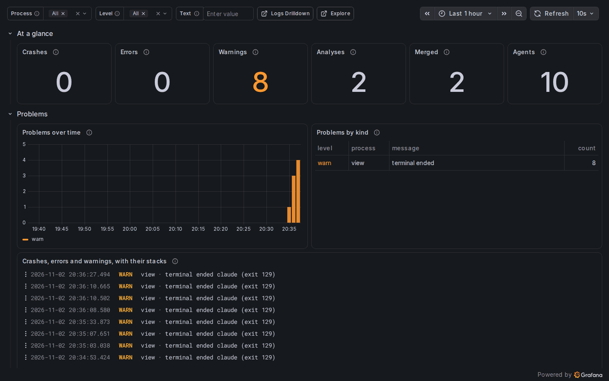

# Configuration

This page lists every setting Symbiote reads: the project's settings file, the text Symbiote
gives its agents, the files it skips, and its environment variables. All of them are optional.
To install Symbiote, see the [README](../../README.md). It also explains the terms this page
uses: workspace, merger, verdict, Nucleus, Scribe and the others.

## The settings file, `symbiote/config.json`

A project's settings are in `symbiote/config.json`, at the root of the repository. Symbiote reads
the file in the checkout where `symbiote view` runs. Commit it to share the settings with everyone
who runs Symbiote there. **Settings** in the app writes `prompts` and the model and effort keys of
the merger, Nucleus and Scribe, and leaves the rest of the file as it is.

```jsonc
{
  "plugins": ["angular"],
  "workspaces": { "branchPrefixes": { "fix": "bugfix/" }, "worktrees": "../{repo}.worktrees" },
  "agent": { "kind": "claude", "permissionMode": "default", "model": "opus" },
  "merge": { "checks": ["pnpm install --frozen-lockfile", "pnpm check"], "push": false }
}
```

| Key | Default | What it does |
|---|---|---|
| `plugins` | none | Framework plugins every analysis uses, by name or path. |
| `workspaces.branchPrefixes` | `feature/`, `fix/`, `refactor/`, `chore/`, `spike/` | The start of a new workspace's branch name, for each kind of work. Give only the kinds you change. |
| `workspaces.worktrees` | `../{repo}.worktrees` | Where workspaces' worktrees go, relative to the checkout. `{repo}` is the checkout's folder name. |
| `agent.kind` | `claude` | The agent offered first, if it is installed: `claude`, `codex` or `hermes`. Nucleus, Scribe and the merger skip `hermes`. |
| `agent.permissionMode` | `default` | The permission mode offered first for Claude Code: `default`, `acceptEdits` or `auto`. |
| `agent.model` | Claude Code's own | The model Claude Code starts on. Codex uses its own configuration's model. |
| `nucleus.model`, `scribe.model` | `agent.model`, else the agent's own | The model each Nucleus or Scribe conversation starts on, if the agent offers it. |
| `nucleus.effort`, `scribe.effort` | the agent's own | The effort level each Nucleus or Scribe conversation starts at, if the agent offers it. |
| `nucleus.web` | `true` | Whether Nucleus searches the web and reads web pages. With `false`, its next conversation has neither; a running one keeps what it started with. See [What Symbiote writes and sends](../../README.md#what-symbiote-writes-and-sends). |
| `advisor.claude.model`, `advisor.codex.model` | `haiku` for Claude Code, `gpt-6-luna` for Codex | The model that suggests a workspace's settings when you press **Suggest settings** with that agent picked, if the agent offers it. |
| `advisor.claude.effort`, `advisor.codex.effort` | `low` | The effort level that model runs at, if it takes that level. |
| `merge.checks` | a command Symbiote finds | The check a merge runs before it lands, and [Hive](#hive-mode) on every commit: one command, or a list run in order. Put an install first if the check needs dependencies. Set it in Settings' **Checks** page. |
| `merge.push` | `false` | If `true`, Symbiote pushes the target branch after a merge lands: to its upstream, else to `origin`. A merge [Hive](#hive-mode) lands is pushed whatever this says. |
| `merge.strategy` | `merge` | How a merge lands unless you pick otherwise: `merge` (a merge commit) or `fast-forward` (the target moves to the approved commit, no new commit, when the target has no commits the branch lacks). |
| `merge.agent` | `agent.kind`, else Claude Code, else Codex | The agent that resolves conflicts: `claude` or `codex`. |
| `merge.model` | `sonnet` for Claude Code, else the agent's own | The model the merger runs on. |
| `merge.effort` | the agent's own | The effort level the merger runs at, if its model takes one. |
| `hive.lands` | `queue` | How [Hive](#hive-mode) lands a workspace: `queue`, through the merge queue into the branch it started from; or `request`, through a pull request (GitHub) or merge request (GitLab) that you merge. See [Landing through a pull or merge request](#landing-through-a-pull-or-merge-request). Set it in Settings' **Hive mode** page. |
| `hive.usage.pauseAt` | `90` | A whole percent from 1 to 100: while any window of your Claude subscription is at it or above, [Hive](#hive-mode) starts no agent until that window resets. `false`: Hive does not pause by usage. See [Pacing: usage and budget](#pacing-usage-and-budget). Set it in Settings' **Hive mode** page. |
| `hive.budget` | none | Dollars a workspace Hive drives may spend, by Claude Code's own count: its agent's sessions and its running reviews. Reached, Hive stops the workspace. See [Pacing: usage and budget](#pacing-usage-and-budget). |
| `hive.reviewer.model` | `opus` | The model [Hive's running reviewer](#the-running-reviewer) is asked on. Set it in Settings' **Hive mode** page, under **Running reviewer**. |
| `hive.reviewer.effort` | `high` | The effort level the running reviewer is asked at, if its model takes it. |
| `prompts` | Symbiote's text | The text Symbiote gives its agents. See [Prompts](#prompts). |

To pick a model or an effort level from the agent's own list, use **Settings** rather than
editing the file.

If there is no `merge.checks`, Symbiote looks for a check in the target branch's files. It tries
these in order:

- a `check` or `test` script in `package.json`, run after the package manager's install;
- a `check` or `test` target in a Makefile;
- `scripts/test.sh`, `cargo test`, `go test ./...` or `pytest`.

The **Start a workspace** page and Settings' **Checks** page name the check it found.

## Rules for the merger, `symbiote/merge.md`

If `symbiote/merge.md` exists, Symbiote adds it to the merger's prompt for every conflict. Write
your project's rules for resolving conflicts there, such as "keep both entries of a changelog".
Commit it to share it.

A file that every branch only adds lines to the end of, such as a changelog, need not reach the
merger at all. One line in the repository's `.gitattributes`, `CHANGELOG.md merge=union`, makes
git keep both sides' new lines, the target's first. Use it only where the order of the added
lines does not matter.

## Prompts

**Settings** (`s`) shows every text Symbiote gives its agents, grouped by agent. You can change
each one, insert its placeholders with a click, and reset it to Symbiote's text. Symbiote saves
your changes under `prompts` in `symbiote/config.json`, and keeps only the prompts you changed. A
change applies to the next agent that starts.

A prompt is a string, or a list of lines. Symbiote fills in each `{name}` that the prompt allows,
and leaves any other brace as text:

```json
{
  "prompts": {
    "start": {
      "spike": [
        "You are starting a new spike on the branch {branch}, started from {start}.",
        "",
        "{brief}",
        "",
        "Commit what you try under spikes/, and push the branch."
      ]
    }
  }
}
```

| Key | What it is | Placeholders |
|---|---|---|
| `start.feature`, `start.fix`, `start.refactor`, `start.chore`, `start.spike` | A workspace agent's first prompt, for that kind of work | `{brief}` (required), `{branch}`, `{worktree}`, `{start}`, `{plan}`, `{documents}`, `{into}`, `{record}`, `{reviews}`, `{agents}`, `{symbiote}`, `{hive}` |
| `plan.first`, `plan.direct` | What `{plan}` becomes, with **Plan first** on and off | none |
| `documents` | What `{documents}` becomes when you gave files with the brief | `{folder}` (required), `{files}` |
| `advisor` | The instructions for the model behind **Suggest settings**: how it sizes a brief, and which of the agent's models is small, mid or large. Edit the guide here when your agent lists new models | `{models}` (required), `{agent}` |
| `verdict.approve`, `verdict.push`, `verdict.address`, `verdict.where` | The lines of a verdict sent to a branch's agent | `{branch}`, `{at}`, `{into}`, `{reviewer}`, `{what}`, `{review}`, `{agents}` |
| `reviews` | The text of `symbiote/AGENTS.md`, which tells agents how to act on a review | none |
| `merger` | The merger's instructions | none |
| `merge.failed` | What **Send to the agent** types into the branch's workspace when a merge's check failed: the command, its last lines, and what the agent is asked | `{output}` (required), `{command}`, `{branch}`, `{at}`, `{into}` |
| `nucleus` | Nucleus's instructions, its system prompt. While Hive is on, a text without `{name}` gets a line at its end that tells Nucleus its name | `{name}`: Nucleus, or Alpha Ceph while [Hive](#hive-mode) is on |
| `scribe` | Scribe's instructions, its system prompt. A `{request}` left from an older text is filled with nothing | `{skills}`, `{checkout}`, `{library}` |
| `library` | What `{library}` becomes in Scribe's prompt when a [skill library](#the-skill-library) is set. Without a library, the line that holds `{library}` is left out | `{folder}` (required), `{skills}` |
| `hive.start` | What `{hive}` becomes in the first prompt of a workspace [Hive](#hive-mode) drives. Without Hive, the line that holds `{hive}` is left out; a start prompt without `{hive}` gets it at its end | `{check}`, `{rounds}` |
| `hive.check` | What Hive sends the agent when the check fails | `{output}` (required), `{command}`, `{branch}`, `{at}`, `{round}`, `{rounds}` |
| `hive.review` | What Hive sends the agent when the [running reviewer](#the-running-reviewer) proved defects: each defect, its test's command and files, and the last lines of Symbiote's rerun | `{findings}` (required), `{count}`, `{branch}`, `{at}`, `{round}`, `{rounds}`, `{folder}` |
| `hive.commit` | What Hive sends the agent when it ended a turn with files not committed, or no commit | `{what}`, `{branch}` |
| `hive.resume` | What Hive sends an agent it stopped, once Hive is on again | none |
| `hive.land` | What Hive sends the agent when a landing failed: a conflict with the branch it lands in, the check failing on the merge, or that branch moved past a fast-forward | `{why}` (required), `{branch}`, `{at}`, `{into}`, `{merge}`, `{merges}` |
| `hive.plan` | Hive's OK to a plan the agent wrote first, in place of yours | none |
| `hive.decide` | What Hive sends an agent that asks you a question or for a permission: no one answers in Hive mode, so it decides | none |
| `hive.reviewer` | The running reviewer's instructions, its system prompt. Symbiote adds the answer it reads after them, which you cannot change. In Settings it is the **Reviewer** page; its model and effort are on the **Hive mode** page | none |
| `hive.nucleus` | What Alpha Ceph is told of Hive: added at the end of its instructions while Hive is on, for each conversation that starts as Alpha Ceph | `{rounds}` |

Settings lists Hive's prompts, in a group of their own, only while Hive is on. Settings lists what
each placeholder stands for. Symbiote ignores a prompt it cannot use, uses its
own text instead, and marks the prompt "not used" in Settings. A prompt cannot be used in three
cases:

- It is neither text nor a list of lines.
- It lacks a required placeholder.
- It is too long. The limits are 8,000 characters for a start prompt, for Nucleus's and Scribe's
  and for `hive.nucleus`; 1,000 for `plan.*`, `documents`, `verdict.*` and the other `hive.*`; and
  20,000 for `reviews`, `merger` and `hive.reviewer`.

Prompts cannot widen what Symbiote's helpers may do. Whatever its prompt says, Nucleus cannot edit
files or run any command but git's read commands, and its starts, verdicts, merges and clean-ups
still wait for your **Confirm**. Scribe writes only in `.claude/skills/` and the skill library.

What Nucleus reads is fixed the same way. On this machine, Nucleus reads the checkout and the
worktree of each open workspace, and nothing else. A workspace is open until it is cleaned up. In a
worktree, Nucleus runs git's read commands with `-C <worktree>`. There it sees uncommitted work
with `git --no-optional-locks status` and `git diff-index -p HEAD`. It cannot run `git diff`
there, because `git diff` rewrites the worktree's index while the workspace's agent uses it.

With Claude Code, a workspace started during a conversation is readable at once. With Codex, it
is readable from the next conversation: Codex fixes the folders a conversation reads when it
starts it. Symbiote gives Codex those folders again with every message and before Nucleus's
terminal opens, and refuses to go on if Codex does not answer that the conversation is read-only.
Continue Nucleus's Codex conversation from Symbiote only: resumed elsewhere, for example with
`codex resume` in a folder Codex trusts, Codex drops those folders and the conversation can
write.

## The skill library

The skill library is one folder of skills kept outside the repository: each skill is a folder
with its `SKILL.md`, as in `.claude/skills/`. It can be a plain folder, or a folder in a git
repository, such as the `skills/` folder of a repository you share. Set it in **Settings**, under
**This machine**, **Skill library**. Every repository you open on this machine shows the same
library on its Skills page, and Scribe can write there too.

Symbiote keeps this setting in its own settings folder, not in the project: `library.json` in
`~/.config/symbiote` on Linux (`$XDG_CONFIG_HOME/symbiote` when set), `~/Library/Application
Support/symbiote` on macOS and `%APPDATA%\symbiote` on Windows.

```json
{ "folder": "/home/you/projects/skillbar/skills", "commits": "push" }
```

| Key | What it does |
|---|---|
| `folder` | The library's folder, a full path. With **Clone a repository**, Symbiote clones the repository into the folder you give, and the library is its `skills/` folder when it has one. |
| `commits` | Who commits the library's changes: `none` (the default) leaves git to you; `commit` lets the Skills page commit them, with your message; `push` commits, then pushes, and lets the page pull, fast-forward only. |

A commit takes only the library's folder: anything else you staged in that repository stays
staged. A push goes to the branch's upstream, else to `origin`. Symbiote never forces a push,
switches a branch or rebases. A clone, a push or a pull never waits for a password: it fails
after two minutes, or at once if git would ask for one.

No agent reads the library from its folder: it is where you keep and write skills.

## Hive mode

In Hive mode, Symbiote drives the workspaces you start from their brief to landed, with no step
that waits for you: their agent works the brief, Symbiote runs the project's check after each of
its turns, a reviewer runs the change and proves defects with failing tests, Symbiote sends the
agent what fails, then Hive lands the workspace in the branch it started from and pushes it. Its
switch is in **Settings**, under **This repository**, **Hive mode**, and turning it on asks first.

**When to use it.** Start a project in normal mode. Turn Hive on once the repository has a check
(`merge.checks`) and tests you trust: what passes them lands on your branch and is pushed without
you. The choice stays yours, per repository.

**Turning it on** asks first. The question says what Hive will do, then what it checks before it
starts: a check is set (`merge.checks`, or one Symbiote finds in the repository), no workspace
started in normal mode is open, the limits (the usage pause, the budget, 3 rounds), and that its
agents get full access to this machine. **Turn on Hive** stays off while no check is set or a
workspace in normal mode is open, and the question names those workspaces: land or clean them up
first. **Turning it off** asks first while Hive works
on a workspace (writes, checks, reviews or lands), and says what happens to each. With nothing in
flight it turns off at once. While Hive is on, every page is in warm neutral ink, in both themes,
and crimson marks what is Hive's: the S, the **Hive** pill by the project's name, the picked tab, its one main button
a page. States keep their colours in both modes: amber for work in progress, green for passed or
landed, red for failed or stopped.

While Hive is on, Nucleus is called **Alpha Ceph**, on every page and in its own words, and its icon
is the Hive Mind. Alpha Ceph's instructions end with what Hive does with the workspaces it starts
(`hive.nucleus`). It starts them without your **Confirm** (see
[Starting workspaces without a Confirm](#starting-workspaces-without-a-confirm)). Its records and files keep the name `nucleus`. Turning Hive on or off ends the
conversation and starts the next under the new name, unless it is answering or waiting on you: then
it keeps its name, and its page says so until **New conversation**.

The question shows traces that route into a Hive Mind and keep moving while it is open. Turning Hive
on takes 1.4 seconds: the question's four steps light up, the question folds into its Mind, Hive's
look opens from the Mind in a growing circle behind a crimson ring, and the **Hive** pill lights.
Once all is still, Nucleus becomes Alpha Ceph in the sidenav: its ring breaks into the Mind's cells and its
name changes over, in about a second. A reload or another window with Hive already on shows Alpha
Ceph at once. If your system asks for reduced motion, the question shows one still picture and the
look and Alpha Ceph appear at once.

### What Hive does with a workspace

Every workspace you start while Hive is on is Hive's, until it is cleaned up. Hive drives Claude
Code only, in Claude Code's `auto` permission mode: with Hive on, **Start a workspace** offers no
other agent, no permission choice and no **Plan first**, and Nucleus's starts are Hive's too.

1. **Its agent works the brief.** Its first prompt has one more paragraph, `{hive}`: Hive drives
   the workspace, which check Symbiote runs, that no person answers, and that the agent commits
   before it ends a turn. A plan the agent writes first gets Hive's OK (`hive.plan`). A question,
   or a permission it asks for, gets "no one answers in Hive mode: decide yourself"
   (`hive.decide`); after 3 such answers, Hive stops, and a message you send the agent then
   counts them again. An agent that failed or never started is started again once.
2. **Symbiote runs the check** when the agent ends a turn with commits and nothing left
   uncommitted. The check is `merge.checks`, else the one Symbiote finds (see
   [the settings file](#the-settings-file-symbioteconfigjson)). It runs in the workspace's
   worktree, on the branch's last commit. If the agent left files uncommitted, or made no commit,
   Symbiote asks it to commit instead. A spike that ends without commits is answered: its report
   is the answer, and there is nothing to land.
3. **A failed check goes back to the agent**: the command and its last 60 lines. That is the next
   round.
4. **A passed check is reviewed** by the [running reviewer](#the-running-reviewer), on the same
   commit. Defects it proves go back to the agent as failing tests: the agent adds each test and
   makes it pass, or says in one line why a test is wrong. That is the next round too.
5. **After 3 rounds**, Hive stops and the card says why.
6. **A check that passed and a review that found nothing land it.** Hive approves that commit in
   your review file, marked as Hive's (`"via": "hive"`, shown as **Approved by Hive**), and queues
   it in the merge queue, into the branch the workspace started from. The queue brings that
   branch up to its remote first (a fetch, and a fast-forward when it is behind), merges, runs the
   check on the merge, lands it, and pushes it, whatever `merge.push` says. The workspace moves to
   **Landed today**, with the time it landed.

A review that cannot run (no sandbox, or the reviewer failed twice) lands on the check alone; no
check set or found lands on the review alone; with neither, it lands all the same. The approval
says what ran.

**A landing that fails goes back to the agent** (`hive.land`): a conflict with the branch it lands
in (no merger agent for Hive's merges), the check failing on the merge, or a fast-forward that
branch moved past. Hive takes its merge out of the queue, so other merges go on, and asks the
agent to merge that branch into its own and fix it, or to say why its branch does not cause it
(a flaky test, say): then the same commit lands again, with only the merge's check run again. The
rounds start again. After 2 such merges, a third failure stops the workspace, with why. A branch
that has diverged from its remote stops it at once: Hive never forces or rebases.

**Your checkout.** Where the branch it lands in is checked out (your main checkout, usually),
landing fast-forwards it there, as **Merge into** does. If your uncommitted changes are in the way,
git refuses; Hive tries again each minute, and the card says **Landing in main: waiting for your
checkout**.

**Its branch is pushed** to `origin` after each turn that ends with commits, never forced. A push
refused is in the **Run** tab, and Hive goes on.

#### Landing through a pull or merge request

With **Lands through** set to **Pull request** (`hive.lands: "request"`), step 6 above
changes. Hive still approves the commit it checked and reviewed. It does not queue the commit and
does not push the branch it lands in. Instead:

1. **Hive opens a request.** It pushes the workspace's branch, then opens a pull request on
   GitHub, or a merge request on GitLab, from that branch into the branch the workspace started
   from. The request is ready for review, not a draft. Its title is the workspace's. Its
   description is the brief, what Hive ran round by round, and its approval
   ("Approved by Hive at …"). If one is already open for the branch, Hive updates its description
   instead of opening another.
2. **Hive posts Symbiote's review on it.** The review covers the change and its warnings and
   errors, as `symbiote pr --post-findings warning` posts them. It goes as a comment, never as an
   approval: the token's user is the request's author, and GitHub refuses an approval from the
   author. Hive does not wait for the forge's CI.
3. **You review and merge it on the forge.** The card says **Waiting for your merge: #12 on
   GitHub**, with a link to the request. The **Run** tab shows the request above the rounds: its
   link, its state and the review posted. Hive reads the request once a minute. That is 60 calls an
   hour per open request, about 1 % of GitHub's 5,000 an hour.
4. **Merged: the workspace is landed.** Hive fetches the branch it landed in from `origin` and
   fast-forwards your copy of it, where it is checked out too. If your uncommitted changes are in
   the way, Hive tries again each minute, and the card says **Merged on GitHub: main waits for your
   checkout**. Then the workspace moves to **Landed today**: **Landed · into main · #12 on GitHub**.

An approval on the forge alone changes nothing: your merge is what lands it.

While a request is open, Hive pushes the branch only once its rounds have passed a commit, not after
each turn: the request never shows a commit the check or the review has not passed.

- **Closed without a merge**: Hive stops the workspace, and the card says why. If you send the
  agent a message, its rounds start again, and the next landing opens a new request.
- **Cannot be merged** (a conflict with the branch it lands in): Hive brings that branch up to
  `origin`'s copy, finds the conflicting files, and sends the agent `hive.land`, as for a failed
  landing above. The agent merges that branch into its own. Hive checks, reviews and pushes it,
  and the request updates itself. After 2 such merges, a third conflict stops the workspace.
- **No request can be opened**: Hive stops the workspace and says why. That happens when there is
  no `origin`, when `origin` is neither GitHub nor GitLab, when no token is found, or when the push
  or the forge refuses. Hive never lands it through the merge queue instead. Settings' **Hive
  mode** page says which forge and project `origin` names, and whether a token is found. Tokens are
  read as for `symbiote pr` (see [Environment variables](#environment-variables)).
- **Hive off, or `symbiote view` restarted**, while a request is open: the request stays open on
  the forge, and Hive reads nothing while it is off. Once Hive is on again, it reads the request
  again. If you merged it meanwhile, the workspace is landed then.

The card shows the workspace's round (a hexagon and `2/3`). A message you send the agent while
Hive is stopped starts its rounds again, and Hive's 3 answers in your place. Hive never
force-pushes, rebases or deletes work.

Hive checks and reviews a commit once:

- **A commit already checked is not checked again.** If a turn ends on a commit where the check
  (the same commands) passed, Hive goes straight to the review. If the reviewer approved that
  commit too, Hive lands it again at once. So a question you ask at landing costs no
  check. A check that failed on a commit runs again, in case it was flaky.
- **A branch being landed is left to the landing.** Once the branch is in the merge queue, or
  merged, Hive sends its agent nothing more and stops a check or review that runs.
- **A turn Hive cannot see stops it.** Hive reads the agent's turns from what its hooks record. If
  no prompt is recorded within a minute of Hive's message, or Claude Code took the message into a
  copy of the session (whose hooks record nothing), Hive stops and the card says why, for example
  "Stopped: the writer's turn cannot be seen: no prompt recorded after Hive's message at
  17:00 UTC".

In Hive mode the sidenav has four groups: **In flight** (writing, checking, reviewing, landing,
or paused), **Stopped**, **Landed today** (since midnight, your time, each with when) and
**Earlier**, folded until you open it. Each row has two lines: the workspace's title, then its
state in its colour, its round and its time, for example **Checking 4/4 · round 2 · 7:23** or
**Stopped · 3 of 3 rounds**. While Hive checks or reviews, the workspace's head says what runs
now, its time ticking:

- **The check**: which of the check's commands runs, its place among them, and the time since the
  check started. If an earlier check of the same commands passed in this repository, the card
  also shows how long that check took, for example `Checking 4/4: pnpm test:e2e · 4:12 of ~7 min`.
  Without one (the first check, or the commands changed), it shows the time alone. A check of one
  command shows that command: `Checking: npm test · 0:42`.
- **The review**: its time, then what the reviewer runs now, from its own output, for example
  `Reviewing · 1:05 · Bash: pnpm vitest run test/csv.test.ts`. Without a check set or found, it
  says `no check found`.

Folded, the sidenav shows each row's icon, and its tip says the rest.

The workspace's **Run** tab shows what Hive did (its **Review** tab before; old links with
`&review` open it). Each round is a timeline: the writer's commits and their lines, the check
with each command and its time, the running review with its model, time, cost and summary, and
in the round Hive is on, the landing. While the check runs, the command running shows its time
against the last passing run's and a bar, and the log's last lines come under the commands. A
defect proven by a test is a card: the defect, the test, its command and Symbiote's rerun.
Older rounds fold to one line; click one to open it. **Full log** opens a check's or review's
output. A workspace Hive stopped starts with why, the failing output and **Message the
writer**, which opens the **Thread** tab's box: a message starts its rounds again. A landed
one starts with where it landed and what was pushed. The side card shows the run's facts
(stage, writer, reviewer, where it lands, the last push) and its spend against the budget. Its **Landing**
part lists each landing Hive tried, how it ended and the merge's log, and the tab says where the
branch was last pushed.

Each check's and review's output is kept beside Hive's record, in
`symbiote/hive/<branch>/logs/`: its first and last 512 KB of each command's output, at most.

### The running reviewer

After the check passes, Symbiote reviews the commit with a fresh Claude Code (`claude -p`) that has
none of the agent's context:

- **In a throwaway copy**: a clone of the repository at that commit in Symbiote's cache, with no
  remote and branches of its own, its dependencies installed by the check's install command.
  Nothing done there reaches the branch, the repository or a remote. The copy is deleted when the
  review ends, whatever the end.
- **Told** the brief, the branch's change, the check's result and, from round 2, the defects the
  last round proved and the agent's report.
- **Confined**: Claude Code's sandbox runs every command it runs, writing only in its copy and the
  temporary folder, with no network but its own. Edits outside the copy are refused, and nothing is
  asked. It reads none of your settings files or the project's: no hooks, plugins or MCP servers.
- **Reporting only proven defects**: each with a test of its own, the command that runs it, and the
  test's name.
- **Checked by Symbiote**: each test runs again in a fresh copy of the commit with only its files
  added, under bubblewrap (writes in the copy only, no network). A defect is kept only when its test
  fails there and the output names the test.

It is asked on Opus at high effort unless Settings' **Hive mode** page, under **Running
reviewer**, says otherwise. One review takes minutes and, by Claude Code's own count, about as much as the agent's
work on the goal; it stops after 30 minutes or $5. Its output is kept in Symbiote's cache,
`hive-reviews/`, and what it runs, as it runs, in the review's log beside Hive's record.

If the review cannot run, Hive lands the workspace on its check alone, and the approval says it
was not reviewed:

- **Claude Code's sandbox is not available.** On Linux it needs `bubblewrap` and `socat`
  (`sudo apt install bubblewrap socat`); there is none on Windows.
- **There is no bubblewrap.** Symbiote's own rerun needs it, so reviews run on Linux only.
- **The reviewer gave no answer twice** on the same commit.

Hive runs the agent in Claude Code's `auto` permission mode, whatever the Start page or the
settings file say: Claude Code's own classifier refuses a risky action instead of asking. What it
still asks, Hive answers (`hive.decide`).

### Pacing: usage and budget

Hive reads your Claude subscription's usage before it starts any agent: a workspace's agent at its
start, each message it sends the agent (a message starts a turn), an agent it starts again, and
each running review. The check, a landing and a request's watch start no agent, so they go on.

- **A window at the threshold pauses Hive.** If any window of the subscription (the 5-hour
  session, the week, or a model's own week) is at `hive.usage.pauseAt` (90 %) or above, Hive starts
  nothing for any of its workspaces until that window resets. Then it goes on by itself. When
  several windows are over it, Hive waits for the one that resets last. A turn or a review already
  running finishes: Hive never stops work for usage.
- **The card says why and until when**, for example **Paused: usage 92 % of the 5-hour window,
  goes on at 16:10**, in your own time. So do the workspace's head, its **Run** tab and
  Settings' **Hive mode** page. The status bar says when a workspace pauses and when it goes on.
- **The pause is kept** in each paused workspace's record (`paused`: the window, its percent, the
  threshold and when it resets). It holds through Hive off and on, and through a restart of
  `symbiote view`, until the window resets. Raising the threshold above the window's use ends it at
  the next look.
- **Usage is read** as the status bar reads it: one read at most every 5 minutes, and none for 5
  minutes after Claude answers 429. A read older than 5 minutes is read again before Hive decides.
- **Usage that cannot be read**: the last read stands for 15 minutes. After that, or with no read at
  all (no token, say), Hive pauses with **Paused: usage unknown** and why, until a read succeeds.
  An account without usage windows (an API key) sets `hive.usage.pauseAt` to `false`. With
  `SYMBIOTE_USAGE=off` Symbiote reads no usage, and Hive does not pause for it.

**The budget** (`hive.budget`, none by default) is in dollars per workspace, by Claude Code's own
count: what its agent's sessions cost (the `cost-state` Claude Code writes in each session's
transcript at the end of a turn) and what each running review cost. Before each start, Hive adds
them up; at the budget or above, it stops the workspace, and the card says
**Stopped: its spend reached its budget: $20.40 of $20.00 (the writer $14.10, 3 reviews $6.30)**.
A turn or a review already running finishes first, so a workspace can end a turn or a review over
its budget. To go on, raise the budget in Settings, then send the agent a message. The **Review**
tab says what each workspace spent: **Spent $47.20: the writer $29.18, 8 reviews $18.02**.

A message you send the agent while Hive holds its own drops Hive's: your turn goes first, and the
rounds start again.

### Hive off and on

- **Turning Hive off** stops every Hive agent that works or waits, and any check or review Hive
  runs; a review's copies are deleted. Each workspace keeps its step. Its card says **Hive off:
  paused**. A landing already in the merge queue goes on: the queue merges, checks, lands and
  pushes it, and Hive records it once it is on again. You can still talk to the agent: Hive does
  nothing while it is off.
- **Turning Hive on again** goes on from each step. An agent Hive stopped is told it was
  interrupted and continues. A check runs again from its start, and a review from a new copy. An agent whose turn went on while
  Hive was off is checked when its turn ends.
- **Stopping `symbiote view`** with Hive on stops its checks and reviews and nothing else: agents
  keep working. The next `symbiote view` goes on from each step, and stops a check or a reviewer
  a killed one left running.

One `symbiote view` drives a repository's Hive at a time. Another one of the same repository
shows the cards and drives nothing, until the first one stops.

With Hive off, a workspace Hive drove is reviewed and landed as any other, from its review.

### Where Hive keeps its state

Each repository has its own Hive mode. Symbiote keeps it in `symbiote/hive.json`, beside the
reviews:

```json
{ "on": true, "since": "2026-10-30T18:00:00.000Z" }
```

- **Every worktree of the repository shares it**: the file is in the main checkout's `symbiote/`.
  Without a git user (`git config user.email`), or when `symbiote/` holds your project's own
  files, it is in Symbiote's cache instead, as the reviews are.
- **It is never committed**: `symbiote/.gitignore` keeps it out of git, and a `hive.json` that
  git tracks reads as off. A commit never turns Hive on for everyone who clones the repository.
- **The nexus's page never takes the look**: each of its tabs shows its own Symbiote's.

A repository's `symbiote view` reads the file when it serves a page, and its runner every 2
seconds while Hive is on. Its other windows take a change on their next load.

A workspace Hive drives has `"hive": true` in its record. Hive writes its step in
`symbiote/hive/<branch>.json` and what it did, one line an event, in `symbiote/hive/<branch>.jsonl`:

```json
{ "branch": "feature/halve", "step": "landing", "round": 2, "rounds": 3, "checked": "4f1c…" }
```

The steps are `writing` (the agent's turn), `checking`, `reviewing`, `landing` (asked of you),
`stuck` (after 3 rounds) and `landed`. A workspace whose next agent waits for usage has `paused`,
and `spent` keeps its agent's cost as Hive last read it. The record also keeps each check's result and the last lines
of its output, and each review with its findings. The tests of the defects a review proved are kept
in `symbiote/hive/<branch>/r<round>/`, where the agent reads them.
`symbiote/hive/runner.lock` names the process that drives the repository.

Before, Hive mode was one switch for the whole machine, in Symbiote's settings folder:
`~/.config/symbiote/hive.json` on Linux. Symbiote no longer reads that file, and leaves it where
it is. You can delete it.

## Starting workspaces without a Confirm

Nucleus starts a workspace only after you click **Confirm**. To let it start one at once, turn on
**Start workspaces without a Confirm** on Nucleus's page in **Settings**. It is off by default.

- **Only a start goes at once.** Starting an agent again, a verdict, every merge action and a
  clean-up still wait for your **Confirm**. So does every tool call of your own agents through
  `symbiote mcp`.
- **Nucleus knows.** The description of `start_workspace` and Symbiote's instructions to Nucleus
  say whether a start waits. A conversation that started before you changed the setting learns it
  from its next start's answer.
- **Each start is recorded.** Nucleus's **Activity** tab shows "Started without a Confirm", with
  why: your setting or Hive mode.
- **Hive mode turns it on.** While Hive is on, Alpha Ceph starts workspaces without a Confirm, and
  Settings shows the switch on and greyed out. Your own choice is kept, and holds again when Hive
  is off.
- **Only you change it.** No MCP tool reads or changes it. Symbiote keeps it as it keeps Hive
  mode: in `symbiote/nucleus-start.json` in the main checkout, never committed, and a copy that
  git tracks reads as off.

```json
{ "on": true, "since": "2026-11-02T08:00:00.000Z" }
```

Symbiote knows Nucleus's calls by the `--as nucleus` its bridge is started with. Any program on
your machine can start a bridge that way. With the setting on, such a program can start a
workspace without asking you, and the start is recorded in Nucleus's activity.

## Branches hidden from Git, `symbiote/git.json`

A branch hidden from Git's graph (right-click it in the branches panel, **Hide from the graph**)
is kept per repository, in `symbiote/git.json`, beside the reviews:

```json
{ "hidden": ["refs/heads/wip", "refs/remotes/origin/old-release"] }
```

`hidden` lists full ref names. **All branches** leaves their commits out unless another branch
or HEAD holds them; the branches panel still lists them, marked *hidden*, and their menu shows
them again. The branch checked out is always listed. As Hive's record, the file is shared by the
repository's worktrees, kept in Symbiote's cache without a git user, and never committed.

## The nexus's pinned folders

The folders and repositories you pin in Symbiote nexus are kept in the same settings folder:
`nexus.json`. Pins are kept for this machine, not for a project.

```json
{ "pinned": ["/home/you/projects", "/home/you/projects/Symbiote"] }
```

`pinned` lists full paths, in the order you pinned them. The nexus reads the file each time it lists
a folder, so a pin made in one nexus window shows in another at its next listing. It writes the
whole file at once, and keeps any other keys in it. A file it cannot read counts as no pins, and
the next pin replaces it.

## Files Symbiote skips, `.symbioteignore`

Symbiote lists changed files in these folders but does not analyze them, so they show no symbols
and no findings: `examples/`, `playground/`, `fixtures/`, `__fixtures__/`, `__snapshots__/` and
`generated/`. It does the same for `*.generated.*` files. To add to that list, or to keep a path
it holds with `!`, write a `.symbioteignore` file at the repository root, in the same syntax as
`.gitignore`:

```gitignore
# every `interfaces` folder, at any depth
interfaces/
# only the top-level `tools` folder
/tools/
# but keep this one
!apps/web/interfaces/public.ts
```

Unlike in git, a `!` line can bring back a file inside a folder that an earlier line skips, as the
last line above does. Symbiote reads the file from the checkout where it runs, not from the
commits it compares. So a change applies at once, even before you commit it. The **Monitor** sets
the same files aside.

## Environment variables

| Variable | What it does |
|---|---|
| `SYMBIOTE_CLAUDE` | The Claude Code program to start. Default: `claude` on your `PATH`. |
| `SYMBIOTE_CODEX` | The Codex program to start. Default: `codex` on your `PATH`. |
| `SYMBIOTE_HERMES` | The Hermes program to start. Default: `hermes` on your `PATH`. |
| `SYMBIOTE_CODE` | The editor command that **Open in VS Code** runs, such as `cursor`. Default: VS Code's `code`. |
| `SYMBIOTE_TERMINAL` | `off`: no agent terminals. A workspace shows its thread and a reply box instead, and Hermes is not offered. Nucleus and Scribe run only in a terminal: their pages say none runs. |
| `SYMBIOTE_USAGE` | `off`: Symbiote does not read your subscriptions' usage, the status bar shows none, and Hive does not pause by usage. |
| `SYMBIOTE_INTRO` | `off`: no intro the first time Symbiote opens. |
| `SYMBIOTE_APP` | `off`: always open the browser, never Symbiote's window. |
| `SYMBIOTE_CACHE_DIR` | Where Symbiote keeps its cache. Default: `$XDG_CACHE_HOME/symbiote`, else `~/.cache/symbiote` (`~/Library/Caches/symbiote` on macOS). Symbiote nexus lists the `symbiote view` servers that use the same cache. |
| `SYMBIOTE_LOG` | `off`: Symbiote writes no logs. |
| `SYMBIOTE_LOG_LEVEL` | The lowest level a log line must have to be written: `debug`, `info` (default), `warn` or `error`. |
| `SYMBIOTE_LOG_DIR` | Where the logs go. Default: `logs` in the cache folder. |
| `GITHUB_TOKEN`, `GH_TOKEN` | The GitHub token for `symbiote pr`, and for Hive's pull requests. It goes to github.com, to the host a GitHub Actions job runs on (`GITHUB_SERVER_URL`), or to `GITHUB_API_URL` when that is set. For any other host, Symbiote asks `gh auth token` for that host. |
| `GH_ENTERPRISE_TOKEN`, `GH_HOST` | A GitHub Enterprise token, and the host it is for, as `gh` reads them. |
| `GITLAB_TOKEN` | The GitLab token for `symbiote pr`, and for Hive's merge requests. It goes to gitlab.com, to GitLab CI's own server, to `GITLAB_API_URL` when that is set, or to the host `GITLAB_HOST` names. |
| `GITHUB_API_URL`, `GITLAB_API_URL` | The forge's API address, for a self-hosted GitHub or GitLab. |
| `SYMBIOTE_FORGE` | `github` or `gitlab`, as `--forge` does. |
| `SYMBIOTE_HIVE_REQUEST_MS` | How often Hive reads a pull or merge request it waits on, in milliseconds. Default: 60000. |

The CI templates read a few more variables. The [review guide](../guide/review-and-ci.md#run-in-ci)
lists them.

## Logs

Every Symbiote process writes its log lines into one folder: `logs` in the cache folder (see
`SYMBIOTE_CACHE_DIR` above), or `SYMBIOTE_LOG_DIR`. On Linux, that is `~/.cache/symbiote/logs/`
by default.
There is one file a day, with one JSON object a line, and Symbiote keeps 14 days. A log line never
holds a prompt, a file's contents, what a terminal shows, or a token.

To read the logs in Grafana, run `pnpm logs:up` in Symbiote's folder and open
http://localhost:3300. It needs Docker, and `pnpm logs:down` stops it. Without Docker, read the
files with `jq` or `lnav`.

The Symbiote dashboard opens first. From the top, it shows:

- the counts for the time range: crashes, errors, warnings, analyses, merged branches and agents;
- the problems over time and by kind, then each one with the start of its stack (open a row for
  all its fields and the whole stack);
- what Symbiote did: the slowest analysis, agents by program, and how each merge ended;
- the server's requests, folded until you open them;
- every other line.

Each level has one colour everywhere: crashes are purple, errors red and warnings orange.
**Process** filters every panel, **Text** filters every list of lines, and **Level** filters the
last list. **Logs Drilldown** and **Explore** open the same lines.



## Older names

Symbiote had another name until 2026-10-21. On first use, it moves what it kept under that name
into `symbiote/`. It also reads two older forms of the settings: a `symbiote.config.json` file at
the repository root, if there is no `symbiote/config.json`, and a `features` section in place of
`workspaces`.

Nucleus was called Scout before. Symbiote still reads what it kept under that name:

- `scout.model`, `scout.effort` and `prompts.scout` in `symbiote/config.json`, if the file has no
  `nucleus.model`, `nucleus.effort` or `prompts.nucleus`. When you save one of these in
  **Settings**, Symbiote writes the new key and removes the old one. Nothing else rewrites them.
- `symbiote/scout.json`, the conversation Scout had open. Nucleus's page shows it, without the
  web, until you press **New conversation**. That ends it and removes `scout.json`,
  `scout-settings.json` and `scout-mcp.json`.
- `"via": "scout"` on a verdict or on a workspace's record, read as made through Nucleus. The
  files stay as they are.
