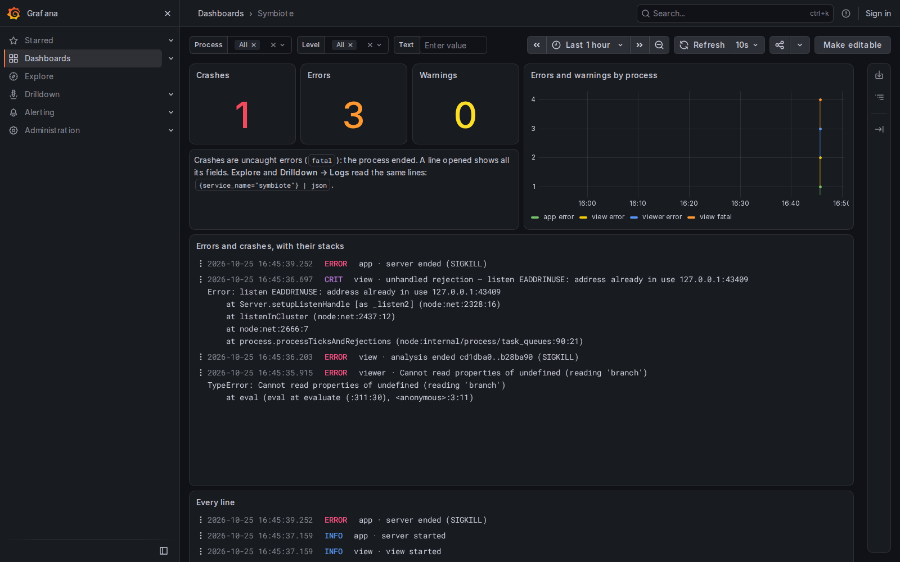

# Configuration

This page lists every setting Symbiote reads: the project's settings file, the text Symbiote
gives its agents, the files it skips, and its environment variables. All of them are optional.
To install Symbiote, see the [README](../../README.md). It also explains the terms this page
uses: workspace, merger, verdict, Nucleus, Scribe and the others.

## The settings file, `symbiote/config.json`

A project's settings are in `symbiote/config.json`, at the root of the repository. Symbiote reads
the file in the checkout where `symbiote view` runs. Commit it to share the settings with everyone
who runs Symbiote there. **Settings** in the app writes `prompts` and the model and effort keys of
the merger, Nucleus and Scribe, and leaves the rest of the file as it is.

```jsonc
{
  "plugins": ["angular"],
  "workspaces": { "branchPrefixes": { "fix": "bugfix/" }, "worktrees": "../{repo}.worktrees" },
  "agent": { "kind": "claude", "permissionMode": "default", "model": "opus" },
  "merge": { "checks": ["pnpm install --frozen-lockfile", "pnpm check"], "push": false }
}
```

| Key | Default | What it does |
|---|---|---|
| `plugins` | none | Framework plugins every analysis uses, by name or path. |
| `workspaces.branchPrefixes` | `feature/`, `fix/`, `refactor/`, `chore/`, `spike/` | The start of a new workspace's branch name, for each kind of work. Give only the kinds you change. |
| `workspaces.worktrees` | `../{repo}.worktrees` | Where workspaces' worktrees go, relative to the checkout. `{repo}` is the checkout's folder name. |
| `agent.kind` | `claude` | The agent offered first, if it is installed: `claude`, `codex` or `hermes`. Nucleus, Scribe and the merger skip `hermes`. |
| `agent.permissionMode` | `default` | The permission mode offered first for Claude Code: `default`, `acceptEdits` or `auto`. |
| `agent.model` | Claude Code's own | The model Claude Code starts on. Codex uses its own configuration's model. |
| `nucleus.model`, `scribe.model` | `agent.model`, else the agent's own | The model each Nucleus or Scribe conversation starts on, if the agent offers it. |
| `nucleus.effort`, `scribe.effort` | the agent's own | The effort level each Nucleus or Scribe conversation starts at, if the agent offers it. |
| `nucleus.web` | `true` | Whether Nucleus searches the web and reads web pages. With `false`, its next conversation has neither; a running one keeps what it started with. See [What Symbiote writes and sends](../../README.md#what-symbiote-writes-and-sends). |
| `advisor.claude.model`, `advisor.codex.model` | `haiku` for Claude Code, `gpt-6-luna` for Codex | The model that suggests a workspace's settings when you press **Suggest settings** with that agent picked, if the agent offers it. |
| `advisor.claude.effort`, `advisor.codex.effort` | `low` | The effort level that model runs at, if it takes that level. |
| `merge.checks` | a command Symbiote finds | The check a merge runs before it lands: one command, or a list run in order. Put an install first if the check needs dependencies. |
| `merge.push` | `false` | If `true`, Symbiote pushes the target branch after a merge lands: to its upstream, else to `origin`. |
| `merge.strategy` | `merge` | How a merge lands unless you pick otherwise: `merge` (a merge commit) or `fast-forward` (the target moves to the approved commit, no new commit, when the target has no commits the branch lacks). |
| `merge.agent` | `agent.kind`, else Claude Code, else Codex | The agent that resolves conflicts: `claude` or `codex`. |
| `merge.model` | `sonnet` for Claude Code, else the agent's own | The model the merger runs on. |
| `merge.effort` | the agent's own | The effort level the merger runs at, if its model takes one. |
| `prompts` | Symbiote's text | The text Symbiote gives its agents. See [Prompts](#prompts). |

To pick a model or an effort level from the agent's own list, use **Settings** rather than
editing the file.

If there is no `merge.checks`, Symbiote looks for a check in the target branch's files. It tries
these in order:

- a `check` or `test` script in `package.json`, run after the package manager's install;
- a `check` or `test` target in a Makefile;
- `scripts/test.sh`, `cargo test`, `go test ./...` or `pytest`.

The **Start a workspace** page names the check it found.

## Rules for the merger, `symbiote/merge.md`

If `symbiote/merge.md` exists, Symbiote adds it to the merger's prompt for every conflict. Write
your project's rules for resolving conflicts there, such as "keep both entries of a changelog".
Commit it to share it.

## Prompts

**Settings** (`s`) shows every text Symbiote gives its agents, grouped by agent. You can change
each one, insert its placeholders with a click, and reset it to Symbiote's text. Symbiote saves
your changes under `prompts` in `symbiote/config.json`, and keeps only the prompts you changed. A
change applies to the next agent that starts.

A prompt is a string, or a list of lines. Symbiote fills in each `{name}` that the prompt allows,
and leaves any other brace as text:

```json
{
  "prompts": {
    "start": {
      "spike": [
        "You are starting a new spike on the branch {branch}, started from {start}.",
        "",
        "{brief}",
        "",
        "Commit what you try under spikes/, and push the branch."
      ]
    }
  }
}
```

| Key | What it is | Placeholders |
|---|---|---|
| `start.feature`, `start.fix`, `start.refactor`, `start.chore`, `start.spike` | A workspace agent's first prompt, for that kind of work | `{brief}` (required), `{branch}`, `{worktree}`, `{start}`, `{plan}`, `{documents}`, `{into}`, `{record}`, `{reviews}`, `{agents}`, `{symbiote}` |
| `plan.first`, `plan.direct` | What `{plan}` becomes, with **Plan first** on and off | none |
| `documents` | What `{documents}` becomes when you gave files with the brief | `{folder}` (required), `{files}` |
| `advisor` | The instructions for the model behind **Suggest settings**: how it sizes a brief, and which of the agent's models is small, mid or large. Edit the guide here when your agent lists new models | `{models}` (required), `{agent}` |
| `verdict.approve`, `verdict.push`, `verdict.address`, `verdict.where` | The lines of a verdict sent to a branch's agent | `{branch}`, `{at}`, `{into}`, `{reviewer}`, `{what}`, `{review}`, `{agents}` |
| `reviews` | The text of `symbiote/AGENTS.md`, which tells agents how to act on a review | none |
| `merger` | The merger's instructions | none |
| `nucleus` | Nucleus's instructions, its system prompt | none |
| `scribe` | Scribe's instructions, its system prompt. A `{request}` left from an older text is filled with nothing | `{skills}`, `{checkout}`, `{library}` |
| `library` | What `{library}` becomes in Scribe's prompt when a [skill library](#the-skill-library) is set. Without a library, the line that holds `{library}` is left out | `{folder}` (required), `{skills}` |

Settings lists what each placeholder stands for. Symbiote ignores a prompt it cannot use, uses its
own text instead, and marks the prompt "not used" in Settings. A prompt cannot be used in three
cases:

- It is neither text nor a list of lines.
- It lacks a required placeholder.
- It is too long. The limits are 8,000 characters for a start prompt and for Nucleus's and Scribe's,
  1,000 for `plan.*`, `documents` and `verdict.*`, and 20,000 for `reviews` and `merger`.

Prompts cannot widen what Symbiote's helpers may do. Whatever its prompt says, Nucleus cannot edit
files or run any command but git's read commands, and its starts, verdicts, merges and clean-ups
still wait for your **Confirm**. Scribe writes only in `.claude/skills/` and the skill library.

What Nucleus reads is fixed the same way. On this machine, Nucleus reads the checkout and the
worktree of each open workspace, and nothing else. A workspace is open until it is cleaned up. In a
worktree, Nucleus runs git's read commands with `-C <worktree>`. There it sees uncommitted work
with `git --no-optional-locks status` and `git diff-index -p HEAD`. It cannot run `git diff`
there, because `git diff` rewrites the worktree's index while the workspace's agent uses it.

With Claude Code, a workspace started during a conversation is readable at once. With Codex, it
is readable from the next conversation: Codex fixes the folders a conversation reads when it
starts it. Symbiote gives Codex those folders again with every message and before Nucleus's
terminal opens, and refuses to go on if Codex does not answer that the conversation is read-only.
Continue Nucleus's Codex conversation from Symbiote only: resumed elsewhere, for example with
`codex resume` in a folder Codex trusts, Codex drops those folders and the conversation can
write.

## The skill library

The skill library is one folder of skills kept outside the repository: each skill is a folder
with its `SKILL.md`, as in `.claude/skills/`. It can be a plain folder, or a folder in a git
repository, such as the `skills/` folder of a repository you share. Set it in **Settings**, under
**This machine**, **Skill library**. Every repository you open on this machine shows the same
library on its Skills page, and Scribe can write there too.

Symbiote keeps this setting in its own settings folder, not in the project: `library.json` in
`~/.config/symbiote` on Linux (`$XDG_CONFIG_HOME/symbiote` when set), `~/Library/Application
Support/symbiote` on macOS and `%APPDATA%\symbiote` on Windows.

```json
{ "folder": "/home/you/projects/skillbar/skills", "commits": "push" }
```

| Key | What it does |
|---|---|
| `folder` | The library's folder, a full path. With **Clone a repository**, Symbiote clones the repository into the folder you give, and the library is its `skills/` folder when it has one. |
| `commits` | Who commits the library's changes: `none` (the default) leaves git to you; `commit` lets the Skills page commit them, with your message; `push` commits, then pushes, and lets the page pull, fast-forward only. |

A commit takes only the library's folder: anything else you staged in that repository stays
staged. A push goes to the branch's upstream, else to `origin`. Symbiote never forces a push,
switches a branch or rebases. A clone, a push or a pull never waits for a password: it fails
after two minutes, or at once if git would ask for one.

No agent reads the library from its folder: it is where you keep and write skills.

## Hive mode

Hive will be Symbiote's graph loop: an orchestrator with full access running a main agent, a
researcher and a reviewer in every workspace. It is not built yet. Its switch is in **Settings**,
under **This repository**, **Hive mode**, and turning it on asks first. For now it changes only
the look: every page in ink and crimson, in both themes, and the S in crimson.

The question shows tendrils that grab a Hive Mind and keep moving while it is open. Turning Hive on,
the Mind grows to the middle of the window, a blackout closes on it, and the new look appears after
a burst from the Mind. If your system asks for reduced motion, the question shows one still picture
and the look changes at once.

Each repository has its own Hive mode. Symbiote keeps it in `symbiote/hive.json`, beside the
reviews:

```json
{ "on": true, "since": "2026-10-30T18:00:00.000Z" }
```

- **Every worktree of the repository shares it**: the file is in the main checkout's `symbiote/`.
  Without a git user (`git config user.email`), or when `symbiote/` holds your project's own
  files, it is in Symbiote's cache instead, as the reviews are.
- **It is never committed**: `symbiote/.gitignore` keeps it out of git, and a `hive.json` that
  git tracks reads as off. A commit never turns Hive on for everyone who clones the repository.
- **The nexus's page never takes the look**: each of its tabs shows its own Symbiote's.

A repository's `symbiote view` reads the file when it serves a page. Its other windows take a
change on their next load.

Before, Hive mode was one switch for the whole machine, in Symbiote's settings folder:
`~/.config/symbiote/hive.json` on Linux. Symbiote no longer reads that file, and leaves it where
it is. You can delete it.

## Branches hidden from Git, `symbiote/git.json`

A branch hidden from Git's graph (right-click it in the branches panel, **Hide from the graph**)
is kept per repository, in `symbiote/git.json`, beside the reviews:

```json
{ "hidden": ["refs/heads/wip", "refs/remotes/origin/old-release"] }
```

`hidden` lists full ref names. **All branches** leaves their commits out unless another branch
or HEAD holds them; the branches panel still lists them, marked *hidden*, and their menu shows
them again. The branch checked out is always listed. As Hive's record, the file is shared by the
repository's worktrees, kept in Symbiote's cache without a git user, and never committed.

## The nexus's pinned folders

The folders and repositories you pin in Symbiote nexus are kept in the same settings folder:
`nexus.json`. Pins are kept for this machine, not for a project.

```json
{ "pinned": ["/home/you/projects", "/home/you/projects/Symbiote"] }
```

`pinned` lists full paths, in the order you pinned them. The nexus reads the file each time it lists
a folder, so a pin made in one nexus window shows in another at its next listing. It writes the
whole file at once, and keeps any other keys in it. A file it cannot read counts as no pins, and
the next pin replaces it.

## Files Symbiote skips, `.symbioteignore`

Symbiote lists changed files in these folders but does not analyze them, so they show no symbols
and no findings: `examples/`, `playground/`, `fixtures/`, `__fixtures__/`, `__snapshots__/` and
`generated/`. It does the same for `*.generated.*` files. To add to that list, or to keep a path
it holds with `!`, write a `.symbioteignore` file at the repository root, in the same syntax as
`.gitignore`:

```gitignore
# every `interfaces` folder, at any depth
interfaces/
# only the top-level `tools` folder
/tools/
# but keep this one
!apps/web/interfaces/public.ts
```

Unlike in git, a `!` line can bring back a file inside a folder that an earlier line skips, as the
last line above does. Symbiote reads the file from the checkout where it runs, not from the
commits it compares. So a change applies at once, even before you commit it. The **Monitor** sets
the same files aside.

## Environment variables

| Variable | What it does |
|---|---|
| `SYMBIOTE_CLAUDE` | The Claude Code program to start. Default: `claude` on your `PATH`. |
| `SYMBIOTE_CODEX` | The Codex program to start. Default: `codex` on your `PATH`. |
| `SYMBIOTE_HERMES` | The Hermes program to start. Default: `hermes` on your `PATH`. |
| `SYMBIOTE_CODE` | The editor command that **Open in VS Code** runs, such as `cursor`. Default: VS Code's `code`. |
| `SYMBIOTE_TERMINAL` | `off`: no agent terminals. A workspace shows its thread and a reply box instead, and Hermes is not offered. Nucleus and Scribe run only in a terminal: their pages say none runs. |
| `SYMBIOTE_USAGE` | `off`: Symbiote does not read your subscriptions' usage, and the status bar shows none. |
| `SYMBIOTE_INTRO` | `off`: no intro the first time Symbiote opens. |
| `SYMBIOTE_APP` | `off`: always open the browser, never Symbiote's window. |
| `SYMBIOTE_CACHE_DIR` | Where Symbiote keeps its cache. Default: `$XDG_CACHE_HOME/symbiote`, else `~/.cache/symbiote` (`~/Library/Caches/symbiote` on macOS). Symbiote nexus lists the `symbiote view` servers that use the same cache. |
| `SYMBIOTE_LOG` | `off`: Symbiote writes no logs. |
| `SYMBIOTE_LOG_LEVEL` | The lowest level a log line must have to be written: `debug`, `info` (default), `warn` or `error`. |
| `SYMBIOTE_LOG_DIR` | Where the logs go. Default: `logs` in the cache folder. |
| `GITHUB_TOKEN`, `GH_TOKEN` | The GitHub token for `symbiote pr`. It goes to github.com, to the host a GitHub Actions job runs on (`GITHUB_SERVER_URL`), or to `GITHUB_API_URL` when that is set. For any other host, Symbiote asks `gh auth token` for that host. |
| `GH_ENTERPRISE_TOKEN`, `GH_HOST` | A GitHub Enterprise token, and the host it is for, as `gh` reads them. |
| `GITLAB_TOKEN` | The GitLab token for `symbiote pr`. It goes to gitlab.com, to GitLab CI's own server, to `GITLAB_API_URL` when that is set, or to the host `GITLAB_HOST` names. |
| `GITHUB_API_URL`, `GITLAB_API_URL` | The forge's API address, for a self-hosted GitHub or GitLab. |
| `SYMBIOTE_FORGE` | `github` or `gitlab`, as `--forge` does. |

The CI templates read a few more variables. The [review guide](../guide/review-and-ci.md#run-in-ci)
lists them.

## Logs

Every Symbiote process writes its log lines into one folder: `logs` in the cache folder (see
`SYMBIOTE_CACHE_DIR` above), or `SYMBIOTE_LOG_DIR`. On Linux, that is `~/.cache/symbiote/logs/`
by default.
There is one file a day, with one JSON object a line, and Symbiote keeps 14 days. A log line never
holds a prompt, a file's contents, what a terminal shows, or a token.

To read the logs in Grafana, run `pnpm logs:up` in Symbiote's folder and open
http://localhost:3300. It needs Docker, and `pnpm logs:down` stops it. Without Docker, read the
files with `jq` or `lnav`.

The Symbiote dashboard opens first. From the top, it shows:

- the counts for the time range: crashes, errors, warnings, analyses, merged branches and agents;
- the problems over time and by kind, then each one with the start of its stack (open a row for
  all its fields and the whole stack);
- what Symbiote did: the slowest analysis, agents by program, and how each merge ended;
- the server's requests, folded until you open them;
- every other line.

Each level has one colour everywhere: crashes are purple, errors red and warnings orange.
**Process** filters every panel, **Text** filters every list of lines, and **Level** filters the
last list. **Logs Drilldown** and **Explore** open the same lines.



## Older names

Symbiote had another name until 2026-10-21. On first use, it moves what it kept under that name
into `symbiote/`. It also reads two older forms of the settings: a `symbiote.config.json` file at
the repository root, if there is no `symbiote/config.json`, and a `features` section in place of
`workspaces`.

Nucleus was called Scout before. Symbiote still reads what it kept under that name:

- `scout.model`, `scout.effort` and `prompts.scout` in `symbiote/config.json`, if the file has no
  `nucleus.model`, `nucleus.effort` or `prompts.nucleus`. When you save one of these in
  **Settings**, Symbiote writes the new key and removes the old one. Nothing else rewrites them.
- `symbiote/scout.json`, the conversation Scout had open. Nucleus's page shows it, without the
  web, until you press **New conversation**. That ends it and removes `scout.json`,
  `scout-settings.json` and `scout-mcp.json`.
- `"via": "scout"` on a verdict or on a workspace's record, read as made through Nucleus. The
  files stay as they are.
