# Spike: the graph's usability for a person reviewing a change

**Question.** Where does the graph get in the way of a person reviewing a change, and which
improvements would help them most? Judged by what a reviewer does with it (normal mode: review
decisions, not lines), not by how it looks.

**Branch** `spike/graph-usability` from `main` at 3a38d5d · 2026-11-10 · no product code changed.
Screenshots at 1x, 2560 × 1440 (a 27" 1440p screen at 100 %), both themes, in [`shots/`](shots/).
Numbers come from [`data/`](data/) and the scripts in [`walk/`](walk/).

## The answer

**The canvas cannot be read at its first view on the changes you review.** On 24 of the last 26
merges into `main` that have code, the first view draws a symbol's name at 0.6–7 px on screen
(median 1.9 px). Here, a name under 11 px on screen counts as unreadable.
19 of them open on the map. Reading the whole change at zoom 1 would take a median of 30
screens, up to 242. Only small library commits are different: 23 of r1's 25 open readable.

**So the review happens in the sidebar and the detail panel, and the canvas adds work.**
In all five walks, every task was done from the findings list and the panel. The canvas joined in
only for "who calls it", and there it took 6–21 wheel notches to make a name readable. Focus
drew the symbol without the links its finding is about.

**Risk is not where the reviewer looks:**
- Files, the page a review opens on, starts with a docs file on 30 of 30 merges. It shows no
  findings. The file holding the top finding sits at a median position of 28 in its list.
- The head counts only errors and warnings, and the Findings tab counts everything. They disagree
  on 33 of the 37 graphs that have findings.
- On the map, no finding is drawn at all.

**Your records point the same way.** In 4 weeks, 169 verdicts, all Approve. 1 comment, and 2
marked symbols. Marks and comments are barely used. What the graph must do for you is help you
decide quickly. So the ranking starts with two things: a picked symbol that lands readable with
its links drawn, and findings shown where you look. Help with marking progress comes last.

**Speed is not the problem.** First paint has a median of 366 ms and a maximum of 966 ms on your
merges. Picking a symbol takes 59–283 ms, marking one 7–11 ms. The wait that matters is the
analysis before a review opens: 5.9–11.3 s on your changes, 26 s on Bitwarden.

## Words used here

| Word | Meaning |
|---|---|
| canvas | The Graph page's drawing, between the sidebar and the detail panel |
| first view | The canvas as a review's Graph page first draws it: the whole change fitted, at most at zoom 1 |
| map | The canvas below zoom 0.45: symbols become coloured blocks and only file and project names are written |
| readable | A name drawn at 11 px or more on screen; the graph writes names at 12 px at zoom 1 |
| the band | Zoom 0.45 to 0.92: not the map, but names are under 11 px |
| pick | Selecting a symbol: from a finding, a row of the change list, `j`/`k`, or a name in the detail panel |
| detail panel | The column at the right that a pick opens: findings, users, uses, signature, changed lines, comments |
| sidebar | The column at the left: the Changes, Findings and Review tabs |
| head | The page's top line: the review's title, its facts and, at the right, the findings pills |
| Focus | The canvas toggle (`f`) that draws only the picked symbol and its neighbours |
| context | Unchanged symbols drawn because they call, or are called by, a changed one |
| summary card | One card standing for many neighbours ("92 uses … show") |
| type reference | A link where one symbol only names another's type; the canvas hides these by default |
| mark | Marking a symbol reviewed on Graph (`r`), or a file viewed on Files (`v`) |
| walk | Doing the seven reviewer tasks on one change, counted by a script |
| the small fix, the feature, the refactor | The three changes walked from this repository ([table](#the-tasks-walked)) |
| r1 | The regression suite's commits of the ky, zod, vite and RealWorld libraries |
| G1–G15 | The problems, under [Problems](#problems-and-how-often-they-bite) |
| 886, 438, … | Decisions in `docs/plan/`, quoted where they are used |

## Ranked improvements

Impact is how often it bites (out of your 26 merges with code, and the 84-graph sample) times how
much it slows or misleads the reviewer each time. Cost: **S** under a day, **M** a few days,
**L** a milestone (the [improvement audit](../../docs/journal/chore-improvement-audit.md)'s
sizes). Ranked by impact for its cost.

| # | Improvement | Fixes | Bites | Cost | Planned items, decisions |
|---|---|---|---|---|---|
| 1 | [A picked symbol lands readable](#1-a-picked-symbol-lands-readable-s) | G3, half of G1, G2 at picks | every pick on 24 of 26 merges | S | amends 886 |
| 2 | [Findings where the reviewer looks](#2-findings-where-the-reviewer-looks-sm) | G5, G6 | 33 of 37 graphs with findings; the map on 19 of 26 | S–M | **includes fix-finding-counts**; amends 839 |
| 3 | [Draw the links the finding is about](#3-draw-the-links-the-finding-is-about-sm) | G4 | 22 % of symbols with findings | S–M | — |
| 4 | [Files in order of risk](#4-files-in-order-of-risk-m) | G7 | 30 of 30 merges | M | amends 431 |
| 5 | [The panel's code reads whole](#5-the-panels-code-reads-whole-s) | G9 | 69 % of the panel's lines | S | 887 kept, or amended |
| 6 | [Graph and Files follow the pick](#6-graph-and-files-follow-the-pick-sm) | G8 | every switch (5 of 5 walks) | S–M | — |
| 7 | [Stylesheet rules as one card per file](#7-stylesheet-rules-as-one-card-per-file-m) | G12, part of G10 | 17 of 26 merges; 46 % of changed symbols | M | — |
| 8 | [The change louder than its context](#8-the-change-louder-than-its-context-s) | G11 | every view at zoom ≥ 0.45 | S | — |
| 9 | [Back after following a link](#9-back-after-following-a-link-s) | G14 | every follow (5 of 5 walks) | S | — |
| 10 | [The map's labels](#10-the-maps-labels-m) | G13 | the map: 19 of 26 merges | M | **is V96**, as planned |
| 11 | [One review progress](#11-one-review-progress-m) | G10 | anyone who marks: 2 reviews in 169 | M | — |
| 12 | [Open the graph on the riskiest finding](#12-open-the-graph-on-the-riskiest-finding-m) | G1 | 24 of 26 merges | M | amends V93's first view |

Each item has a plan in `docs/plan/`:
[V99](../../docs/plan/v99-picks-land-readable.md) (1),
[V100](../../docs/plan/v100-findings-where-you-look.md) (2),
[V101](../../docs/plan/v101-links-a-finding-is-about.md) (3),
[V102](../../docs/plan/v102-files-by-risk.md) (4),
[V103](../../docs/plan/v103-panel-code-whole.md) (5),
[V104](../../docs/plan/v104-graph-files-follow.md) (6),
[V105](../../docs/plan/v105-stylesheet-cards.md) (7),
[V106](../../docs/plan/v106-change-louder-than-context.md) (8),
[V107](../../docs/plan/v107-back-in-the-panel.md) (9),
[V96](../../docs/plan/v96-map-labels.md) (10, as planned),
[V108](../../docs/plan/v108-one-review-progress.md) (11) and
[V109](../../docs/plan/v109-open-on-the-risk.md) (12).

Items 1–3 together take a review from "pick, then zoom 6–21 notches, then guess the links" to
"pick, read, see who is affected". Add item 9 for the way back, and the walks' model puts
"follow callers" at about 4 s instead of 10.7–15.3 s. There is no wheel, no Focus round trip and no
second pick.
Item 12 is last because, once 1–3 exist, it saves about 3 s per review, and it gives up the
whole-change view you chose in V93.

Two planned items are not part of this answer:
- **fix-code-point-order** makes the graph JSON's order independent of the machine's locale. A
  reviewer sees it only as a different list order on two machines.
- **fix-graph-file-check** keeps a page from going white when a dropped file is not a graph. That
  is not part of reviewing a change.

Both stay as planned.

### 1. A picked symbol lands readable (S)

- **What to change**: any pick should bring the symbol to a reading zoom when its name would be
  drawn under 11 px on screen. That includes a finding, a row of the change list, `j`/`k`, a
  neighbour in the panel, and Focus. Today only a pick from the map does this. The reading zoom
  should follow Settings' Text size, so that a name lands at the body size. By default that is
  15 px, which is zoom 1.25 for the graph's 12 px names. Focus zooms in no further than that.
  Today Focus stops at zoom 1.1, where names are 13.2 px. A pick whose name is already readable
  and in view still moves nothing.
- **Why**: between zoom 0.45 and 0.92 a pick does not move or zoom. 5 of your 26 merges open in
  that band, and so does any view you zoom out yourself. On the small fix, the picked card stays
  at 5.9 px ([G3](#g3-a-pick-keeps-the-zoom-between-045-and-092)). From the map a pick comes to
  1×, where names are 12 px, 3 px under your reading size
  ([G2](#g2-the-graphs-type-is-smaller-than-the-apps-and-ignores-text-size)).
- **Where to look**:
  - `packages/viewer/src/diff/Canvas.tsx`: `READING_ZOOM` (:83); the pick's effect, where
    `onMap ? READING_ZOOM : zoom` (:222) decides; Focus's `fitView` with `maxZoom: 1.1` (:206).
  - `src/shell/text-size.ts` for the size chosen; `src/graph/mapzoom.ts` for `MAP_ZOOM`.
- **Decisions**: amends 886 (V93, your choice 6: "the canvas framed as the proof; no zoom to the
  symbol"). This brief goes against a choice you made, so it keeps that choice wherever it can:
  the framing stays for readable picks, and only unreadable ones move. Keeps 438 (the
  layout estimated from the graph's own type).
- **Out of scope**: the layout, the graph's type sizes.
- **Done when**:
  - On the `callers` fixture zoomed to 0.6, clicking a finding leaves the picked name at least
    15 px on screen.
  - At zoom 1.3, a pick that is in view moves nothing.
  - Bitwarden's select stays near today's 63 ms (`scripts/viewer/interactions.mjs`).

### 2. Findings where the reviewer looks (S–M)

- **What to change**:
  - The head counts what the Findings tab counts, by severity, for example "2 warnings · 65
    notes". Each pill opens the tab at that severity.
  - The tab folds the "changed its signature compatibly; existing users keep working" findings
    into one row per project, under the warnings.
  - On the map, a symbol with findings keeps its count badge, scaled like the file names, and
    its file's name takes the worst severity's colour.
- **Why**:
  - The head and the tab disagree on 33 of 37 graphs with findings. On 14 of them the head shows
    nothing while the tab says N.
  - 86 % of findings are infos (352 of 407). On the refactor, 65 infos sit under 2 warnings, so
    the tab reads "67".
  - The map, which is the first view of 19 of your 26 merges, draws no finding at all
    ([G5](#g5-the-map-hides-every-finding),
    [G6](#g6-the-head-and-the-findings-tab-disagree-and-infos-flood-the-tab)).
- **Where to look**:
  - `packages/viewer/src/diff/DiffHead.tsx:166` (`FindingPills`).
  - `src/diff/Sidebar.tsx:19` (`SEVERITY_ORDER`), `:135` (the tab's count) and the findings list.
  - `src/graph/map.css:71` (`.react-flow.map .symbol > *` hides the badge with the rest of the
    card) and the label rules beside it. A badge on the map must scale by transform only, as the
    file names do (decision 37).
- **Planned items**: includes [fix-finding-counts](../../docs/plan/fix-finding-counts.md), whose
  brief is the first bullet of "What to change". Amends 839 ("errors and warnings as pills").
- **Out of scope**: what a finding is and its severity (core's detectors).
- **Done when**:
  - On `callers`, the head and the tab give the same numbers.
  - On feature/issues-page's map at zoom 0.16, `Route`'s block shows its warning.
  - Zooming restyles nothing on each frame, as the map's labels already ensure (V8a).

### 3. Draw the links the finding is about (S–M)

- **What to change**: draw the picked symbol's type-reference edges whatever the Type references
  toggle says, the way its other edges are raised today. Focus includes them. The panel's "Used
  by" and "Uses" and the canvas then show the same symbols.
- **Why**: type references are hidden by default. In the sample, 90 of the 405 symbols with
  findings (22 %) are linked only by type references, so Focus draws them alone. 2,290 of 6,624
  changed symbols (35 %) have some links hidden. Two examples
  ([G4](#g4-the-canvas-hides-the-links-the-findings-talk-about)):
  - **Bitwarden's warned constructor**: the panel lists 7 uses and 1 "no longer uses"
    (`ConfigService`, which is the decision this change makes). Focus draws 1 card, 0 edges.
  - **The small fix's `MergerOptions`**: the panel lists 8 neighbours. Focus draws 2 cards with
    no edge between them.
- **Where to look**:
  - `packages/viewer/src/graph/flow.ts:202`, the edge filter
    (`typeReferences || e.kind !== 'type-reference'`).
  - `decorateEdges` (:369) and `edgesToDraw` (:347) in the same file.
  - `src/diff/review.ts`'s `neighbourhood`, which already takes every kind of edge.
- **Out of scope**: type references on by default. There are 6,925 in the sample, and V8c
  measured what edges cost a moving view.
- **Done when**: Focus on Bitwarden's `AssignCollectionsComponent.constructor` draws its 8 linked
  symbols and their edges; a `flow.test.ts` case; the edges drawn while moving stay within
  `MOVING_EDGE_LIMIT`.

### 4. Files in order of risk (M)

- **What to change**: Files lists files in this order:
  1. files holding findings, worst severity first;
  2. other code;
  3. tests;
  4. docs and other files.

  Each row shows its findings count. The page opens on the first file. While the change is
  analyzed, the list stays in git's order (decision 847). When the graph arrives it reorders,
  without changing the open file.
- **Why**: on 30 of 30 merges, Files opens on a docs file (`docs/JOURNAL.md`, `README.md`, a
  skill). The top finding's file is at a median position of 28 in the list (5 to 111). Files
  shows no findings at all ([G7](#g7-files-opens-on-a-docs-file-and-shows-no-risk)).
- **Where to look**:
  - `packages/viewer/src/diff/FilesPage.tsx`: the list, about lines 195–240, and
    `useReviewFiles`.
  - `src/workspaces/ChangesPanel.tsx`: `FileRow` and its `after` slot.
  - `src/diff/review.ts`.
- **Decisions**: amends 431 (what a review opens on: Files still, at its riskiest file). Keeps 432
  (a row's counts are git's).
- **Done when**: feature/issues-page opens on `packages/viewer/src/shell/pages.ts`, the warning's
  file, with docs last; a unit test of the order.

### 5. The panel's code reads whole (S)

- **What to change**:
  - The panel's code wraps its long lines. Or, if you prefer, a wide toggle widens the panel to
    the longest line, up to half the window.
  - A changed signature shows once, with the removed and added words marked, instead of two whole
    blocks.
- **Why**: at the panel's 336 px (decision 887), 48 of the 70 lines in the five walks' panels
  were cut (69 %). In Bitwarden's constructor, the "before" block cuts off with "…" right before
  `configService`, the one parameter removed
  ([G9](#g9-the-panel-cuts-the-code-it-shows)).
- **Where to look**:
  - `packages/viewer/src/diff/DetailPanel.tsx`: the signatures (:269–273), the code (:378).
  - `src/diff/DetailPanel.css` (`.code`, `.row { white-space: pre }`).
  - `src/diff/detail.ts`, where a word diff would go: pure, with a test.
- **Decisions**: wrapping keeps 887; the wide toggle would amend it.
- **Done when**: Bitwarden's constructor shows `private configService: ConfigService` struck out;
  no line of the five walks' excerpts is cut.

### 6. Graph and Files follow the pick (S–M)

- **What to change**:
  - `g` with a symbol picked opens its file on Files at its first changed line. For a removed
    or moved symbol, that is its deleted lines, in the file they were deleted from.
  - The panel gets "Show its lines".
  - On Files, the symbol holding the last line clicked is picked when you go to Graph.
- **Why**: in 5 of 5 walks, `g` from a picked symbol showed the file that was already open: a
  docs file. The symbol's file was at position 5 to 48 in the list. On the refactor, the warned
  symbol had moved: its first changed line was a deleted one, and the file Files opened did not
  show it ([G8](#g8-graph-and-files-do-not-follow-each-other)).
- **Where to look**:
  - `packages/viewer/src/diff/App.tsx`: `showPage` (:115) and `openDraft` (:160). `openDraft`
    already does this for a comment.
  - `src/diff/useDiffKeys.ts:75`.
  - `FilesPage`'s `focus` (`FileFocus`).
  - `src/diff/comments.ts:61` (`symbolAt`).
- **Done when**: an e2e test both ways. Pick on Graph, press `g`: the changed row is in view on
  Files. Click a line on Files, press `g`: its symbol is picked.

### 7. Stylesheet rules as one card per file (M)

- **What to change**: draw a file's changed CSS rules as one card, for example
  "IssuesPage.css · 62 rules", which opens like a summary. The change list folds them by file,
  and the progress counts code symbols and stylesheet files apart.
- **Why**: 2,487 of the 5,425 changed symbols on your merges (46 %) are CSS rules. On the 7
  redesign merges (V88–V93 and the redesign's own merge) they are 33–94 %, and more than half on
  6 of them. Some are on 17 of 26 merges. They draw the largest block on the
  feature's map, and they make most of what "212 changed symbols" counts
  ([G12](#g12-stylesheet-rules-fill-the-canvas-and-the-counts)).
- **Where to look**:
  - `packages/viewer/src/graph/flow.ts`: the summaries' phase (`NEIGHBOUR_LIMIT`, :153).
  - `src/graph/SummaryNode.tsx`.
  - `src/diff/review.ts`: `changeList` (:22), `reviewStatus` (:208).
- **Out of scope**: core's stylesheet symbols, which stay in the graph JSON.
- **Done when**: V88's merge (98e28e23) draws at most one card per CSS file; layouts of graphs
  without CSS stay identical (a `flow.test.ts` comparison).

### 8. The change louder than its context (S)

- **What to change**: draw a summary card's count at the size and weight of an unchanged name
  (12 px, regular, muted). Changed names keep weight 600 at full ink.
- **Why**: at zoom 1, "92 uses" and "13 users" are the largest, boldest text on the canvas, at
  14 px bold. A changed symbol's name is 12 px. On your merges, a median graph draws 0.72
  unchanged symbols per changed one, and 24 summary cards
  ([G11](#g11-the-context-is-drawn-louder-than-the-change)).
- **Where to look**: `packages/viewer/src/graph/SummaryNode.css:21` (`.summary-count`),
  `SymbolNode.css:152–166`; the `symbiote-style` skill for weights and ink.
- **Done when**: before and after shots; `tokens.test.ts` passes.

### 9. Back after following a link (S)

- **What to change**: the panel remembers the picks followed from it. Back, a button in the
  panel's head and Alt+←, returns to the previous one.
- **Why**: in 5 of 5 walks, getting back to the finding after following a user meant picking the
  finding again ([G14](#g14-no-way-back-after-following-a-link)).
- **Where to look**: `packages/viewer/src/diff/App.tsx` (`selected`), `DetailPanel.tsx`'s
  header, `useDiffKeys.ts`.
- **Done when**: an e2e test: pick a finding, follow a user, press Back, and the finding's symbol
  is picked.

### 10. The map's labels (M)

- **What**: [V96](../../docs/plan/v96-map-labels.md) as planned: project names never cover file
  names on the map. Here too: "@symbiote/cli" covers "er.ts", and "symbiote-monorepo" runs over
  its own blocks ([G13](#g13-map-labels-cover-and-cut-each-other)).
- **Why tenth**: with items 1–2, a reviewer leaves the map at the first pick. File names cut to
  2–4 letters ("pa…", "Merg…") are a second label problem V96 does not name; add it to its brief
  if wanted.

### 11. One review progress (M)

- **What to change**:
  - A file viewed marks its symbols reviewed, and a file whose symbols are all reviewed shows as
    viewed.
  - One line on both pages says what is left.
  - One key marks a file's symbols.
- **Why**: after all 19 of the small fix's symbols were marked reviewed, Files showed 0 of 18
  files viewed. Marking the refactor takes 928 keystrokes, 2 for each of its 464 symbols
  ([G10](#g10-two-progresses-that-never-meet)). It ranks low because your records show 2 marks in
  169 reviews.
- **Where to look**: `packages/viewer/src/diff/useReview.ts` (`toggleReviewed` :60,
  `toggleViewed`); `review.ts` (`reviewStatus` :208, `fileViewed` :175); the sidebar's progress.

### 12. Open the graph on the riskiest finding (M)

- **What to change**: the Graph page's first view is the top finding's symbol with everything
  linked to it, at the reading zoom. The whole change is one key away.
- **Why last**: it fixes the unreadable first view
  ([G1](#g1-the-first-view-cannot-be-read)). But once items 1–3 exist, the risk is one click away
  and lands readable. This would then save about 3 s per review, and it gives up the
  whole-change fit V93 chose. Revisit after 1–3: do you still zoom before your first pick?

## The tasks walked

Five changes, each served by a real `symbiote view` of this branch's build. The three from this
repository were opened as branch reviews, as a workspace's Review opens them. Bitwarden and Qwik
are two commits compared, as Git's Compare does.

| Change | Kind | Files | Changed symbols | Findings | First fit |
|---|---|---|---|---|---|
| `fix/e2e-flakes` (4cbcae0c) | small fix | 18 | 19 | 6 infos | zoom 0.48, names 5.9 px |
| `feature/issues-page` (11610c73) | mid feature, 9 projects | 55 | 212 | 1 warning, 7 infos | 0.16, map |
| `refactor/cli-services` (eb807773) | big refactor, moves | 122 | 464 | 2 warnings, 65 infos | 0.06, map |
| Bitwarden 737ee3f, Angular plugin | multi-project removal | 31 | 86 | 7 warnings, 2 infos | 0.20, map |
| Qwik 65661bf49, Qwik plugin | mid feature | 23 | 62 | 2 warnings, 14 infos | 0.24, map |

**How each task was walked.** First by hand, from screenshots, to find the shortest path the
screen offers. Then a script ([`walk/walk.mjs`](walk/walk.mjs)) repeated that path, counted each
operation and timed each wait. Person time is an estimate from the counts, using the
keystroke-level model:

| Operation | Seconds |
|---|---|
| point and click | 1.3 |
| key or typed character | 0.28 |
| wheel notch | 0.3 |
| drag | 1.5 |
| reading or deciding | 1.35 |

The measured waits are added. Nobody was timed doing it, and I know the code, so "lost" below
means the screen did not say what to do, not that I did not know.

| Task | Small fix | Feature | Refactor | Bitwarden | Qwik |
|---|---|---|---|---|---|
| Open the diff (cold: the analysis) | 1 click; 5.9 s | 1 click; 6.8 s; ≈ 9.4 s | 1 click; 11.3 s; ≈ 13.9 s | 1 click; 26 s | 1 click; 6.5 s |
| Find the riskiest change | 1 click, 1 key; 0.15 s; ≈ 4.4 s | 1 click, 1 key; 0.3 s; ≈ 4.6 s | 1 click, 1 key; 0.7 s; ≈ 5 s | 1 click, 1 key; 0.24 s; ≈ 4.5 s | 1 click, 1 key; 0.2 s; ≈ 4.5 s |
| Follow callers and callees | 4 clicks, 2 keys, **6 wheel**; ≈ 10.7 s | 4 clicks, 2 keys, **14 wheel**; ≈ 13.1 s | 4 clicks, 2 keys, **21 wheel**; ≈ 15.3 s | 4 clicks, 2 keys, **12 wheel**; ≈ 12.5 s | 4 clicks, 2 keys, **12 wheel**; ≈ 12.5 s |
| Read a finding, get to its code | 1 click, 1 key; ≈ 4.4 s | 1 click, 1 key, 1 wheel; ≈ 4.8 s | 1 click, 1 key, then a search; ≈ 4.5 s + search | 1 click, 1 key; ≈ 4.4 s | 1 click, 1 key; ≈ 4.4 s |
| Comment on a line (Files) | 1 click, 33 typed, 1 key; ≈ 11 s | same; ≈ 11 s | same; ≈ 11 s | no review: cannot | no review: cannot |
| Comment on a symbol (Graph) | 4 keys, 33 typed; ≈ 10.6 s | same | same | cannot | cannot |
| Mark reviewed | 1 key; 8 ms | 1 key; 10 ms | 1 key; 31 ms | 1 key; 19 ms | 1 key; 16 ms |
| Know when you are done | 1 click, 2 reads; ≈ 4 s | same | same | 1 read | 1 read |
| *Mark everything (by `j`, `r`)* | *38 keys; ≈ 36 s* | *424 keys; ≈ 6.7 min* | *928 keys; ≈ 15 min* | *172 keys; ≈ 2.7 min* | *124 keys; ≈ 2 min* |

What the numbers say:
- **Most tasks are short because the sidebar and the panel carry them**: 1–2 operations, under
  5 s. The canvas joined in only for "follow callers". There it took 6–21 wheel notches and
  Focus, and Focus hid the type-reference links (G4).
- **Lost or guessed, in every walk**:
  - After following a user from the panel, there was no way back: the finding had to be picked
    again (5 of 5).
  - `g` from a picked symbol showed the wrong file (5 of 5).
- **Lost in one walk**: on the refactor, the warned symbol had moved, and its first changed line
  (a deleted one, base line 106) was not in the file Files opened. It had to be searched for
  (G8).
- **Knowing when you are done** means reading "x of N changed symbols reviewed" on Graph, and
  then each file's check on Files. The two never meet (G10).
- **Two commits compared** (Bitwarden, Qwik) have no review: no comment box, no Review tab, no
  verdict (G15).

## Problems, and how often they bite

"Your merges" means the last 30 merges into `main`; 26 have code. "The sample" adds r1's 25 real
commits, 3 of Bitwarden's multi-project commits and Qwik's 30, for 84 graphs in all. Each problem
has a dark and a light screenshot.

### G1. The first view cannot be read

In the first view, a symbol's name is under 11 px on screen on **24 of 26** of your merges. The
median zoom is 0.16, where names are 1.9 px. 19 of them open on the map, 5 in the band, and 2
are readable. Reading the whole layout at zoom 1 takes a median of 30 screens, up to 242. Across
the sample, 27 of 84 open on the map and 15 more in the band. r1's library commits are the
exception: 23 of 25 are readable.

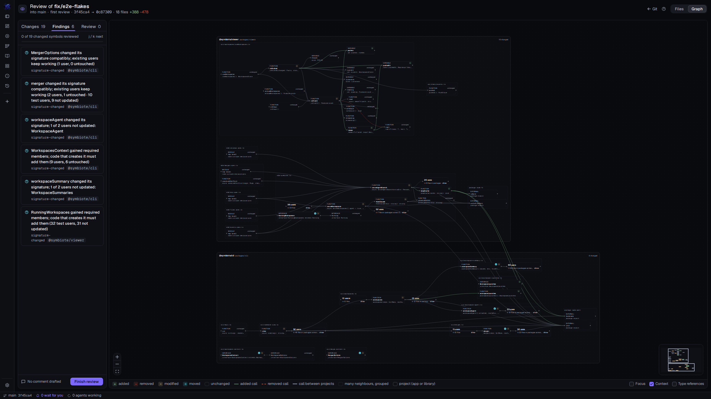
Small fix, zoom 0.48, names at 5.9 px ([light](shots/p01-first-view-small-fix-light.png)).
Feature, map at 0.16: [dark](shots/p01-first-view-feature-dark.png) ·
[light](shots/p01-first-view-feature-light.png).

### G2. The graph's type is smaller than the app's and ignores Text size

`.react-flow` sets the graph's own scale (`ui/base.css:526`, decision 438):
- At zoom 1 a symbol's name is 12 px, and its kind, its signature line and its findings count are
  11 px. The app's body text is 15 px, and V87's rule is nothing under 12 px.
- Settings' Text size "large" moves the sidebar from 14 to 15 px. It moves no graph label.
- Contrast is not the problem: 5.5:1 or more for every label in both themes; the lowest is a
  card's findings count in light ([`data/legibility.json`](data/legibility.json)).

This bites always, and most at the picks of item 1.

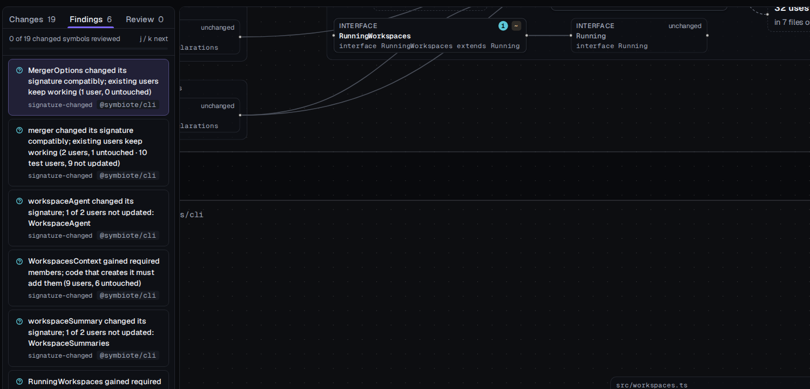
Zoom 1: the findings at 14 px, the cards at 12 and 11 px
([light](shots/p02-graph-type-at-zoom-1-light.png)).

### G3. A pick keeps the zoom between 0.45 and 0.92

A finding, a row or `j` picks the symbol and opens the panel. The canvas moves only if the
symbol is off screen. It zooms in only if the view is on the map, and then to zoom 1 (decision
886). In the band, the picked card stays unreadable: 5.9 px on the small fix. This bites 5 of
26 merges at their first view, 15 of 84 in the sample, and any view you zoom out yourself.

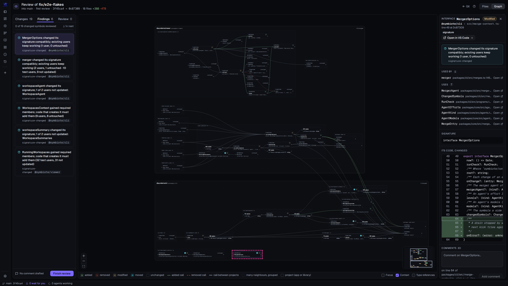
The picked `MergerOptions`, ringed for this shot
([light](shots/p03-pick-keeps-the-zoom-light.png)).

### G4. The canvas hides the links the findings talk about

Findings speak of users, for example "8 of 12 users not updated". Type references are hidden by
default (`flow.ts:202`). For 90 of 405 symbols with findings (22 %), every link is a type
reference, so Focus draws them alone. 35 % of changed symbols have some links hidden.

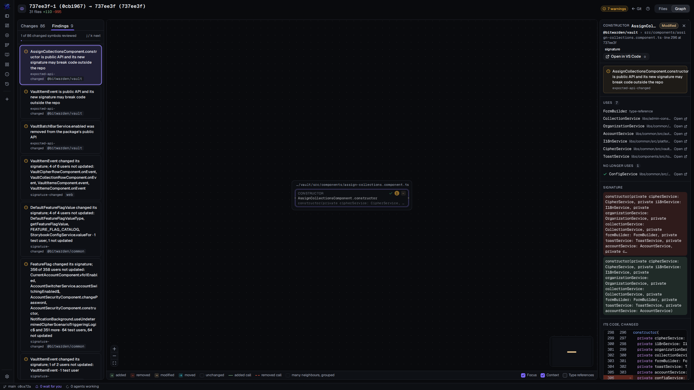
Bitwarden: the panel lists 7 symbols the constructor uses and 1 it no longer uses. Focus draws
the constructor alone ([light](shots/p04-focus-draws-no-users-light.png)). The small fix: 2
cards, no edge, while the panel lists 8: [dark](shots/p04-focus-users-unlinked-dark.png) ·
[light](shots/p04-focus-users-unlinked-light.png).

### G5. The map hides every finding

On the map, `map.css:71` hides everything inside a symbol, its findings count included. The
head's "1 warning" is not a link. This bites 19 of 26 of your first views.

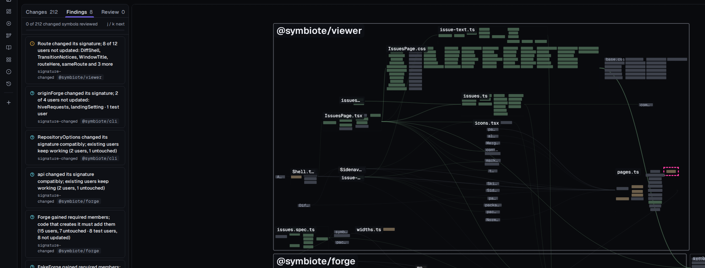
`Route`, the change's only warning, is ringed for this shot. On screen it is a block like any
other ([light](shots/p05-map-hides-findings-light.png)).

### G6. The head and the Findings tab disagree, and infos flood the tab

The head counts errors and warnings, and the tab counts everything. They disagree on 33 of 37
graphs with findings, and on 14 the head shows nothing. No error appears in the sample. 352 of
the 407 findings are infos, most of them "changed its signature compatibly; existing users keep
working". On the refactor, 65 infos follow 2 warnings.

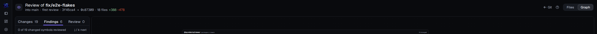
The small fix: no pill, "Findings 6" ([light](shots/p06-head-vs-findings-tab-light.png)). The
refactor's tab: [dark](shots/p06-findings-flood-dark.png) ·
[light](shots/p06-findings-flood-light.png).

### G7. Files opens on a docs file and shows no risk

Files lists files in path order, so `.claude/`, `CLAUDE.md`, `README.md` and `docs/` come first.
That is 30 of 30 merges. The file of the top finding is at a median position of 28 (5 to 111).
No finding is shown on Files.

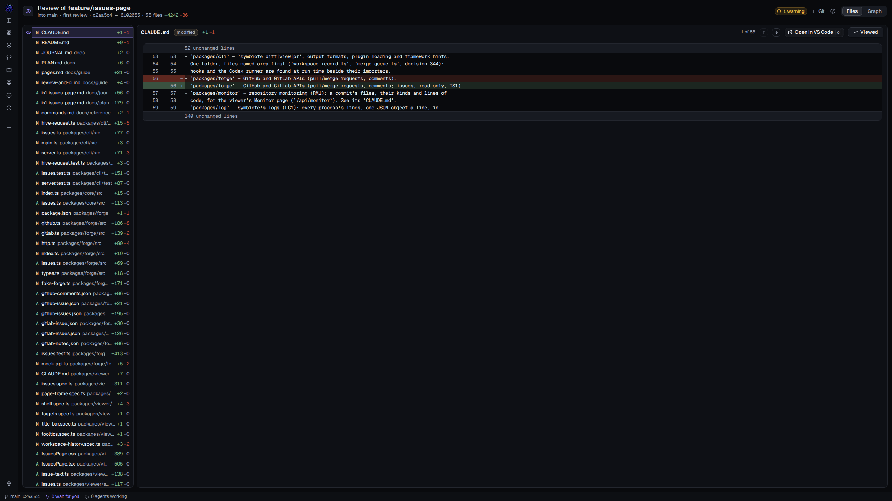
The feature opens on `CLAUDE.md`. Its warning is in file 48 of 55
([light](shots/p07-files-opens-on-docs-light.png)).

### G8. Graph and Files do not follow each other

`g` from a picked symbol shows the file Files had open. Getting to the symbol's lines takes a
read of the list, a click, maybe a scroll of the list, and a scroll to the line. For a moved
symbol (the refactor's warning), the first changed line is a deleted one that the file Files
opens does not show. Nothing on Files leads to a line's symbol on Graph. This bites every
switch: 5 of 5 walks.

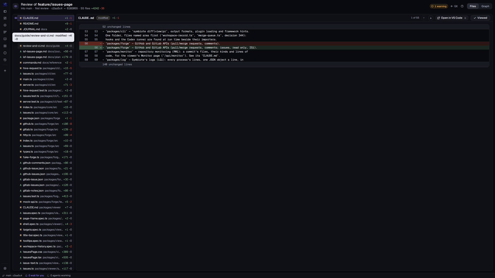
After picking `Route` on Graph, `g` shows `CLAUDE.md`
([light](shots/p08-g-forgets-the-symbol-light.png)).

### G9. The panel cuts the code it shows

The detail panel is 336 px wide (decision 887), and its code does not wrap: 48 of 70 lines in the
five walks were cut. A changed signature shows two whole blocks without marking the difference,
and on Bitwarden the "before" block ends with "…" just before the removed parameter.

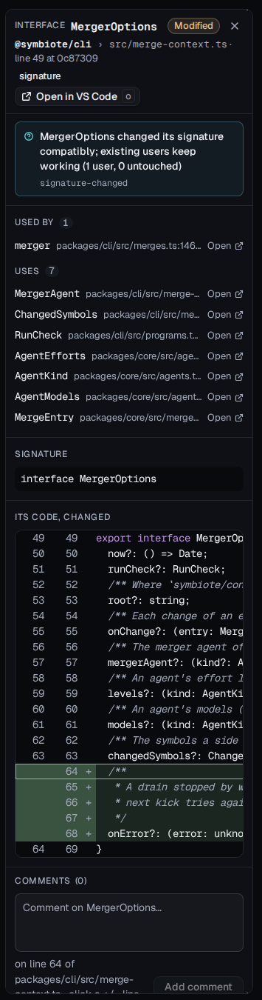
The small fix's panel ([light](shots/p09-panel-code-cut-light.png)). Bitwarden's signature:
[dark](shots/p09-signature-no-diff-dark.png) · [light](shots/p09-signature-no-diff-light.png).

### G10. Two progresses that never meet

Graph counts symbols reviewed; Files counts files viewed. With 19 of 19 symbols reviewed, Files
showed 0 of 18 files viewed, and nothing says the review is done. The symbol count includes CSS
rules (46 % on your merges) and tests (10 %). Your records: 2 marked symbols in 169 reviews.

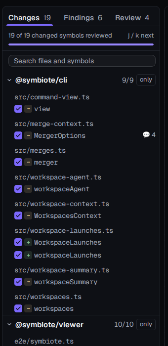
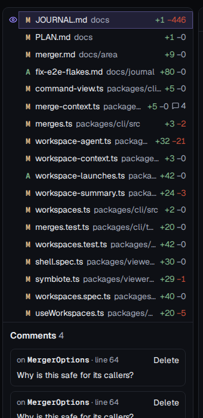
Light: [Graph](shots/p10-graph-all-reviewed-light.png) ·
[Files](shots/p10-files-none-viewed-light.png).

### G11. The context is drawn louder than the change

At zoom 1, a summary's count ("92 uses") is 14 px bold. A changed symbol's name is 12 px. Context
is on by default. On your merges, a median graph draws 0.72 unchanged symbols per changed one
(1.0 across the sample), and 24 summary cards. This bites every view at zoom 0.45 or more.

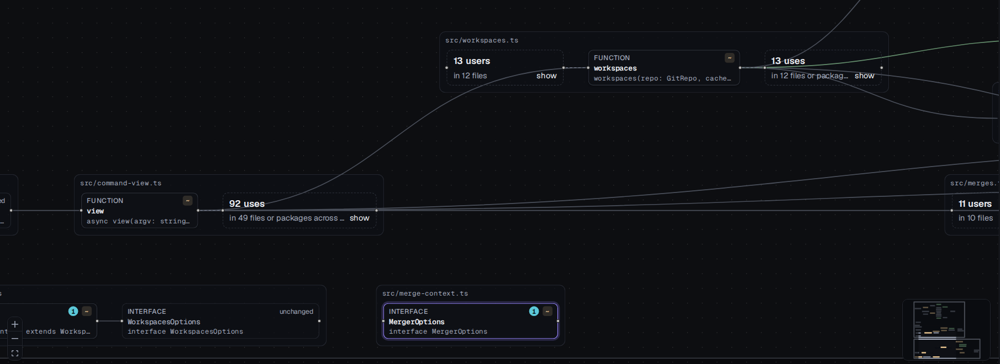
([light](shots/p11-context-louder-than-change-light.png))

### G12. Stylesheet rules fill the canvas and the counts

Each changed CSS rule is a symbol: 2,487 of 5,425 changed symbols on your merges, and some on 17
of the 26. They make 33–94 % of the 7 redesign merges' changes, more than half on 6, and the
feature's largest block (`IssuesPage.css`).

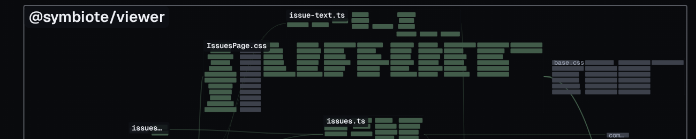
([light](shots/p15-stylesheet-rules-light.png))

### G13. Map labels cover and cut each other

Project names cover file names: "@symbiote/cli" over "er.ts", and "symbiote-monorepo" over its
own blocks. This is V96, also the audit's V7. File names are cut to 2–4 letters ("pa…",
"Merg…"). It bites every map: 19 of 26 first views.

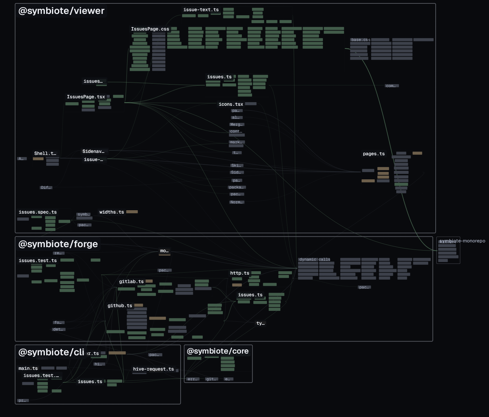
([light](shots/p12-map-labels-light.png))

### G14. No way back after following a link

A name in the panel's "Used by" picks that symbol. Nothing returns to the one before. In every
walk the finding had to be picked again.

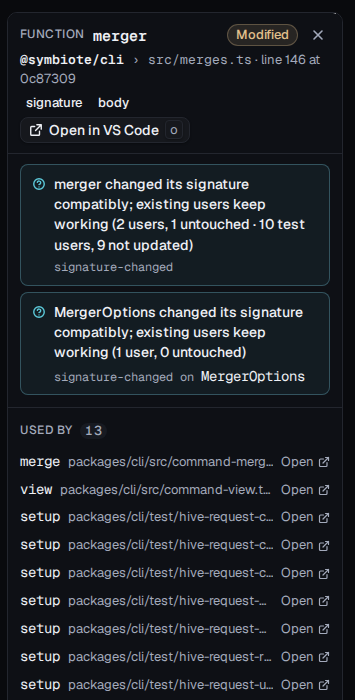
([light](shots/p13-no-way-back-light.png))

### G15. Two commits compared have no review

Git's Compare, or `symbiote view <base> <head>`, gives no comment box, no Review tab and no
verdict: marks only. It is minor for you, since workspaces open branch reviews.

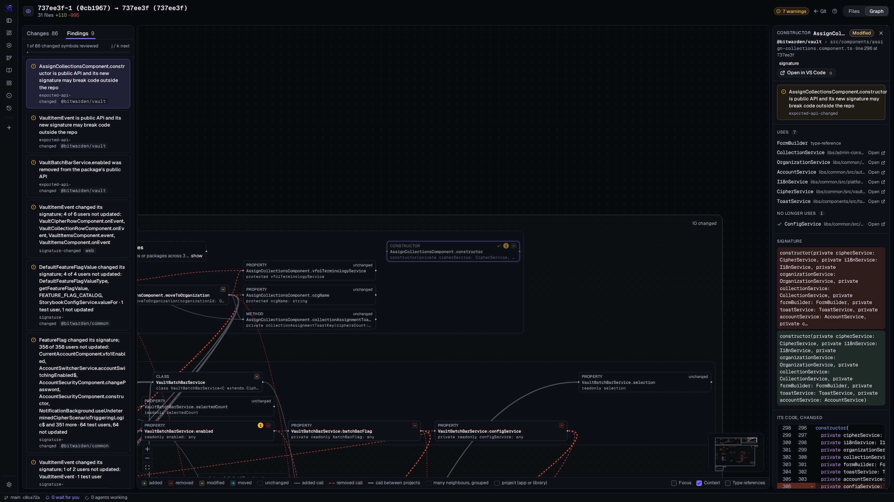
([light](shots/p14-compare-has-no-review-light.png))

## Speed

Medians of 3 rounds of `scripts/viewer/interactions.mjs`, which uses a 1440 × 900 window. The
machine was shared with other sessions, so timings vary ±30 %. "Blocked" is the time the main
thread spent in frames over 50 ms.

| Graph | Open | Select a change | `j` ×8 | Mark (`r`) | Open a group | Context off / on |
|---|---|---|---|---|---|---|
| Small fix | 217 ms | 64 ms | 1,038 ms | 7 ms | 51 ms | 70 / 47 ms |
| Feature | 361 ms (89 blocked) | 59 ms | 1,062 ms | 8 ms | 152 ms | 104 / 96 ms |
| Refactor | 908 ms (198 blocked) | 283 ms | 1,152 ms | 11 ms | 461 ms (124 blocked) | 244 / 188 ms |
| Bitwarden | 360 ms (59 blocked) | 63 ms | 1,084 ms | 8 ms | 133 ms | 77 / 94 ms |
| Qwik | 292 ms (42 blocked) | 62 ms | 1,031 ms | 7 ms | 91 ms | 75 / 71 ms |

First paint at 2560 × 1440 has a median of 366 ms on your merges and 193 ms across the whole
sample, where most graphs are small. The maximum is 966 ms.
The wait a reviewer feels is the cold analysis: 5.9 s (small fix), 6.8 s (feature), 11.3 s
(refactor), 6.5 s (Qwik), 26 s (Bitwarden). Not a graph problem; not ranked. On the refactor,
the script's "close a group" step timed out: it could not find the group again after it opened.
I did not chase this. It looks like the script, not the product.

## Your review records

Read only, from `symbiote/reviews/`: 150 records, 169 verdicts from 2026-10-14 to 2026-11-10.
- All 169 verdicts are Approve.
- 11 carry a summary.
- 1 comment was ever left, on a symbol.
- 2 reviews hold marks: 1 symbol each, both on 2026-10-14, the records' first day.

The request logs record only writes, so which page you read (Files or Graph) cannot be known.

## Method, and what was not measured

- **Servers**: `symbiote view` from this branch's `dist`, each in a `git clone --shared` scratch
  copy with no remote and `merge.push` off. Each ran with its own `SYMBIOTE_CACHE_DIR` and
  `XDG_CONFIG_HOME`, `SYMBIOTE_INTRO=off`, and no `WAYLAND_DISPLAY`. Nothing touched your checkout
  or its `symbiote/`. The walks' marks and drafts were removed before the first-view shots.
- **Graphs**: `walk/make-graphs.mjs` made the 84-graph sample:
  - this repository: base = a merge's first parent, head = its second, from their merge-base,
    as a review does;
  - r1, bitwarden-projects and qwik-docs from `scripts/regression/sets.json`.

  5 of Bitwarden's 8 commits failed: the scratch copy cannot fetch the blobs the regression clone
  takes lazily from GitHub. r1's 3 patched experiments were left out.
- **Measures**:
  - `walk/audit.mjs`: the first view's zoom, sizes, what is drawn, names cut, screens at zoom 1.
  - `walk/legibility.mjs`: sizes and contrast, both themes, both text sizes.
  - `walk/walk.mjs`: the tasks.
  - `walk/problems.mjs`: the shots.
  - `walk/summarize.mjs`: the tasks' table.
  - `walk/frequencies.mjs`: how often each problem bites
    ([`data/frequencies.txt`](data/frequencies.txt)), from `data/first-view.jsonl`.
- **Not measured**:
  - A person's real time: the estimates are a model.
  - The desktop app's window: headless Chromium, no 38 px title bar.
  - Comments posted to a forge.
  - The intro and the Overview's findings.
  - Edge contrast: the stroke's colour did not parse.
  - The small fix's cold open came from the first look, not the walk, which was warm.

To run it again (with `pnpm build` done, and servers on ports 47311–47315 as `walk/problems.mjs`
lists):

```sh
SYMBIOTE_CACHE_DIR=<own> node spikes/graph-usability/walk/make-graphs.mjs <clones> <graphs> own r1 bitwarden-projects qwik-docs
env -u WAYLAND_DISPLAY node spikes/graph-usability/walk/audit.mjs <out.jsonl> <graphs>/*.json
env -u WAYLAND_DISPLAY node spikes/graph-usability/walk/walk.mjs 47312 issues --branch feature/issues-page
env -u WAYLAND_DISPLAY node spikes/graph-usability/walk/problems.mjs
node spikes/graph-usability/walk/summarize.mjs
```
