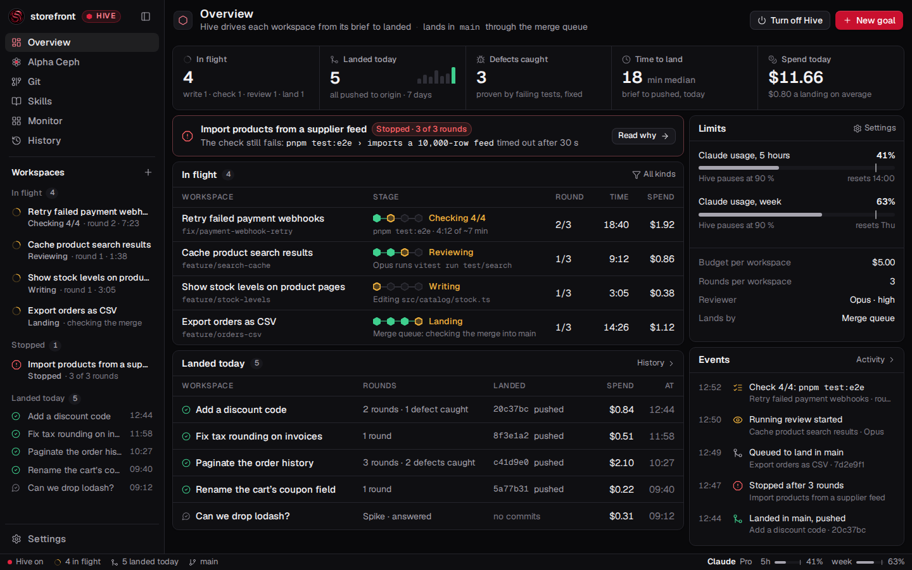
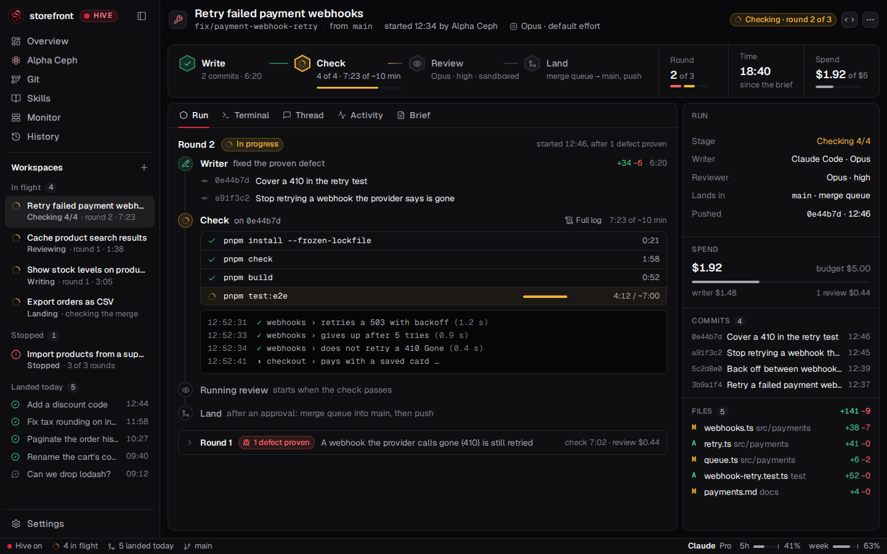

# Hive mode redesigned: Hive Control

A design for Symbiote in Hive mode, asked for as "more professional… real design, screenproofs. No
implementation at the moment" (the workspace `feature/redesign-of-the-app`, 2 November 2026). Seven
screens and a kit, written as static HTML and CSS and rendered by Chromium at 1440 × 900, 1×, with
Geist at the viewer's own sizes (V87: 15 px body, nothing under 12 px). No viewer code was changed.

The review page, with the before and after and the screens at 2×:
<https://claude.ai/artifact/7vxMJBeM676zMVBWkHaxm9> (private to its owner until shared).

## The direction

Hive mode as an operations console for autonomous work: what is in flight, what landed, what stopped
and why, and what it cost.

| Today (`main` at `2911d6a`) | Hive Control |
|---|---|
| A crimson honeycomb, sheen streaks and a glow behind every page; red-tinted cards | Neutral ink surfaces; the hexagon lives on in the stage track and the mark |
| Hive's red is the accent, the primary and the error at once; "Clean up" is the crimson primary | Crimson is Hive's identity only: the mark, the Hive pill, the picked tab, one constructive primary a page. Destructive actions are secondary with red words |
| The stage is a sentence in the head: "Hive drives it: round 2 of 3 · 4 commits · under a minute" | A pipeline, Write · Check · Review · Land, as hexagons on a line; round, time and spend beside it |
| The Review tab: badges and paragraphs, round after round, each the same weight | A Run tab: the round on a timeline, each check command with its time, the log's tail, a proven defect as a card; old rounds fold to one line |
| No page shows all of Hive's work | A new Overview: five figures, a stopped workspace called out, in flight, landed today, limits, events |
| Sidenav cards of five lines in groups Hive and Done | Rows of two lines in In flight, Stopped, Landed today |
| Settings' Hive mode page: paragraphs with the controls between them | Grouped rows: a name, one line of help, the control; the reviewer's model and effort there too |
| In progress, failed and Hive all red | States as CI reads them: amber in progress, green passed or landed, red failed; always an icon and a word |

## The screens

| Proof | What it shows |
|---|---|
| [01-overview](proofs/01-overview.webp) | Hive's home: figures, a stopped workspace, in flight with stage tracks, landed today, limits, events |
| [02-run-live](proofs/02-run-live.webp) | A workspace while Hive checks it: the pipeline, round 2 of 3, each command's time against the last passing run, the log's tail |
| [03-run-landed](proofs/03-run-landed.webp) | The landed workspace of the README's `docs/images/hive.png`, redesigned: where it landed, two rounds, a defect proven by a test |
| [07-run-stopped](proofs/07-run-stopped.webp) | A workspace Hive stopped at the round cap: why, the failing output, Message the writer |
| [04-settings](proofs/04-settings.webp) | Settings, Hive mode: Landing, Limits, Running reviewer (today's `docs/images/hive-settings.png`) |
| [05-new-goal](proofs/05-new-goal.webp) | Start a workspace in Hive mode: no plan-first or permissions (Hive's), the check it will run, how Hive runs it |
| [06-kit](proofs/06-kit.webp) | Tokens with their contrast, states, the stage track, type, controls, sidenav rows, a metric, a gauge |
| [01-overview-light](proofs/01-overview-light.webp), [03-run-landed-light](proofs/03-run-landed-light.webp) | The light theme |





The data is an example (the demo repository `storefront`), but every field is one Hive records
today: rounds, checks and their commands and times, reviews with their model, cost and findings,
landings, pushes, usage and the budget (`WorkspaceHiveDetail`, `HiveLive`, `HiveSpend`,
`HivePacingSetting` in `packages/core/src/workspaces.ts`). The Overview's day figures (time to land,
defects caught, spend today) would be derived from those records.

## Tokens

Contrast is the lowest ratio over the four grounds (`--bg`, `--side`, `--panel`, `--raised`), the
rules of `packages/viewer/test/tokens.test.ts`.

| Token | Dark | Light | Contrast, dark · light |
|---|---|---|---|
| `--bg` / `--side` / `--panel` / `--raised` | `#09090b` `#0e0e11` `#0f0f12` `#18181d` | `#f3f3f5` `#f9f9fa` `#ffffff` `#f0f0f3` | |
| `--line` | `#24242b` | `#e3e3e8` | 1.24 · 1.28 on a card |
| `--text` | `#f3f2f5` | `#121216` | 15.9 · 16.4 |
| `--muted` | `#a6a4ae` | `#595762` | 7.2 · 6.2 |
| `--faint` | `#7b7983` | `#7c7a85` | 4.1 · 3.7 (3 required) |
| `--hive` (identity) | `#e5243f` | `#c8102e` | |
| `--hive-text` | `#ff8090` | `#b30f2a` | 7.4 · 6.1 |
| `--primary`, white words | `#c8102e` | `#c8102e` | 5.88 |
| `--run` (in progress) | `#f2b33d` | `#8f5b00` | 9.5 · 5.0 |
| `--ok` (passed, landed) | `#3fcf8e` | `#137a4a` | 8.9 · 4.7 |
| `--fail` (failed, stopped) | `#ff6166` | `#cf2330` | 6.0 · 4.7 |
| `--info` (paused) | `#5cc8d8` | `#0a7383` | 9.0 · 4.9 |

Type keeps V87's scale and adds one size, 26 px for a figure. Letter-spacing is 0 except on
uppercase labels (V37). Page actions are 30 px with an 8 px radius and cards 10 px, as today.

## Decisions taken

Hive drove this workspace and nobody was asked, so these were the designer's calls:

- **The honeycomb background leaves the working screens.** The arrival animation and Hive's question
  (the circuit board) are unchanged. The comb could come back as a choice in Appearance.
- **The crimson primary stays**, one per page, for constructive actions. Clean up moves to the ⋯
  menu; Turn off Hive is secondary with red words.
- **In progress is amber**, so Hive's crimson and the failure red stop standing for each other.
- **The Review tab is renamed Run** in Hive mode: nobody reviews by hand there.
- **Not redesigned:** Git, Skills, Monitor, History and Alpha Ceph's page would take the new tokens
  as they are.

## Files

| File | What it is |
|---|---|
| `src/kit.css` | The tokens (dark, light) and every component |
| `src/kit.js` | Lucide's icons (ISC), the shared sidenav and status bar, the stage track |
| `src/run.css` | A workspace's page: the pipeline, the run's timeline, the side card |
| `src/01-…07-*.html` | One screen each |
| `shoot.mjs` | Renders the screens to `proofs/` |
| `proofs/*.webp` | The proofs, 1×, lossless |

## Rendering it

From the repository's root, after `pnpm install`:

```sh
env -u WAYLAND_DISPLAY node spikes/hive-redesign/shoot.mjs              # every screen, 1x WebP
env -u WAYLAND_DISPLAY node spikes/hive-redesign/shoot.mjs --scale 2 --png 01-overview
```

A screen also opens as a file in a browser; `?theme=light` gives the light theme.
