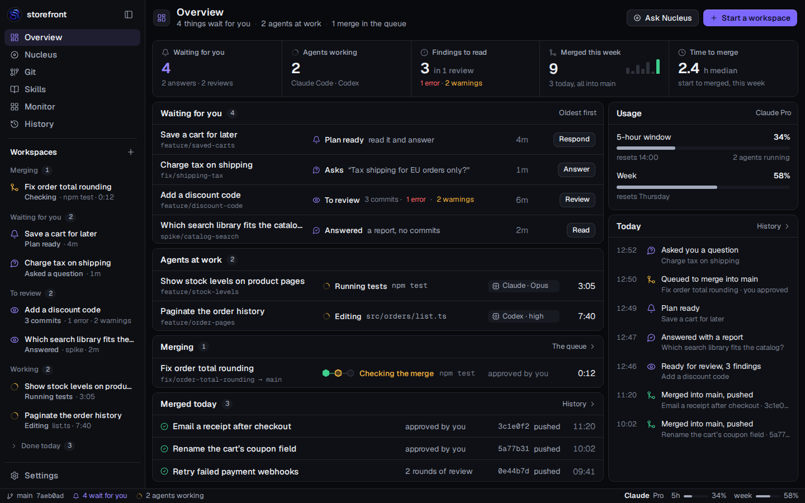
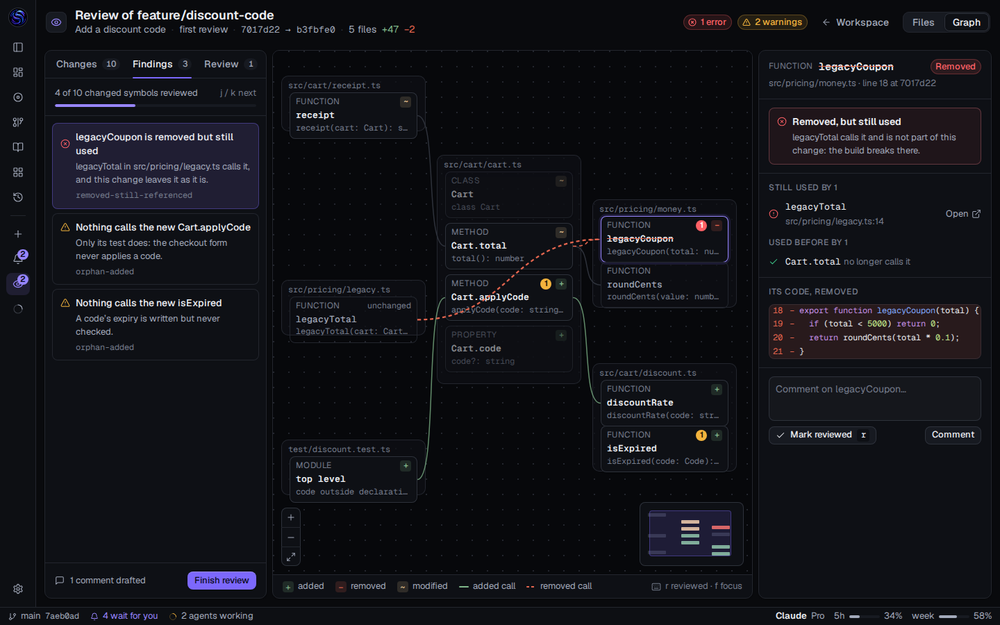

# Normal mode redesigned, in Hive Control's system

The second half of the redesign on `feature/redesign-of-the-app` (2 November 2026): after
[Hive Control](../hive-redesign/README.md), the person asked for "one for normal mode… i really like
the new design". Nine screens and a kit, static HTML and CSS rendered by Chromium at 1440 × 900, 1×.
No viewer code was changed.

The review page, with the before and after and the screens at 2×:
<https://claude.ai/artifact/VMVyX1K8y3QZbtDKykheZw> (private to its owner until shared).

## One system, two modes

The screens load Hive Control's kit (`../hive-redesign/src/kit.css`, `kit.js`, `run.css`) and then
`src/normal.css`, which changes only the identity and the neutrals' temperature:

| | Hive mode | Normal mode |
|---|---|---|
| Neutrals | Warm ink, `#09090b` … `#18181d` | Cool ink with a breath of blue (V61), `#090a0d` … `#171a21` |
| Identity | Hive's crimson `#e5243f`; primary `#c8102e`, white words | The S's violet `#9886ff`; primary `#7c68fc`, dark words (V61) |
| The person's turn | none (no step waits for a person) | Violet: waiting for you, to review |
| The agent's turn | Amber | Amber |
| Done, failed | Green, red | Green, red |

Normal mode also has what Hive does not: an inbox, a plan to answer, the review's graph and diff,
and a change's kinds, which keep VS Code's colours (V42) but for a brighter removed red in counts.

## The screens

| Proof | What it shows |
|---|---|
| [01-overview](proofs/01-overview.webp) | A new home: figures, the inbox (each workspace that needs you and its one action), agents at work, the merge queue, merged today, usage, today's events |
| [02-plan-ready](proofs/02-plan-ready.webp) | Today's `docs/images/workspace.png`, redesigned: the steps (Plan, Your OK, Build, Review, Merge), the plan typeset, Approve plan and Send reply under it |
| [03-review-graph](proofs/03-review-graph.webp) | Today's `docs/images/review.png`, redesigned: findings with progress, a removed function still used picked in the graph, its dangling call drawn over the nodes, its detail beside |
| [04-review-files](proofs/04-review-files.webp) | Today's `docs/images/review-files.png`, redesigned: files with their viewed state, your review and verdict, comments under their lines |
| [10-review-loading](proofs/10-review-loading.webp) | A review while its change is analyzed: the six steps with their times, the agent's report and commits; ready now on the right: the files, the brief, what waits for the graph |
| [05-merge](proofs/05-merge.webp) | A merge in the queue on Hive's stage track: approved, merged, checking, land; the log beside it |
| [06-start](proofs/06-start.webp) | Start a workspace: the brief, then source, agent, permissions, effort and Plan first, and where you come in |
| [08-terminal](proofs/08-terminal.webp) | The terminal view: Claude Code asks permission; its tab and row turn violet; a bar under the terminal says what it asks and the keys that answer it; the files it changed, live, beside it |
| [09-terminal-split](proofs/09-terminal-split.webp) | Split, new: the agent and a shell running the dev server side by side |
| [11-settings-hive](proofs/11-settings-hive.webp) | Settings, Hive mode off: where Hive is turned on (the page under Hive's question), with nothing open in the sidenav |
| [07-kit](proofs/07-kit.webp) | Tokens with their contrast, the shared states, a change's kinds, findings, graph nodes, controls |
| [01-overview-light](proofs/01-overview-light.webp), [03-review-graph-light](proofs/03-review-graph-light.webp), [08-terminal-light](proofs/08-terminal-light.webp), [10-review-loading-light](proofs/10-review-loading-light.webp) | The light theme (the terminal stays dark, as today) |





## Tokens

Contrast is the lowest ratio over the four grounds (`--bg`, `--side`, `--panel`, `--raised`).

| Token | Dark | Light | Contrast, dark · light |
|---|---|---|---|
| `--bg` / `--side` / `--panel` / `--raised` | `#090a0d` `#0d0f13` `#0e1015` `#171a21` | `#f3f4f7` `#f9fafc` `#ffffff` `#eef0f5` | |
| `--line` | `#23262e` | `#e0e3eb` | 1.26 · 1.28 on a card |
| `--text` | `#eef0f5` | `#0f1320` | 15.3 · 16.2 |
| `--muted` | `#a3aabb` | `#525c71` | 7.5 · 5.9 |
| `--faint` | `#767d8d` | `#747e95` | 4.2 · 3.6 (3 required) |
| `--you` (your turn, the accent) | `#9886ff` | `#5b3fd9` | 6.0 · 5.8 |
| `--primary` | `#7c68fc`, words `#0b0a1a` | `#5b3fd9`, white words | 4.9 · 6.7 |
| `--added` / `--removed` / `--modified` / `--moved` | `#81b88b` `#e5664f` `#e2c08d` `#3fc5d6` | `#587c0c` `#ad0707` `#895503` `#0a7d8c` | 5.3–10.1 · 4.3–6.6 |

The states (`--run`, `--ok`, `--fail`, `--info`) are Hive Control's.

## Decisions taken

- **Violet for the person's turn.** The style keeps the accent off states (V61, rule 3); this makes
  one exception, so that what waits for you has the colour of the button that answers it. Amber
  moves to the agent's turn, in both modes (today it means waiting for you).
- **An Overview page**, first in the sidenav; the sidenav keeps its groups and folds Done today.
- **Approve plan**, a button that sends the plan's OK, beside Send reply.
- **The workspace's steps**: Plan and Your OK only when Plan first is on.
- **The terminal view** (the person: "Most of the time i use the terminal view"): the steps join
  the head on one line; the tabs name each session and what runs in it, with a dot for its state;
  the bar under the terminal gives the agent's notice in its own words (Claude Code's hook) and the
  keys Claude Code offers, never a button that answers for you. Split and Focus are new; the side
  card shows what the agent does now and its uncommitted files, live. The terminal's styles are
  `../hive-redesign/src/term.css`, shared with Hive.
- **Opening a review** (the person: "one more for normal mode, the to review loading screen"):
  today `DiffProgress.tsx` shows a card on the start page's arcs, with the steps, the seconds and
  Stop, and nothing to read. The redesign keeps the six steps of `analysis-steps.ts` as a timeline
  with each one's time (as the page sees the phase change: it asks every 500 ms) and shows what
  needs no graph at once: the files (git's, as the Files page reads them), the commits, the agent's
  report and the brief. The arcs and the comet leave this page.
- **Graph nodes** carry a mark for the kind (+, −, ~) and a count of findings; no coloured text or
  bars. The picked symbol's calls are drawn above the other nodes.
- **Not redesigned:** Git, Nucleus, Skills, Monitor, History and Settings would take the tokens as
  they are.

## Files

| File | What it is |
|---|---|
| `src/normal.css` | Normal mode's tokens (dark, light) and its own parts: the inbox, the plan, the graph, a file's diff |
| `src/nkit.js` | The sidenav with today's groups, the review's icon rail, the status bar, the graph's edges |
| `src/01-…11-*.html` | One screen each |
| `shoot.mjs` | Renders the screens to `proofs/` |
| `proofs/*.webp` | The proofs, 1×, lossless |

From the repository's root, after `pnpm install`:

```sh
env -u WAYLAND_DISPLAY node spikes/normal-redesign/shoot.mjs              # every screen, 1x WebP
env -u WAYLAND_DISPLAY node spikes/normal-redesign/shoot.mjs --scale 2 --png 03-review-graph
```
